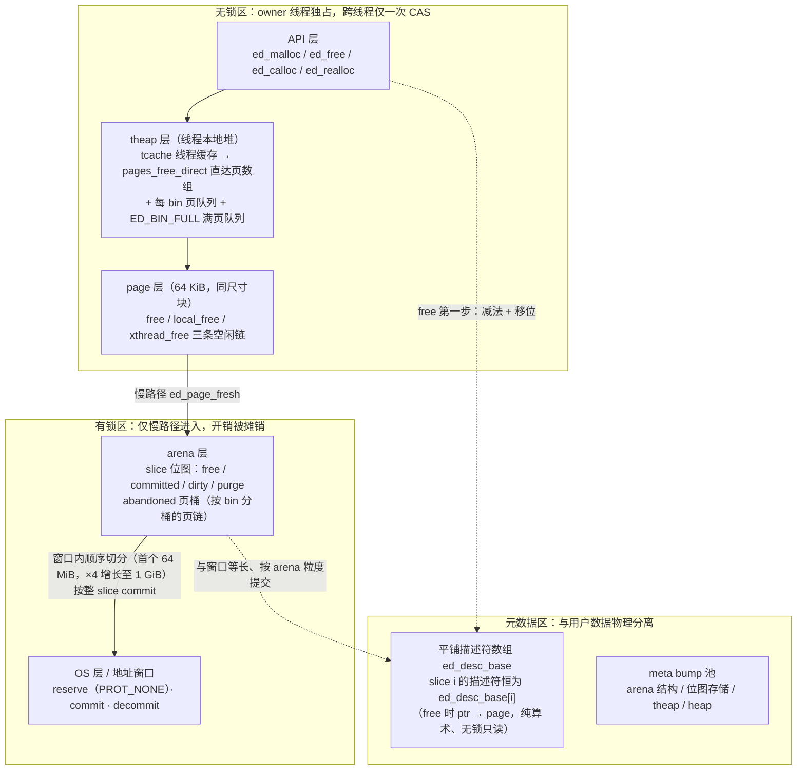
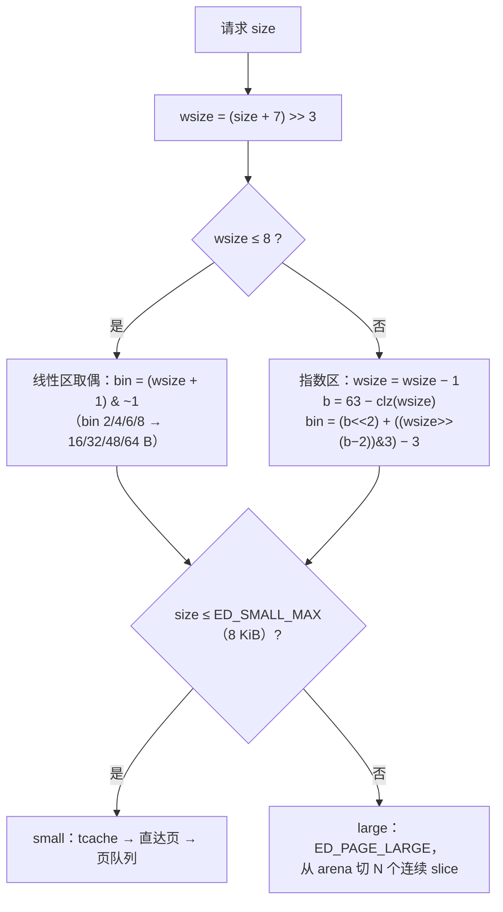
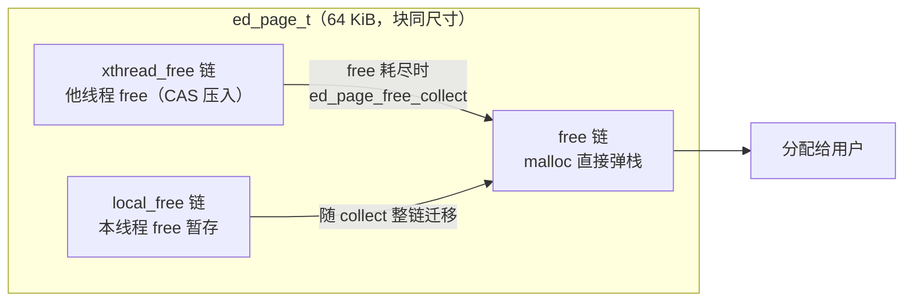
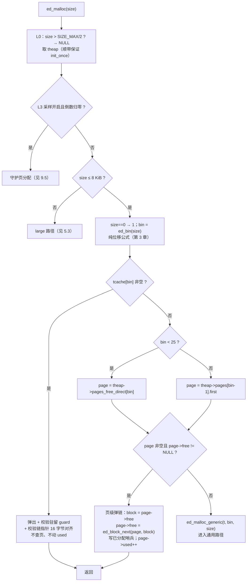
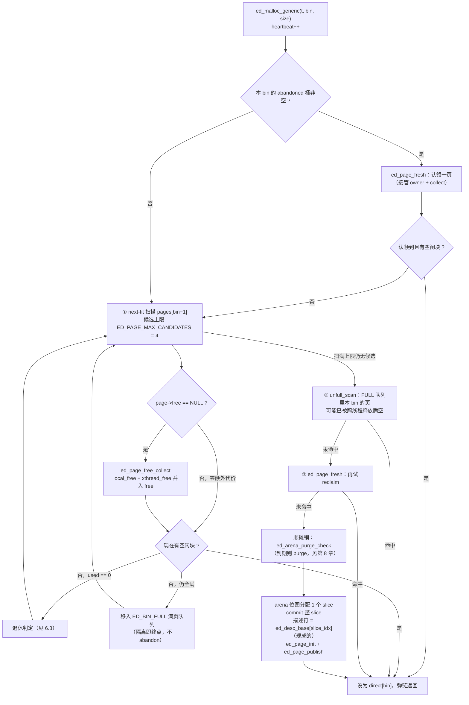
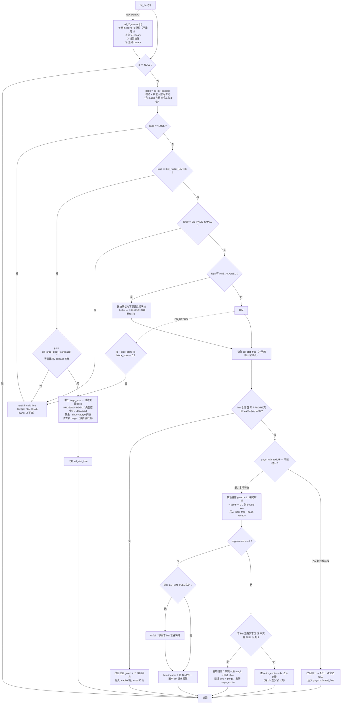
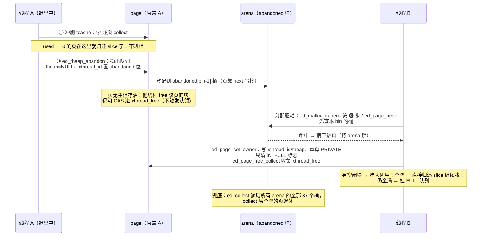
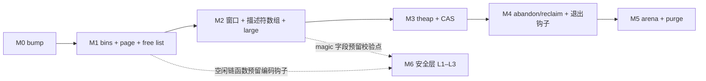

# EduMalloc：教学优先的生产级内存分配器设计文档

*结合 jemalloc 与 mimalloc 的设计取舍 · v2（2026-09）*

> **历史存档**：本文记录导入 culib 前的 EduMalloc v2；旧 API、路径和私有堆要求不再约束当前实现。当前用法见 [culib 分配器文档](../../docs/mem.md)。

> **本文档描述 2026-09 的 EduMalloc v2 设计。** v1 是 2026-09-14 的初版设计，2026-09-15 的一次
> 评估暴露了四个已复现缺陷与三处结构性脆弱（地址空间依赖 mmap 布局、页元数据查找
> 的两层间接、线程退出钩子从失效 TLS 读数据），随后做了一次重设计（决策记录见
> `docs/decisions.md` 的 D1–D7 与附录三条教训）。

## 怎么读这份文档

全文约 2300 行，一次通读**不是**推荐路径。按你的目的选一条：

| 你想做什么 | 读哪里 | 大约篇幅 |
|---|---|---|
| **理解这个分配器怎么工作**（架构层） | §1 → §2 → §3.1–3.3 → §4.1–4.3 → §5.1 → §6 开头的判定树 → §7.1–7.2.1 → §8.1–8.3 → §9.6 → §10 → §13.1 | 全文约 45% |
| **动手实现一个**（教学路线） | 先读 §10 拿到 M0–M6 的拆法，再按里程碑回头读对应章节；每个里程碑的"可验证性质"一列就是你的验收条件 | 按里程碑分批 |
| **改这个仓库里的某段代码** | 先读该机制的"代价"小节（下表），再读源码；这些小节记的是拿崩溃与实测换来的约束 | 按需 |
| **查一个常量、字段或默认值** | 去 **`SPEC.md`**——它是实现的单一事实源。本文只回答"为什么是这个数" | — |
| **查一条决定的备选与代价** | 去 **`docs/decisions.md`**（D1–D7 + 三条血的教训） | — |

**下面这些小节是"代价层"，首读可以跳过**——它们记录的是事故复盘与消融实验，服务于"改这段代码之前要知道什么"，不服务于"这个分配器怎么工作"：

| 小节 | 记的是什么 |
|---|---|
| §4.4.4 | 惰性清除的三条读侧复核，漏一条会返回**重叠内存** |
| §5.2.1 / §5.2.2 | 为什么"择优更满页"与 `page_full_retain` 都没留下来 |
| §6.2.2 | 为什么没实现"释放驱动 reclaim" |
| §6.4.1 后半 | L1 编码哨兵的强度边界（"能兜底"是假的） |
| §7.2.2 | 线程退出钩子的两条规则，四平台崩溃率 |
| §8.4.1 | 免清零只接通一半，以及它出过的两次错 |
| §9.4.1 | L2 头 canary 的位置是承重的（消融实验） |
| §12.3.2 | v2 基准实测与差距清单（含三条防误读的限定） |

**两条贯穿全文的约定**：（1）凡 v1 与 v2 取法不同的地方，本文一律**保留两者并写清为什么换**——那个换的理由通常比结论更值得读，而且多数是拿崩溃、拿实测数字换来的；行文中"v1 曾经…、v2 改为…"的段落都是有意的历史对照，不是漏改。（2）**带数字的实测结论都标了负载与出处**，可以按原字符串 `grep` 回源码或 `docs/decisions.md` 复核——追不到的就该被当作可疑。

## 1. 设计目标与取舍哲学

本章是全文的「为什么」：先定义问题、立下公理与冲突时的取舍序，后续各章的设计决定都可回溯到本章的某一条公理。

### 1.1 问题定义

#### 1.1.1 通用分配器的四大矛盾

通用内存分配器要同时服务四个目标：分配释放要快（性能）、长期运行不浪费内存（碎片与占用）、多线程吞吐随核数增长（并发扩展性）、对堆破坏有抵抗力（安全）。困难在于四者两两牵制，改进一个往往要支付另一个，每对矛盾背后都有一笔具体的账：

- **性能 vs. 低占用**。jemalloc 用 tcache（线程缓存）把热点分配收敛到线程本地缓存槽，快路径完全无锁；代价是释放的块批量滞留在 tcache 中，直到冲刷才回到全局结构——缓存越大越快，滞留内存越多（jemalloc wiki §1）。
- **并发扩展性 vs. 元数据复杂度**。jemalloc 用 4×nCPU 个 arena 分摊锁竞争，bin 再分片各自持锁；扩展性随核数增长，但读者须额外理解「线程绑定 arena」这层概念和一套锁协议——用概念数换吞吐。
- **安全 vs. 快路径预算**。链加密、double-free 检测、canary 校验都发生在 malloc/free 关键路径上，而快路径预算以「条机器指令」计，安全检查必须证明自己花得起。
- **碎片 vs. 归还延迟**。空闲页立即归还 OS 可压低 RSS（常驻内存集），但下次分配要重新 mmap 与 commit，付出系统调用与缺页开销；久不归还则碎片内存长期滞留。

因此「设计一个分配器」本质上是「在这四维空间中选一个可辩护的点」，EduMalloc 的选择由 1.2 节的公理给出。

#### 1.1.2 现有生产分配器的教学门槛

为什么不直接读现有的生产分配器？因为教学成本已高到不现实。jemalloc 核心约 3.5 万行 C（jemalloc wiki §1），架构包含多 arena、tcache、extent 的 dirty/muzzy/retained 三态衰减、PA/PAC/HPA/SEC 四层页分配体系（jemalloc wiki §2），层间取舍历史对新读者并不可见。mimalloc 核心约 1–2 万行，数据结构明显更统一（mimalloc wiki §1），但读懂 page 所有权、三链分片与 abandon/reclaim 协议仍需相当的并发功底。

换句话说：读者若想自己动手实现一个生产级分配器，需要的不是 3.5 万行的答案，而是每一步可验证的路径。EduMalloc 的定位由此而来：以约 3750 行核心代码实现一个可 `LD_PRELOAD` 替换系统 malloc 的分配器，性能与安全向生产级看齐，概念数被硬性压缩。（教学路线按里程碑拆开时的估计量约 2100 行，两个数字的差额来自三工具链适配、可观测族与不变式自检，见第 10 章。）

需要强调：**教学优先不等于玩具**。生产级是约束条件——元数据开销、归还延迟、并发行为都有量化验收标准；教学性是组织原则——满足约束的前提下，永远选概念更少、路径更短的方案。

### 1.2 设计公理与优先级

#### 1.2.1 四条公理

EduMalloc 的设计建立在四条公理之上，按优先级从高到低排列：

| 序 | 公理 | 一句话含义 | 冲突时的让步方 |
|---|---|---|---|
| 1 | 教学可理解性 | 概念数最少化，每层一页纸讲清，快路径 < 40 行可通读 | — |
| 2 | 内存安全是默认属性 | 结构性防御零开销常驻，主动防御默认开启 | 3、4 |
| 3 | 低占用 | 元数据与空闲内存有硬性预算 | 4 |
| 4 | 高性能 | 快路径零锁零原子，跨线程释放一次原子操作 | — |

冲突时严格按序取舍：1 > 2 > 3 > 4。更简与更快不可兼得时选更简；安全与快路径冲突时安全胜，但安全检查必须「花得起」——预算见下节。公理 4 排最后不等于目标低：≤10 条指令的快路径本身就是一流指标，只是不许以牺牲前三条为代价达成。

#### 1.2.2 公理的量化含义

「快」「安全」「省」这类词若无数字支撑便无法验收。EduMalloc 为每条公理设定了可测量的边界（验收标准详见骨架第 11 节）：

- **公理 1（教学）**：核心实现约 3750 行 C++11（`src/` + `include/` + `src-override/`）；快路径 < 40 行；概念数最少化——全系统只有一种页描述符、一种页队列结构。
- **公理 2（安全）**：默认开启的 L1 防御（空闲链 XOR 编码、页内分配位置随机化、double-free 编码哨兵）开销为快路径一次异或；结构性防御（元数据与数据物理分离、对象无 header）约 0%。
- **公理 3（低占用）**：元数据 ≤0.3%（128 字节页描述符对 64 KiB 页约占 0.19%）；空闲页 1 秒内归还 OS（`purge_delay` 默认 1000 ms）；物理页按需提交。
- **公理 4（性能）**：小对象分配的页级弹链 ≤10 条 x86-64 指令；本地 free 的页级压链 ≤6 条；跨线程 free 恰好一次成功 CAS；内部碎片在指数区最坏约 20%（浪费/块大小口径，详见 3.2 节），期望约 8–11%。

这些数字原则上是全文的不变量：机制若突破其中任何一条，改机制，不改数字。v2 有
三处**明确改了数字**，每处都有验收级的理由，并在对应章节展开：

| 数字 | v1 | v2 | 为什么改 |
|---|---|---|---|
| 核心代码量 | 约 2000 行 | 约 3750 行 | 跨三条工具链、L0–L3 全实现、可观测族与不变式自检都是真代码（第 10 章） |
| 快路径指令预算 | malloc 全路径 ≤10 条 | **页级弹链** ≤10 条 | v2 在页之前多了一层 tcache，它自带两次安全校验；预算的口径因此收窄到页级操作（5.1.1） |
| L1 开销 | ≤5% | 按机制计（一次异或） | "≤5%" 是 v1 照抄 mimalloc `MI_SECURE` 的估计值，本项目从未按该口径测过；写一个没测过的百分比比不写更糟（9.3.1） |

最小块尺寸也从 8 字节升到 16 字节，但那不是预算让步而是 ABI 修正（3.1.1）。

### 1.3 为什么是 jemalloc × mimalloc 的交集

#### 1.3.1 jemalloc 的贡献

jemalloc 是「分区分治」路线的成熟样本：多 arena 分摊锁、尺寸分级管理小对象 slab 与大对象 extent、tcache 加速线程本地分配、按时间常数渐进回收脏页（jemalloc wiki §1）。EduMalloc 从 jemalloc 继承的是**思想**而非**结构**：大对象按页对齐 extent 独立管理的做法直接采纳；dev 分支的大对象释放安全检查（`large_dalloc_safety_checks`）思想纳入 L0 默认防御；「满页隔离」以满页队列形式保留；脏页时间衰减思想简化为单一到期 purge。

#### 1.3.2 mimalloc 的贡献

mimalloc 是「page 所有权」路线的代表：每个 page 恰有一个 owner 线程，owner 操作自己的 page 完全无锁；空闲链分片到每个 page，本地与跨线程释放走不同的链，跨线程 free 只需一次 CAS；线程退出时 page 被遗弃（abandon），由后续线程顺势认领（reclaim），全程无锁（mimalloc wiki §1、§3）。这套模型同时服务公理 1 与公理 4：「分片代替锁」既消掉了 jemalloc 模型中「线程绑定 arena + bin 锁」的整层概念，又给出了零锁快路径。

#### 1.3.3 取舍总原则

当两家冲突时默认取 mimalloc——理由是公理 1：同等生产级效果下它的概念数更少、路径更短。jemalloc 的思想不以主体形态进入核心，而以「可选扩展」保留：三态衰减、muzzy 页、后台 purge 线程等在相应章节作为扩展路线给出。三个例证预示后文的取法：

- **尺寸分级**：弃 jemalloc 启动时建表的 sc 表，取 mimalloc 纯位移公式（第 3 章）。
- **页到元数据查找**：两家都没照抄。v1 曾取 mimalloc 的扁平页映射表（每 64 KiB 地址 1 字节，约 60 行；对照 jemalloc 的 rtree 基数树约 500 行）；v2 把它连同描述符池一起删掉，换成"启动时保留一整片地址窗口 + 与窗口等长的平铺描述符数组"——指针到描述符成了一次减法加一次移位，连查表这一层都没有了（4.4 节）。这一步不是因为扁平表不好，而是因为窗口这个前提一旦立住，表就成了多余的间接层。
- **线程缓存**：v1 照 mimalloc 的结论删掉了整层 tcache（`pages_free_direct` 直达页数组即达同等快路径）；v2 把它加回来了，因为本项目的 free 路径背着 mimalloc 没有的常驻安全检查，删掉之后 larson 吞吐**低于 glibc**，直接撞上"性能不逊色"这条需求（4.2.3 节）。

后两条说明了一件事：照抄某个成熟实现的结论是危险的——它的结论成立在它自己的
前提上。标准只有一条：不突破 1.2.2 任何一条量化边界，选那个能用一页纸讲清的方案；
边界与方案冲突时，先确认边界是不是自己测过的。

## 2. 总体架构

本章是全文的地基：先给出 EduMalloc 的五层结构与其上的两条不变式，再建立一套贯穿全书的词汇，然后以一张九行决策表交代每个子系统在 jemalloc / mimalloc / EduMalloc 之间的取舍，最后用一次完整的分配与释放把各层串起来。字段级的数据结构细节留给第 3–4 章，本章只回答"有哪些部件、各管什么、为什么这么选"。

### 2.1 分层模型

#### 2.1.1 五层结构：API → theap → page → arena → 地址窗口 / OS

为什么分配器要分层？因为不同操作的频率相差几个数量级：小对象分配每秒发生百万次，必须是无锁的几条指令；向 OS 申请内存是系统调用，微秒级且越少越好。分层让每一层只处理一个时间尺度上的问题，快路径永远不必看到慢路径的复杂度。EduMalloc 采用 mimalloc 的 page 中心（page-centric）分层，而非 jemalloc 的 arena/bin 模型：



各层职责一句话：

- **API 层**：标准接口族，做参数校验、尺寸溢出检查（L0 安全），L3 采样判定与 L2 canary 包装也挂在这一层，然后立即分发。
- **theap 层**：每线程一个的本地堆（`ed_theap_t`），持有 tcache（线程缓存）、各尺寸等级的页队列与直达页数组，是线程的"分配工作台"。
- **page 层**：64 KiB 的分配单元，只容纳同一尺寸等级的块，是小对象管理的一切核心（mimalloc wiki §3）。
- **arena 层**：地址窗口内顺序切下的一段连续 slice（首个 64 MiB，×4 指数增长至上限 1 GiB），用位图管理 64 KiB slice 的分配、提交与归还。
- **OS / 地址窗口层**：进程启动时一次性保留的连续虚拟地址区（默认 1 TiB），以及 reserve/commit/decommit/protect 四个原语的平台封装，唯一与内核打交道的地方。

图中用两个色块标出了并发性质的分界：**无锁区**覆盖 API、theap、page 三层——owner 线程对自己的 page 操作完全无锁，跨线程释放也只是一次 CAS；**有锁区**从 arena 开始，位图操作需要锁，但它只出现在"页队列找不到可用页"的慢路径上，开销被摊销。这与 jemalloc 形成对照：jemalloc 的 bin 锁位于每次 tcache 未命中后的必经之路上（jemalloc wiki §5.2），而 EduMalloc 的锁不在热路径上。

元数据区在 v2 里分成了两块，值得先分清，后面几章会反复用到：**平铺描述符数组**
是与地址窗口等长的第二片保留区，每个 64 KiB slice 对应一个固定位置的 128 字节
`ed_page_t`，位置由 slice 下标直接算出，不需要分配也不需要查表；**meta bump 池**
仍按 jemalloc `base` 的思想运作，供 arena 结构、位图存储、theap 与 heap 结构使用。
v1 的两个概念——扁平页映射表 `_ed_page_map` 与 `pages_meta` 描述符池——在 v2 里
被前者整体取代（4.4 节）。两块都不在用户 slice 之内，这是 L0 "元数据物理分离"的
字面含义。

#### 2.1.2 关键不变式：每个 page 恰有一个 owner 线程；对象无 header

两条不变式支撑起整个并发与内存模型，先给直觉再给定义。

**直觉**：如果一块工作区任何时刻只有一个人使用，就根本不需要锁——锁是为了调解竞争，而所有权（ownership）直接消除了竞争。至于"free(p) 怎么知道 p 多大"，教科书答案是在对象前面藏一个 header，但 header 浪费空间、破坏对齐、还与用户数据共享 cache line；更好的办法是把簿记信息挪到对象外面。

**定义**：

1. **page 所有权不变式**：任何时刻，每个 page 恰好属于一个 owner 线程（abandoned 页属于"暂无"这一特例）。owner 对 `free`、`local_free`、`used` 的访问无需任何同步；非 owner 线程只能通过 `xthread_free` 上的一次 CAS 与该 page 交互（mimalloc, src/free.c）。
2. **对象无 header**：用户对象内部不含任何分配器元数据。free 时把用户指针减去地址窗口基址、右移 16 位，得到 slice 下标，描述符就在 `ed_desc_base[idx]`；尺寸、状态、归属全部在那里。描述符数组与 meta 池都不在用户 slice 之内，与用户数据物理分离——这同时是安全公理的结构性基础（元数据不会被堆溢出覆写）。

第二条不变式在 v2 里还多了一条推论，后面会反复用到：**窗口建立之后，进程再没有
任何在窗口之外的用户内存映射**。v1 的 huge 分配（> 8 MiB）走独立 mmap，于是
`ed_free` 的第一步必须先回答"这个指针到底在不在映射表覆盖的范围里"；v2 把 huge
与 L3 守护页分配都收回窗口内（5.3、9.5 节），那个分支就整体消失了——不是被优化
掉，而是前提变了以后它不再有意义。

### 2.2 概念词汇表

#### 2.2.1 block / bin / page / slice / arena / theap 的定义与尺寸

| 术语 | 精确定义 | 尺寸 / 数量 |
|---|---|---|
| block | page 内等长切分出的用户对象容器，free 后串入空闲链 | = 所属 bin 的档尺寸（16 B ～ 8 KiB 为 small，均为 16 的倍数） |
| bin | 尺寸等级：请求尺寸经位移公式映射到的档位 | 编号 1–36，其中 1/3/5/7 闲置（线性区取偶，见 3.1.1），实际可用 32 档 |
| page | 只容纳同一 bin 之 block 的分配单元，描述符 `ed_page_t` | 64 KiB；描述符 128 字节（两条 cache line） |
| slice | arena 位图管理的最小粒度，也是提交粒度 | 64 KiB（与 small page 等大） |
| window | 进程启动时一次性保留的连续虚拟地址区，所有 arena 从中切分 | 默认 1 TiB，保留失败逐级减半，下限 4 GiB |
| 描述符数组 | 与窗口等长的平铺数组，slice i 的描述符恒为 `ed_desc_base[i]` | 1 TiB 窗口 → 2 GiB 虚拟保留，按 arena 粒度提交 |
| arena | 窗口内顺序切下的一段连续 slice，内部按 slice 位图管理 | 首个 64 MiB，×4 增长至 1 GiB；上限 1024 个 |
| theap | 线程本地堆 `ed_theap_t`：tcache + 直达页数组 + 每 bin 页队列 + 满页队列 | 每线程一个（2208 字节）；`ED_DIRECT_MAX = 25`（bin 1–24），覆盖块 ≤ 1 KiB 的直达档 |
| tcache | theap 内的线程本地小块缓存，按 bin 分链 | 每 bin 16 KiB 字节预算，条数夹在 [4, 64]；全满上界 448 KiB/线程 |

三组关系容易混淆，值得先辨清。其一，page 与 slice：slice 是 arena 眼中的地盘单位，page 是 theap 眼中的分配单位；一个 small page 恰好占 1 个 slice，large/huge/guarded 分配则占 N 个连续 slice。其二，bin 与 page：bin 是纯粹的尺寸概念（一个数），page 是实体（一块内存）；一个 theap 为每个 bin 维护一条页队列。`ED_SMALL_MAX = 8 KiB` 取 64 KiB page 的 1/8，保证单页至少容纳 8 块，避免页内块数过少导致的浪费。其三，window 与 arena：窗口只保留一次、只增不减，`ed_window_used_slices` 是一条单调水位线；arena 是窗口里被切出去的一段，arena 数量会长、窗口大小不会变。进程可用堆的硬上限因此就是窗口大小——这是 v2 用"指针到描述符纯算术"换来的代价，写在 13.2 节的适用边界里。

尺寸分级的完整公式与档位表见第 3 章。

### 2.3 与两大分配器的架构对照

#### 2.3.1 决策表

下表按九个子系统逐项对照。jemalloc 列与 mimalloc 列给出两者各自的机制，EduMalloc 列给出选择与一句话理由；所有被否决的方案并非"不好"，而是在教学可理解性优先的公理下被裁掉的复杂度。

| 子系统 | jemalloc | mimalloc | EduMalloc 的选择与理由 |
|---|---|---|---|
| 并发分区 | 4×nCPU 个 arena + bin 分片 + bin 锁 | page 所有权：owner 无锁，分片代替锁 | mimalloc：所有权不变式一条规则替代锁协议，少一层"线程绑定 arena"概念 |
| 线程缓存 | tcache：批量填充/冲刷/GC | 无 tcache，`pages_free_direct` 直达页数组 | **两者之间**：保留 tcache 的最小形态（单链、按字节预算封顶、无 GC 纪元），因为本项目的 free 路径背着常驻安全校验，删掉它 larson 低于 glibc（4.2.3） |
| 小对象管理 | slab + 位图，bin 锁下清位 | page 内三条空闲链（free/local_free/xthread_free） | mimalloc：三链把并发释放分流，释放侧无需锁与位图扫描 |
| 跨线程释放 | 回到 owner arena 加锁归还 | 恰好一次 CAS 压入 xthread_free | mimalloc：free 路径零锁竞争，并发扩展性成本压到一次 CAS |
| 线程退出 | tcache flush、对象归还 arena | abandon：O（页数）摘链 + 登记 abandoned 索引 | mimalloc + 一处加强：先 collect、全空页直接归还 slice，其余才 abandon（7.2） |
| ptr→元数据映射 | rtree 基数树（约 500 行） | 扁平页映射表（约 60 行） | **都不取**：单一地址窗口 + 与之平铺的描述符数组，一次减法加一次移位，连查表层都没有（4.4） |
| 尺寸分级 | sc 表生成器，启动建表，最坏碎片约 20% | 位移公式，结构同 jemalloc（每区间 4 档），最坏碎片约 20%（浪费/块口径） | mimalloc：纯位移免建表；线性区按 16 字节取整（ABI 要求），这一点与 jemalloc 的量子殊途同归（3.2.2） |
| 大对象 | 页对齐 extent；≥8 MiB 进 huge arena | 按页尺寸分档，超大 singleton | 统一：所有 > 8 KiB 的分配都从 arena 切连续 slice（kind=ED_PAGE_LARGE），> 8 MiB 仅额外打 HUGE 标志（"free 即 decommit"），**不再有独立映射**（5.3） |
| 内存归还 | dirty/muzzy/retained 三态 + smoothstep decay + 可选后台线程 | 两态 + 1000 ms 到期 purge，检查摊销进分配路径 | mimalloc：砍掉 muzzy 态与预测器，purge_expire==0 时零开销，无后台线程 |

纵向读这张表，EduMalloc 的选型规律仍然一致：多数决策整体采用 mimalloc，理由都指向同一条公理——**分片代替锁、遗弃代替迁移、公式代替建表、摊销代替后台线程**，每一刀砍掉的都是 jemalloc 为极致生产性能付出的一整块机制复杂度（jemalloc 核心约 3.5 万行，mimalloc 1–2 万行，EduMalloc 约 3750 行）。jemalloc 的独立遗产有三条：大对象的"溢出阈值"思想（`ED_HUGE_THRESHOLD = 8 MiB` 与 jemalloc `oversize_threshold` 同值）、满页隔离（`ED_BIN_FULL`）、以及大对象释放安全检查（dev 分支的 `large_dalloc_safety_checks` 思想）分别进入分配路径与 L0 安全层（jemalloc wiki §6.2）。

三处"两家都不照抄"的格子值得单独看，因为它们是 v2 相对 v1 的实质变化，也是本文档
里教学价值最高的三段：

- **线程缓存**：v1 照 mimalloc 的结论删掉整层，v2 加回最小形态。转折点是一次消融
  实测（20 核 WSL2）：删除 tcache 后 bench_single 62 → 40 Mops/s，bench_larson
  237 → 126，而同机 glibc 是 136——**低于 glibc**。mimalloc 能不要 tcache，是因为
  它的 free 路径可以只做一次段内掩码查页；本项目按 L0 公理把元数据物理分离，
  每次 free 都要走描述符校验加 L1 哨兵，那部分成本必须有地方摊。
- **ptr→元数据映射**：v1 的扁平页映射表本身没问题，问题在它的前提——arena 可以
  落在地址空间任何位置，所以需要一张表把地址翻译成描述符索引。v2 换了前提
  （启动即保留一整片窗口），表就成了多余的一层；顺带删掉的还有描述符池、
  描述符回收 LIFO 与整组 `ED_DESC_*` 常量。代价明码标价：三条读侧复核（4.4）。
- **大对象**：v1 的 "> 8 MiB 直接 mmap/munmap" 是从 jemalloc huge arena 简化来的，
  看起来更简单，实际上给 free 路径留了一个"指针可能不在窗口内"的分支，而且
  L3 守护页分配也得另走一套独立映射。v2 统一收回窗口内之后，`ed_ptr_page`
  对 small / large / huge / guarded 四类页是同一条纯算术路径。

### 2.4 一次分配与释放的全景

#### 2.4.1 malloc(24)：从 API 到返回指针

以 `ed_malloc(24)` 为例，快路径共六步，全部在无锁区内完成：

1. **API 层**：`ed_malloc(24)` 做尺寸溢出检查（L0：拒绝 `size > SIZE_MAX/2`），取本线程 theap（顺带保证 `ed_init_once` 已跑过），L3 若开启则递减采样倒数计数器，然后转入内联快路径。
2. **算 bin**：`bin = ed_bin(24)`。24 ≤ 64 走线性档，`wsize = ceil(24/8) = 3`，取偶得 `bin = (3+1) & ~1 = 4`，块大小 32 字节——纯位移，无查表。（v1 在这里得 bin 3、块 24 字节；v2 让线性区只落在偶数 bin 上，为的是 malloc 返回值恒 16 字节对齐，见 3.1.1。）
3. **tcache**：`ed_tcache_pop(t, 4)`。命中即返回——不查页、不动 `used`、不碰任何原子量。代价是两次校验比较：驻留 guard（`w[1] == ed_tcache_guard ^ 块地址`）与链指针的 16 字节对齐，两者都是 double-free 与链污染的检出点（4.2.3、9.3.3）。
4. **取页**：tcache 空时 `page = theap->pages_free_direct[4]`，一次数组索引直达该尺寸当前分配页。
5. **弹链**：`page->free != NULL`，于是 `block = page->free`；`page->free = ed_block_next(page, block)`（L1 下解一次 XOR）；块首写入编码后的已分配哨兵；`page->used++`；返回 block。这一段是"页级弹链"，目标 ≤10 条 x86-64 指令，零锁零原子。
6. **返回**：用户得到一块 32 字节可用、无任何 header 的内存（请求 24 字节，取整浪费 8 字节）。

若第 5 步发现 `page->free == NULL`，落入慢路径 `ed_malloc_generic(t, bin, size)`：先看本 bin 的 abandoned 桶有没有可认领的页；再在本 bin 队列里 next-fit 扫描（候选上限 `ED_PAGE_MAX_CANDIDATES = 4`，只对 `free == NULL` 的页做 `ed_page_free_collect`，**首个有空闲块的页即返回**）；collect 后仍满的页移入 `ED_BIN_FULL` 满页队列，全空的页进退休判定；队列落空则查 FULL 队列里本 bin 的页是否已被跨线程释放腾空；仍无则 `ed_page_fresh`——先 reclaim abandoned 页，失败才进入有锁区从 arena 位图取 1 个 slice、commit、用 `ed_desc_base[slice_idx]` 这个现成的描述符初始化新页；顺带检查 `arena->purge_expire`，到期则 purge。分配路径的完整展开（以及为什么 v1 的"择优更满页"与 `page_full_retain` 都没有留下来）见第 5 章。

#### 2.4.2 free(p)：本地 / 跨线程 / large 三条分支

`ed_free(p)` 的第一步对所有分支相同：`page = ed_ptr_page(p)`——一次减法、一次移位、一次数组访问，并校验描述符魔数 `magic`（L0）。若该 slice 是多 slice 页的续页项，还要经 `cont_first` 跳到首项并做三条复核（4.4 节，这三条是 v2 最贵也最值得读的一段）。查不到就是"invalid free"，当场 abort。此后按 page 的类型与归属分四路：

1. **large 释放**（`kind == ED_PAGE_LARGE`，含 huge 与 L3 guarded）：先用**等值比较**核对 `p` 是不是这唯一一个块的起点（内部指针拒收，release 下也做），然后整页的 slice 归还 arena 位图。打了 `HUGE` 标志的页（> 8 MiB 或 guarded）在归还前先 decommit，物理页立即还给内核；其余走"dirty → 到期 purge"两态回收。**没有 munmap**——窗口内的映射从不解除。
2. **tcache 归还**（small 页、非私有堆页、本 bin 未超预算）：校验驻留 guard 与 L1 编码哨兵，然后把块压进本线程 tcache 链，`used` 不动。从页的视角这个块**仍算已分配**，退休与统计语义因此不变（代价见 4.2.3）。
3. **本地释放**（tcache 满或不适用，且 `xthread_id` 等于本线程 id）：把块压入 `page->local_free`，`page->used--`，页级操作目标 ≤6 条指令，无锁无原子。若 `used == 0`（页全空）：本 bin 还有其它页就立即退休归还 slice，否则置 `retire_expire = 4` 进入宽限（每 bin 至少保留 1 页）。
4. **跨线程释放**（`xthread_id` 不等于本线程 id，包括页已被 abandon 的情形——abandoned 位就在 `xthread_id` 的低位上，因此永不等于任何线程 id）：一次成功 CAS 把块压入 `page->xthread_free`，就此结束，不存在"回到 owner 所在 arena 加锁"。

分支判定的成本是一次普通读加几次比较，热分支仍是常数条指令。与 v1 的设计相比这里
少了一件事：v1 打算让跨线程 free 在命中 abandoned 页时**顺势认领**该页
（mimalloc `mi_free_try_collect_mt` 思想）；v2 没有实现这条"释放驱动 reclaim"，
无主页的回收全部交给分配驱动与 `ed_collect` 兜底。理由与代价见 6.2.2 与 7.3。
释放路径与并发模型的完整论证分别见第 6、7 章。

## 3. 尺寸分级系统

请求尺寸近乎连续分布，空闲内存却须按离散规格回收复用。尺寸分级（size classing）把请求向上取整到有限个档位（bin），同档的块可串进同一条空闲链——用可控的内部碎片换取 O(1) 的分配与回收。本章给出分级规则（§3.1）、碎片率推导（§3.2）与实现形式（§3.3）。

### 3.1 分级规则

#### 3.1.1 线性区：≤64 字节取偶档（16 字节粒度）

直觉上，小尺寸请求在真实负载中占比最高，且相邻尺寸的相对差异最大，故应分档最密。EduMalloc 以 8 字节机器字折算尺寸：记 wsize = ⌈size/8⌉，当 wsize ≤ 8（即 size ≤ 64 字节）时走线性档。

v1 在这里取 `bin = wsize`，得到 8 个精确档：8、16、24、32、40、48、56、64 字节，取整浪费至多 7 字节。**这是一个真实的 ABI 违反**：x86-64 与 aarch64 要求 `malloc` 的返回值按 16 字节对齐（`long double` 与 SSE/NEON 的存取要求），而 8/24/40/56 这四档的块大小不是 16 的倍数，页内等间距平铺之后约半数块首落在 8 对齐而非 16 对齐的地址上——2026-09-15 的评估直接复现了这一点（`malloc(8/24/40/56)` 约半数指针非 16 字节对齐）。

v2 的修法是**取偶**（等价于 mimalloc 在 x86-64 上的 `MI_ALIGN2W`）：

```
bin = (⌈size/8⌉ + 1) & ~1
```

于是线性区只落在 bin 2/4/6/8 上，块大小 16/32/48/64 字节，**bin 1/3/5/7 闲置**，最小块是 16 字节。连带的性质是：所有 bin 的块大小都是 16 的倍数，页首 64 KiB 对齐，因此**页内每个块的起点都是 16 的倍数**——`ed_malloc` / `ed_calloc` / `ed_realloc` 的返回值恒 16 字节对齐，与 release / ED_DEBUG、L3 采样开与关都无关。这是一条**无条件承诺**：它不能"取决于某个选项没开"或"取决于哪种构建"，后面 5.3（L3 守护页右对齐的起点取整）与 9.4（ED_DEBUG 的 L2 头部为什么必须是 16 字节而不是 8 字节）两处都是为兑现它付的账。

为什么是取偶而不是重编 bin 号把 4 个空档挤掉？因为重编要重排全部文档表格与档位对照，收益只是省下 4 个空队列；而空队列的代价是可以数出来的——每个 theap 240 字节（`sizeof(ed_theap_t)` = 2208 字节的 10.87%），每个 arena 32 字节，一次性固定元数据，不随分配量放大。

代价栏要如实写：**小尺寸请求整体向上跳一档**——8 字节请求拿到 16 字节块，24 → 32，40 → 48，56 → 64。线性区的取整浪费从至多 7 字节变成至多 15 字节。对"大量 8 字节小对象"的负载这是实打实的内存放大，换来的是 ABI 正确性，按公理序（安全 > 占用）这笔账没有别的走法。

#### 3.1.2 指数区：每个 2 幂区间 4 档

超过 64 字节后，固定档距的相对浪费随尺寸增大迅速缩小，分档应变稀；要让浪费的**相对**水平在各量级上一致，档距须随尺寸按比例增长——这是指数分档的直觉。EduMalloc 沿用 mimalloc 的规则（mimalloc wiki §4）：每个 2 的幂区间均分 4 档，bin 号由纯位移公式给出：

```c
wsize = (size + 7) >> 3          // ceil(size/8)
wsize--;                         // 关键一步：让 2 的幂精确落档（见下）
b     = 63 - clz(wsize)          // wsize 的最高有效位（clz = count leading zeros）
bin   = (b << 2) + ((wsize >> (b - 2)) & 3) - 3
```

公式分三步理解：`b` 定位请求落在哪个 2 幂区间；`(wsize >> (b - 2)) & 3` 提取最高位（恒为 1，无需提取）之后的两位，把区间细分为 4 个子档；`(b << 2)` 给每个区间分配 4 个连续 bin 号，常数 −3 对齐编号，使指数区第一档恰接在线性区之后得 bin 9（mimalloc, src/page-queue.c）。

`wsize--` 是 mimalloc 源码中容易看漏、却不可省略的一步。没有它，请求 1024 字节（wsize = 128）会算出 b = 7，落入块 1280 字节的 bin 25，浪费 25%；有了它，wsize 变为 127、b = 6，1024 字节精确落进块恰为 1024 字节的 bin 24。2 的幂恰恰是最高频的请求尺寸（缓冲区、页框、对象数组大多取整到 2 的幂），这一步让每个 2 的幂都精确落档、零取整浪费。

两个算例。**size = 100**：wsize = 13，递减得 12（二进制 1100）；b = 3；(12>>1)&3 = 2；bin = 12 + 2 − 3 = **11**，块 112 字节，浪费 12 字节。**size = 1000**：wsize = 125，递减得 124（二进制 1111100）；b = 6；(124>>4)&3 = 3；bin = 24 + 3 − 3 = **24**，块 1024 字节，浪费 24 字节（2.3%）。

下表列出 16～1024 字节的全部档位（bin 号与块大小均由上式实算得出）：

| bin | 块大小（字节） | 覆盖请求（字节） |
|----:|----:|----:|
| 1 | —（闲置） | — |
| 2 | 16 | 0–16 |
| 3 | —（闲置） | — |
| 4 | 32 | 17–32 |
| 5 | —（闲置） | — |
| 6 | 48 | 33–48 |
| 7 | —（闲置） | — |
| 8 | 64 | 49–64 |
| 9 | 80 | 65–80 |
| 10 | 96 | 81–96 |
| 11 | 112 | 97–112 |
| 12 | 128 | 113–128 |
| 13 | 160 | 129–160 |
| 14 | 192 | 161–192 |
| 15 | 224 | 193–224 |
| 16 | 256 | 225–256 |
| 17 | 320 | 257–320 |
| 18 | 384 | 321–384 |
| 19 | 448 | 385–448 |
| 20 | 512 | 449–512 |
| 21 | 640 | 513–640 |
| 22 | 768 | 641–768 |
| 23 | 896 | 769–896 |
| 24 | 1024 | 897–1024 |

（1024 字节恰为 bin 24 的块大小；指数区每个区间端点 128、256、512、1024……都是档位，2 的幂请求零浪费。`size == 0` 按 `size = 1` 处理，落进 bin 2、得到一个 16 字节的合法块，于是返回值可以安全地传给 `ed_free`。）

观察档距：线性区内恒为 16 字节（v1 为 8 字节）；指数区内，同一 2 幂区间档距固定、每跨入下一区间翻倍，恰为 2^(k−2)（k 为字节区间的指数），故相对取整浪费在各量级上恒定。数量上，bin 编号占 1–36，其中 1/3/5/7 闲置，**实际可用 32 档**（4 个线性档 + 7 个指数区间 × 4 档）；连同 ED_BIN_FULL 满页队列共 37 个页队列——bin 是几十量级的小常数，故第 4 章的 `pages[ED_BIN_COUNT]` 可做成平坦数组按下标直访；bin 号与块大小互推，页描述符只需记录 bin 号。

闲置档在数据结构里不做特殊处理：`pages[0]`、`pages[2]`、`pages[4]`、`pages[6]` 与对应的
`pages_free_direct` / `tcache` 项就是永远为空的槽。这是"编号与公式不变"的直接后果，
也是上面那笔 240 字节/theap 账的来源。反过来说，读代码时不必担心 bin 1 的队列——
`ed_bin` 永远不会返回奇数（线性区取偶、指数区最小返回值是 9）。

尺寸分派全貌：先折算成字，再按线性/指数规则算 bin；超过 ED_SMALL_MAX 的请求不进 bin，直接走 large 路径。



### 3.2 碎片分析

#### 3.2.1 最坏内部碎片约 20% 的推导

内部碎片（internal fragmentation）指因取整多分配的字节：请求 s 分到块 B，浪费 w = B − s。本文统一以**浪费相对块大小**（w/B）计量，下面推导指数区的上界。

设块大小落在 2 幂区间 (2^k, 2^(k+1)] 字节（k ≥ 6）。该区间均分 4 档，档距 d = 2^(k−2) 字节，每档覆盖的请求宽度不超过 d。最坏情形出现在每个区间的第一档：请求刚好超过上一区间端点 1 字节，此时块为 2^k + d，浪费 w = d − 1，于是

```
w/B = (d − 1)/(2^k + d) → d/(2^k + d) = 2^(k−2)/(2^k + 2^(k−2)) = 1/5 = 20%（k → ∞ 的极限）
```

实例：请求 1025 字节分到 1280 字节块，浪费 255/1280 ≈ 19.9%，随区间增大趋近 20%。若换用其他基准：(d−1)/(2^k+1) 相对请求约 25%；d/2^(k+1) 相对区间上界恰为 1/8 = 12.5%。mimalloc 源码注释自称 "~12.5% worst internal fragmentation"（mimalloc, src/page-queue.c），采用的正是最后这种"档距/区间上界"口径（mimalloc, include/mimalloc/types.h 亦写作 "spaced exponentially in 12.5% increments"）；引用该数字时必须注明基准。EduMalloc 统一采用 w/B 口径，记最坏内部碎片约 20%。期望情形的直觉：均匀请求下平均浪费约为半个档距，相对典型块大小约 8%。

上面这笔账只管指数区。线性区（≤64 字节）在 v2 里按 16 字节取整，最坏情形是请求 1 字节分到 16 字节块，w/B = 15/16 ≈ 94%；请求 17 字节分到 32 字节块，w/B ≈ 47%。这些比例看着骇人，但**不应与"最坏约 20%"混在一起报**，因为它们的绝对量有硬上界：线性区任何请求的浪费都不超过 15 字节。真实负载里小对象的数量大、单个浪费小，总放大取决于尺寸分布而非最坏比例；把两个区间的比例放进同一个"最坏碎片"数字，只会让这个数字失去意义。本文的约定是：**"最坏内部碎片约 20%"专指指数区（>64 字节）**，线性区单独按绝对字节记账（≤15 字节/块）。

#### 3.2.2 与 jemalloc"每组 4 份最坏约 20%"的对比及差异原因

jemalloc 的分级（64 位平台，LG_QUANTUM = 4，即量子 16 字节）分三段（jemalloc wiki §3）：量子以下保留 2 幂 tiny 档（8 字节，16 为量子本身）；随后是**伪组**（pseudo-group）——量子的 1～4 倍：16、32、48、64；再往后是**常规组**，与 EduMalloc 结构相同——每个 2 幂区间 (base, 2·base] 均分 SC_NGROUP = 4 份，档距 delta = base/4。jemalloc wiki §3 给出的结论是"内部碎片率最坏约 20%、几何平均约 11%"。

两家常规区结构完全相同，同口径下数字也相同：jemalloc 的"约 20%"以组内首档（最小块）为基准，正是 §3.2.1 的 (delta − 1)/(base + delta) → 1/5；mimalloc 注释的 12.5% 则是"档距/区间上界"口径。数字差异纯粹来自基准选择，而非分级密度。几何平均约 11% 与均匀负载期望约 8% 同处 8%–11% 量级，但加权方式不同，不宜直接相比。

64 字节以下的结构差异是本节最值得读的一段，因为 v1 与 v2 在这里走到了相反的结论。

jemalloc 从 16 字节量子起步，源于其对分配地址保证量子对齐的约束（LG_QUANTUM = 4），伪组正是"量子整数倍"的产物；这使 17～64 字节的请求只能按 16 字节粒度取整——请求 17 字节分到 32 字节块，浪费 46.9%。**v1 曾把这一点当作 EduMalloc 的优势**：线性区按 8 字节粒度取整，同例分到 24 字节块，"以 8 个精确小档取代 tiny 加伪组两层结构，规则更少、小尺寸分档更密"。

**这个优势是假的。** jemalloc 的 16 字节量子不是保守，而是 ABI 约束的直接后果：`malloc` 的返回值必须 16 字节对齐，而无 header 的分配器里块起点就是返回值，所以块大小必须是 16 的倍数——这一步没有选择余地。v1 用 8 字节档换来的"更密"，换的其实是 ABI 正确性（3.1.1 节记了复现过程）。v2 取偶之后，17 字节请求同样落到 32 字节块，**与 jemalloc 完全一致**。

所以两家在这一段其实殊途同归，只是 jemalloc 用"量子 + tiny + 伪组"三条规则表达，EduMalloc 用"⌈size/8⌉ 取偶"一个表达式表达。规则数的优势仍然在，分档密度的优势没有了——这才是如实的对照。留下的教学价值也变了：它不再是"我们分得更细"，而是"一个看起来像保守设计的常数，往往是某条硬约束的影子；动它之前先找到那条约束"。

### 3.3 实现形式

#### 3.3.1 纯位移公式 vs jemalloc 启动建表

jemalloc 的尺寸等级由 sc.h/sc.c 在启动时生成表，运行期只是查表（jemalloc wiki §3；§12 源码地图将 sc.c/sz.c 列为"尺寸等级表生成与查询"）。这带来两层复杂度：生成器要处理 tiny、伪组、常规组三套规则及配置组合；表须在首次 malloc 前建好，卷入 bootstrap 初始化顺序。EduMalloc 把 §3.1.2 的位移公式直接写成头文件内联函数，sc.c 式表生成器被整体删除：

```cpp
/* size -> bin（2..36）。wsize-- 不可省略：2 的幂必须精确落档。 */
static inline int ed_bin(size_t size) {
    size_t wsize = (size + 7) >> 3;             /* ceil(size/8)            */
    if (wsize <= 8)                             /* 线性区：取偶，见 3.1.1  */
        return (int)((wsize + 1) & ~(size_t)1);
    wsize--;                                    /* 让 2 的幂精确落档       */
    int b = 63 - ed_clz64(wsize);               /* 此处 wsize != 0，良定义 */
    return (b << 2) + (int)((wsize >> (b - 2)) & 3) - 3;
}

/* bin -> 块大小（反向公式，同样不建表） */
static inline size_t ed_bin_size(int bin) {
    if (bin <= 8) return (size_t)bin * 8;
    int b = (bin + 3) >> 2;
    int q = (bin + 3) & 3;
    return ((size_t)(5 + q)) << (b + 1);
}
```

整个计算是若干移位、掩码加一次 clz（x86-64 上单条指令），约 5 条指令。`ed_clz64` 不是 `__builtin_clzll` 的别名而是 `src/compiler.h` 里的抽象：MSVC 没有这个内在函数，那一分支用 `_BitScanReverse64`（`popcount` 同理，MSVC 分支用不依赖 POPCNT 指令的 SWAR 实现，免得要求 `/arch` 开关）。编译器差异全部收敛在那一个头文件里，正文代码不出现 `__GNUC__` / `_MSC_VER`。

有一处**契约要记住**：`ed_bin(0)` 返回 0，那不是合法 bin。v1 在函数里写了 `wsize == 0 ? 1 : wsize` 做归一，v2 把归一移到了调用点（`ed_malloc_internal_with` 与 `ed_heap_malloc_internal` 都先 `if (size == 0) size = 1;`）。这么改是因为归一之后还要用同一个 size 去算记账字节与 L2 外扩，放在调用点只写一次；代价是 `ed_bin` 单独看不再是全定义域安全的。新增调用点时必须先归一——bin 0 会索引到 `pages[-1]`。

教学收益不变：无初始化顺序依赖；可在头文件内联、零调用开销；任何尺寸到 bin 的映射读者都能手算验证。反向公式 `ed_bin_size` 同样是纯 ALU，这一点在快路径上有用——tcache 命中时统计记账需要"这个块多大"，用 `ed_bin_size(bin)` 算比查页描述符便宜得多，于是 tcache 命中路径可以一次都不碰描述符（5.1.1）。

#### 3.3.2 small/large 分界 8 KiB 的依据：page 的 1/8 保证单页 ≥8 块

EduMalloc 规定 ED_SMALL_MAX = 8 KiB，恰为 64 KiB page 的 1/8，保证最大的 small 档单页也容纳至少 8 块。依据有三。其一，页机制收益靠页内块数摊薄（页描述符 128 字节摊在 64 KiB 上约占 0.19%）；若一页只放一两块，空闲链复用、整页 retire 等机制便无收益。其二，mimalloc 用同一启发式：各档上限取页大小的约 1/6～1/8（其 small 上限 MI_SMALL_MAX_OBJ_SIZE 为 10 KiB ≈ 64 KiB/6）（mimalloc wiki §4；mimalloc, include/mimalloc/types.h），EduMalloc 取整为 1/8。其三，8 KiB 是 2 的幂：由 wsize-- 带来的精确落档性质，8192 字节恰好是 bin 36 的块大小，small 与 large 的分界落在档位端点上、无取整歧义——mimalloc 同样要求 large 上限取 2 的幂以避免 bin 计算舍入问题（mimalloc, include/mimalloc/types.h）。超过 8 KiB 的请求进入 large 路径：从 arena 切 N = ⌈size/64 KiB⌉ 个连续 slice，元数据复用页描述符（kind = ED_PAGE_LARGE，capacity = 1，实际可用字节记在 `large_size`），结构见第 4 章、路径见 5.3 节。分界落在档位端点上还有一个 v2 才显现的好处：8 KiB 是 bin 36 的块大小，而 `ED_L2_OVERHEAD = 24` 的调试外扩会把"恰好 8 KiB 的请求"推过分界线走 large 路径——若分界不在档位端点上，ED_DEBUG 与 release 就会在某个尺寸区间里分走两条不同的分配路径，那正是最难复现的一类差异。

## 4. 核心数据结构

上一章讨论了尺寸分级：一个请求如何映射到某个 small bin。本章回答一个更根本的问题——`free(p)` 只拿到一个裸指针，分配器如何知道这块内存多大、属于谁、空闲状态如何？EduMalloc 的答案是：对象体内不放任何簿记字节（无 header），全部元数据集中存放在独立的描述符与位图中。本章逐一介绍四组数据结构：页描述符 `ed_page_t`、线程本地堆 `ed_theap_t`（与一等堆 `ed_heap_t`、以及它内部的 tcache）、地址空间管理者 `ed_arena_t`、以及把指针翻译成描述符的地址窗口与平铺描述符数组，最后讨论"分配器自己的元数据从哪里来"的元数据分配器。后续第 5/6/7 章的所有路径都建立在本章字段之上。

### 4.1 ed_page_t：一切围绕它优化

先给直觉：分配器的绝大多数操作——分配一个块、释放一个块——都以"页"为单位发生。EduMalloc 的页是 64 KiB 内存，内部切成同一尺寸的块；描述这个页的结构体 `ed_page_t` 恰好 128 字节，即两条 64 字节 cache line。mimalloc 的 `mi_page_t` 注释明示其布局是"为 `mi_free` 与 `mi_page_alloc` 快路径优化"的（mimalloc wiki §5.1），EduMalloc 完整继承了这一思想。

#### 4.1.1 两条 cache line 的字段布局与热冷分离

```cpp
struct ed_page_s {
  /* ---- cache line 0：分配/释放热路径 + CONT 续页项 ---- */
  std::atomic<uintptr_t> xthread_id;  // owner 线程 id(左移 3 位) | 低 3 位标志
  ed_block_t*            free;        // 立即可分配空闲链（仅 owner）
  ed_block_t*            local_free;  // 本线程延迟释放链（仅 owner）
  uint32_t               used;        // 已分配块数（含 xthread_free 与 tcache 滞留块）
  uint16_t               capacity;    // 总块数
  uint16_t               block_size;  // 块字节数（small；large 为 0）
  uint8_t                kind;        // SMALL / LARGE / CONT
  uint8_t                retire_expire;  // 退休宽限计数（心跳）
  bool                   free_is_zero;   // 空闲块内容已清零
  uint8_t                flags;       // ED_PAGE_FLAG_*
  uint8_t                bin;         // small bin（1..36）；large 为 0
  uint8_t                _pad0;
  uint16_t               arena_idx;   // 所属 arena 下标（slice 的固有属性）
  uint8_t*               slice_start; // 页首地址（slice 起始，64 KiB 对齐）
  uint32_t               slice_count; // 连续 slice 数（small = 1）
  uint32_t               cont_first;  // CONT 项：首 slice 的窗口下标
  std::atomic<uint32_t>  magic;       // ED_PAGE_MAGIC（L0 校验 + 发布屏障）
  uint8_t                _pad1[4];

  /* ---- cache line 1：跨线程、队列、冷字段 ---- */
  std::atomic<uintptr_t> xthread_free; // 他线程释放链头（裸指针，0 = 空）
  ed_theap_t*            theap;        // owner theap（abandoned 页为 NULL）
  ed_page_t*             next;
  ed_page_t*             prev;
  uintptr_t              keys[2];      // L1：空闲链 XOR 密钥
  size_t                 large_size;   // large/huge/guarded：可用字节数
  uint8_t                _pad2[8];
};
static_assert(sizeof(ed_page_t) == 128, "两条 cache line");
```

为什么费心思把字段排进两条 cache line？因为 CPU 以 64 字节为粒度缓存内存。快路径（`ed_malloc` / 本地 `ed_free`）只会触碰第一条 cache line 的字段：判断归属要读 `xthread_id`，弹出空闲块要读写 `free` 与 `used`。把这些字段装进同一条 cache line，意味着快路径最多引入一次缓存缺失。第二条 cache line 放"冷"字段：跨线程释放才用的 `xthread_free`、入队出队才用的 `next`/`prev`、安全检查才用的 `keys`、只在 `usable_size` 与 large 释放上被读的 `large_size`——owner 线程跑快路径时不必为它们付出缓存代价。

**一处有意的偏离值得单独说**：`magic` 在 v1 的设计稿里属于冷字段、排在 cache line 1，实现里把它挪到了 line 0（`large_size` 换过去补位）。理由是 v2 新增的 CONT 续页项：一个多 slice 页的每个续页项只写 `kind` / `cont_first` / `magic` 三个域（4.4 节），三者同处 line 0 时每个续页项只脏一条 cache line，分处两条则脏两条——而 large 路径每次 alloc+free 要走 `2 × slice_count` 个续页项，这是纯放大的内存写流量。7 轮配对实测（bench_large，log-uniform 64 KiB..4 MiB，平均约 15 slice/块）：中位数 **+5.3%**；bench_single / larson / xthread 的中位数都落在各自噪声带内（该机跨轮漂移 ±8%~±12%），即"large 受益、small 不受损"。这条布局决策有机器可检查的形式，就写在结构体旁边：

```cpp
static_assert(offsetof(ed_page_t, kind) < 64 &&
              offsetof(ed_page_t, cont_first) < 64 &&
              offsetof(ed_page_t, magic) < 64,
              "kind/cont_first/magic must share cache line 0");
```

把"为什么这么排"写成断言而不是注释，是因为注释拦不住下一个人按字段类型重排结构体。

逐字段说明其存在理由：

- `xthread_id`：owner 线程的标识，由全局自增计数器左移 3 位得到（永不复用，因此非 0 且低 3 位空闲）。`ed_free` 用它做唯一一次比较来决定走本地路径还是跨线程路径（见第 6 章）；低 3 位复用为页标志，目前只用了 `ED_PAGE_XTHREAD_ABANDONED = 0x1`。abandoned 位置位后 `xthread_id` 不可能等于任何线程 id，于是"页已被遗弃"自动走进跨线程分支——这是一个不需要额外分支的编码技巧。
- `free`：立即可分配的空闲链头。页级弹链就是从这里弹栈。仅 owner 线程访问，故无锁无原子。
- `local_free`：本线程释放的块先压入这条链，而不是直接还给 `free`。分离的理由是支持单调心跳语义：分配永不立即复用刚释放的块，运行时系统（如引用计数语言）可借此获得有界的延迟释放保证（mimalloc wiki §3）。等 `free` 耗尽时再把 `local_free` 整链并入。
- `used`：已分配块数，包含尚在 `xthread_free` 链上等待回收的块，**以及滞留在某个线程 tcache 里的块**（后者是 v2 的新情况，见 4.2.3）。它是"页是否全空"的判据：`used == 0` 触发退休流程。
- `capacity`：页的总块数，初始化后不变。
- `block_size`：块字节数。v1 设计稿写的是 `block_shift_or_size`（"小尺寸存值、大尺寸存移位量"的编码形式），实现里没有采用——block_size 最大 8192，`uint16_t` 直接放得下，编码只会换来一次解码分支。large 页的这个域为 0，实际字节数记在 `large_size`。
- `kind`：三态而非两态。`ED_PAGE_SMALL`（页内切多块）、`ED_PAGE_LARGE`（整段即一个对象，`capacity = 1`）之外，v2 新增 `ED_PAGE_CONT`——多 slice 页的**续页项**，只是一块指回首项的路牌，不是页（4.4 节）。释放路径在 `kind` 上有一道护栏：small 路径整条都假定 `bin` 落在 1..36，而 large 页的 `bin == 0`，误入会让 `t->pages[bin - 1]` 越界读写 theap 结构本身。
- `flags`：五个互不重叠的位——`IN_FULL 0x01`（当前挂在满页队列）、`HUGE 0x02`（free 即 decommit）、`GUARDED 0x04`（L3 守护页分配）、`HAS_ALIGNED 0x08`（页内曾切出过对齐块）、`PRIVATE 0x10`（私有堆页，不进 tcache）。这一组位是 v2 重排过的：v1 有一个 `BARE` 标志（"不包 canary 的块"），已删除；而 2026-09-15 的评估复现过一个真实缺陷——`PRIVATE` 与 `HUGE` 曾同为 `0x02`，于是私有堆里 > 8 KiB 的块 free 之后同一段内存被发出去两次。标志位重叠是那类"每个单独看都对"的缺陷，写在这里提醒读者：位掩码常量表值得单独扫一遍。
- `bin`：small bin 号，large 为 0。页描述符只记 bin 号，块大小由 `ed_bin_size(bin)` 反推（3.3.1）。
- `arena_idx`：所属 arena 在 `g_arenas[]` 中的下标。它是**slice 的固有属性**而不是页的属性——同一个 slice 被反复用作不同的页，arena 归属不变，所以 `ed_page_init` 有意不碰这个域，由调用方在初始化之前设好。
- `slice_start` / `slice_count`：页覆盖的地址段。small 页恒为 1 个 slice；large/huge/guarded 为 N 个连续 slice。
- `cont_first`：只有 CONT 项用它，存首项的**窗口 slice 下标**（不是 arena 相对下标）。
- `retire_expire`：页全空后的退休宽限计数（`ED_RETIRE_EXPIRE = 4` 个心跳），防止"刚腾空就归还、马上又申请"的抖动。
- `free_is_zero`：记录空闲块内容是否已清零。purge 后重新提交的 slice 已知为零。v2 里它仍被正确维护，但小块 calloc 尚未接上这个消费者（8.4 节如实记了这笔账）。
- `magic`：描述符魔数 `ED_PAGE_MAGIC`。它同时是两件事：L0 校验的第一道防线，以及**唯一的发布点**——`ed_page_init` 先把它熄灭再写全部字段，最后由调用方显式 `ed_page_publish(page)` 做一次 release store 点亮。这个顺序不是风格问题：`magic` 就是 `ed_ptr_page` 的准入门槛，任何在它之后才写的字段都可能被并发的野指针 free 读到半成品。
- `xthread_free`：其他线程释放的块通过恰好一次成功 CAS 压入此链，0 表示空。**v1 设计稿把它的最低位复用为"所有权位"**（页被 abandon 时清零，释放线程借此顺势认领）；v2 没有采用——abandoned 标志改放在 `xthread_id` 的低位上，`xthread_free` 是干净的裸指针链头。理由见 6.2.2：既然释放驱动 reclaim 没有实现，这一位就没有消费者，留着只会让"链头的低位有时有意义"成为一条必须记住的例外。
- `theap`：指向 owner 的线程本地堆；页被遗弃后置 `NULL`。
- `next`/`prev`：把页链入所属 bin 的页队列的双向链。abandoned 桶与私有堆的 large 链表也复用 `next`。
- `keys[2]`：页内随机密钥，空闲链的 next 指针以 XOR 编码存放（L1 安全），篡改空闲链会解出非法地址而被检测。实现只用 `keys[0]`（恒为奇数），`keys[1]` 保留；`secure` 关闭时 `keys[0] == 0`，编码退化为恒等——同一条代码路径，零分支。
- `large_size`：large/huge/guarded 页的可用字节数。它是 `usable_size` 与 large 释放的等值比较共同的口径，guarded 时还要与"右对齐起点按 16 取整"保持同步（5.3、9.5 节）。

#### 4.1.2 三条空闲链（free / local_free / xthread_free）的分工与不变式

一个页为什么需要三条空闲链而不是一条？直觉是：一条链无法同时满足三个互相冲突的需求——分配要快（无锁）、本地释放要有延迟语义、跨线程释放要在没有锁的情况下把块"扔回"别人的页。三条链各管一件事：

| 链表 | 内容 | 访问方式 |
|---|---|---|
| `free` | 立即可分配的块 | 仅 owner 线程，无锁 |
| `local_free` | 本线程已释放、尚未并入 `free` 的块 | 仅 owner 线程，无锁 |
| `xthread_free` | 其他线程释放的块 | 任意线程，单次 CAS 压栈 |

三条链之间的流转如下：



`xthread_free` 与 `local_free` 中的块对分配不可见，只有当 `free` 耗尽、`ed_page_free_collect` 执行时才统一并入 `free`——收集操作把"跨线程回收"的成本从每次释放摊薄到每次补充。整个机制的正确性由两条不变式刻画（mimalloc wiki §3）：

1. **存活块数**：`used - |xthread_free| = 存活块数 + tcache 滞留块数`。`used` 把跨线程已释放的块仍计为"已分配"，减去链上块数才是"页认为还在外面的块"；v2 里这批块又分两种——真正被用户持有的，和已 free 但滞留在某个线程 tcache 里的（4.2.3）。页分不清这两者，也不需要分清。
2. **capacity 守恒**：`used + |free| + |local_free| = capacity`。

第二条的形式值得停一下，因为 v1 的设计稿在这里写错了：它写的是 `used - |xthread_free| + |free| + |local_free| = capacity`，比正确形式少了 `|xthread_free|`。错因是把两条不变式机械地拼在一起。正确的推理是：跨线程 free 只压 `xthread_free`、**不动 `used`**，所以那个块此刻同时"计在 `used` 里"和"躺在 `xthread_free` 上"，三项之和不变；随后 collect 把它搬进 `free`（+1）并 `used--`（−1），一加一减仍抵消。因此 `xthread_free` 根本不出现在守恒式里。

这条等式在 ED_DEBUG 下有可执行形式 `ed_page_check_invariants`，在 `ed_collect` 里每页检查一次——选在 collect 之后是因为那一刻页内全部空闲块都在 `free`/`local_free` 两条本地链上，等式必须**精确**成立。它抓的是块数记账的所有走样：重复入链、`used` 漏减或多减、collect 少收一段链。这些错误在 release 构建里表现为"页永远退不了休"或者更糟的二次发放，靠现象反推极难；在这里它们只是一条等式不成立。加上它之后立刻抓住了两个真实缺陷（续页项查表与统计记账失衡）。

两个实现细节顺带记住：遍历两条链时以 `capacity` 为上界，链表成环时不挂死而是带着超额计数落到不等式上当场 fatal——一个会在它要检测的损坏上挂死的检查没有价值。以及它的开销：最坏形态（5 万活块 + 5 万空闲块同页 + 密集连调 `ed_collect`）实测约 **700×**（0.18 ms → 130 ms），正常测试无差别（Linux `test_rss` +0.7%）。曾讨论过改成抽样，**明确否决**：这条护栏的全部价值恰恰在"每页都必须精确相等"，抽样会让它变质成"大概率相等"，而它要抓的正是低频的记账偏差。要给杠杆应该做运行时开关，而不是采样。

### 4.2 ed_theap_t 与 ed_heap_t

页之上的组织者是线程本地堆 `ed_theap_t`：每个线程一个，是分配请求的入口。

```cpp
struct ed_theap_s {
  ed_page_t*      pages_free_direct[ED_DIRECT_MAX]; // 直达页数组，索引 1..24
  ed_page_queue_t pages[ED_BIN_COUNT];              // 每 bin 队列 + [ED_BIN_FULL]
  uint64_t        heartbeat;        // 单调计数：驱动退休宽限扫描
  uint64_t        random_state;     // splitmix64（页密钥与页内洗牌的熵源）
  uintptr_t       thread_id;        // 本线程唯一 id（非 0，低 3 位为 0，永不复用）
  ed_heap_t*      heap;             // 所属一等堆（默认堆或私有堆）
  int             arena_idx;        // 当前偏好 arena
  uint32_t        full_count[ED_BIN_COUNT];  // 每 bin 在 FULL 队列中的页数
  uint64_t        guarded_countdown;         // L3：按字节倒数采样
  ed_page_t*      large_list;                // 私有堆的 large 页链表
  ed_tcache_bin_t tcache[ED_BIN_FULL];       // 线程缓存，索引 bin-1
  uintptr_t       tcache_key;                // 链指针编码密钥（每线程随机）
  uint64_t        stat_alloc_count, stat_alloc_bytes;   // 统计：四者单调递增
  uint64_t        stat_free_count,  stat_free_bytes;
  ed_theap_t*     next_free;                 // theap 结构回收链
};
struct ed_tcache_bin_t { void* head; uint32_t count; uint32_t _pad; };
```

`sizeof(ed_theap_t)` = 2208 字节。相对 v1 设计稿有三处差异值得点明：

- **`ed_tld_t` 那层间接没有了**。v1 把"线程本地数据（统计、随机源）"另装一个结构体、由 theap 持指针；实现里直接内联成字段。多一层间接换不到任何东西——theap 本身就是线程独占的。
- **`page_full_retain` 字段与对应选项已删除**，理由见 5.2.2（那个选项在本实现里不仅无用，按它的字面语义做还会引发 abandon/reclaim 风暴）。
- **随机源退化为 splitmix64 的一个 `uint64_t`**，不是 cha-cha 风格的上下文。它只服务页密钥与页内洗牌，两者都不是密码学用途；进程级种子来自 OS 熵源（`getrandom` / `rand_s`），失败时退化为时间加栈地址——可预测性上升但不崩溃。

统计四元组的排列也是被一个真实缺陷逼出来的形状：**没有 "current bytes" 这种可增可减的量**。跨线程释放天然会让"本线程当前字节"变成负数，用无符号存就是下溢——历史上 `ed_stats_print` 曾打出 `current=18446744073705882174`。现在存两个方向的累计量，把"是否可能为负"这件事留给 `ed_stats_get` 显式截断。四个计数器按 alloc/free 成对相邻排列，于是一次 malloc 只脏前 16 字节、一次 free 只脏后 16 字节，四者同处一条 cache line。

#### 4.2.1 pages_free_direct 直达数组：省掉"找队列再找页"的一跳

直觉：分配 16 字节对象时，理想情况是一次数组索引就拿到"当前正在用的那个 16 字节页"。传统做法是"按 bin 找队列 → 在队列里找第一个有空闲的页"，多一次间接。mimalloc v3 引入的直达数组证明多出来的一跳可以省掉（mimalloc wiki §5.2），EduMalloc 的 `pages_free_direct` 同样如此：对 ≤ 1 KiB 的小 bin（bin 1–24，共 `ED_DIRECT_MAX = 25` 项），数组项直接指向该尺寸的当前分配页，页级分配因此只剩"索引 → 弹链 → 计数加一"。

v1 曾把这一条当作"敢于删除 jemalloc tcache 整层（批量填充、冲刷、GC）的依据"——直达页数组以少得多的机制达到同等快路径。**这个推论在本项目里不成立**，4.2.3 节用实测数字展开。v2 的形态是两层并存：tcache 命中在最前，直达页数组是它的第一层后备。两者分工清晰——tcache 省掉的是"查页描述符"，直达数组省掉的是"查队列"。

bin ≥ `ED_DIRECT_MAX`（块 > 1 KiB）的档没有直达项，快路径退化为取本 bin 队列的队首页。这个分界的理由是空间：直达数组每项 8 字节，覆盖到 bin 36 要多 96 字节/线程，而大块的分配频率低得多，队首页那一跳的相对成本可以忽略。

`pages[ED_BIN_COUNT]` 是通用路径的后盾：每 bin 一个页队列，外加一个 `ED_BIN_FULL` 满页队列。满页被隔离进 `ED_BIN_FULL`，分配扫描不再路过它们（jemalloc 的"满 slab 隔离"思想以满页队列形式保留）。`full_count[bin]` 记录每 bin 有多少页在 FULL 队列里——它存在的理由很具体：退休判定要回答"本 bin 是不是只剩这一页了"，而 FULL 队列是所有 bin 混装的，不单独计数就得遍历。`heartbeat` 是每线程单调计数（本地 free 与 generic 都会推进它），每推进到 16 的倍数就在本地 free 路径上触发一次本 bin 的退休宽限扫描；`random_state` 为页内随机化与密钥生成供能。

#### 4.2.2 一等堆：私有堆创建与整体销毁

`ed_theap_t` 服务"当前线程"，而 `ed_heap_t` 是用户可见的一等堆对象：EduMalloc 暴露一个全局默认堆，并提供 `ed_heap_new` / `ed_heap_destroy`，允许组件（如一个插件、一个解释器实例）使用私有堆并在卸载时整体销毁，无需逐块释放（mimalloc heap API 思想，mimalloc wiki §5.3）。

实现取了 SPEC 允许的最小形态：

```cpp
struct ed_heap_s {
  ed_theap_t  theap;      // 内嵌一份"伪 theap"承载页队列 + 伪 owner id
  std::mutex  mutex;      // 私有堆分配整体串行化
  bool        is_default;
};
```

私有堆的页 owner 是这份伪 theap（`thread_id` 是堆专属 id，不属于任何线程），于是**任何线程 free 私有堆的块都走跨线程 CAS 分支**，由 `ed_heap_malloc` 的 collect 兜底回收。默认堆快路径走 thread_local theap、完全无锁；私有堆分配路径整体持一把堆级锁。这个取舍是明码标价的：私有堆不是为吞吐设计的，是为"整体销毁"设计的。

私有堆还牵出一个必须存在的标志位：`ED_PAGE_FLAG_PRIVATE`。私有堆的块**不进 tcache**——`ed_heap_destroy` 无条件归还全部页，若有块滞留在某个线程的 tcache 里，之后被弹出发放就是 UAF。这个标记在页初始化与 reclaim 接管两条路径上都要按新 owner 重算（`ed_page_set_owner`），漏掉一处就漏一个 UAF 源。

进程级资源在 v2 里**不再有 `ed_subproc_t` 这个结构体**：v1 用一个单例持有 arena 数组、元数据 bump 分配器与 abandoned 登记位图；实现里它们就是 `src/arena.cpp` 的文件作用域全局（`g_arenas[1024]`、`g_arena_count`、`g_subproc_lock`）加 `src/meta.cpp` 的 bump 池。删掉这个结构体是因为它只有一个实例、也没有第二个实例的计划，包一层只是多一个需要解释的名字。abandoned 页的登记形态也变了：v1 是"位图"，实现是**按 bin 分桶的页链表**（`arena->abandoned[ED_BIN_COUNT]`，页靠自己的 `next` 串接）——位图只能回答"有没有"，链表能直接把页摘下来，而 reclaim 要的正是后者。

#### 4.2.3 线程缓存层（tcache）：v1 删掉、v2 加回来的一层

这一节是 v2 相对 v1 的第一处实质变化，也是全文唯一一处"概念数增加"的决定，所以理由要摊开写。

**v1 的推理**：jemalloc 的 tcache 是一整层机制（批量填充、批量冲刷、GC 纪元、per-bin 低水位），mimalloc 证明了不要它也能有同等快路径，那就删掉——概念数优先（公理 1）。

**推翻它的实测**（20 核 WSL2，删除 tcache 的消融实验）：

| 基准 | 有 tcache | 删掉 tcache | 同机 glibc |
|---|---:|---:|---:|
| bench_single | 62 Mops/s | 40 | — |
| bench_larson | 237 Mops/s | 126 | **136** |

larson 掉到了 glibc 之下，直接违反"与 jemalloc / mimalloc 一起 benchmark，性能不逊色"这条需求。

**为什么 mimalloc 的结论在这里不成立**：mimalloc 的 free 路径可以只做一次段内掩码查页，本项目按 L0 公理把元数据物理分离，每次 free 都要走"减法 + 移位 + 描述符 magic 校验 + L1 编码哨兵 + tcache 驻留 guard"这一串常驻检查。直达页数组省掉的是分配侧的一跳，它省不掉释放侧这串检查；而 tcache 能——命中时整条 free 不碰描述符。**一个成熟实现的结论成立在它自己的前提上**，这是本项目最贵的一条教训之一。

加回来的是**收编过的最小形态**，不是 jemalloc 那一层：

```cpp
#define ED_TCACHE_BIN_BUDGET (16 * 1024)   // 每 bin 字节预算
#define ED_TCACHE_MIN 4
#define ED_TCACHE_MAX 64
cap(block_size) = clamp(16 KiB / block_size, 4, 64)
```

单链 LIFO、无 GC 纪元、无批量填充（一次只弹一个）、冲刷只发生在线程退出与 `ed_collect`。三笔代价都要认：

1. **占用**。tcache 里的块从页的视角看仍是"已分配"，也就是**扣住不还的内存**。每线程最坏滞留 **448 KiB**（36 个 bin 按容量函数求和；其中 bin 1/3/5/7 恒空，实际可达上界 440 KiB）。这是收编之后的数字——收编之前按**条数**分档（128/64/32 条）是 **1908 KiB/线程**，光一个 8 KiB 的 bin 自己就扣住 32 × 8 KiB = 256 KiB。改成"每 bin 固定 16 KiB 字节预算、条数夹在 [4, 64]"之后单 bin 上界降到 32 KiB。两端的夹紧各有用处：`MIN` 保证最大的几个 bin 也还有缓存，`MAX` 让小块不至于囤积到几千条——那已经超出"线程本地热缓存"的意义。
2. **安全**。`ed_tcache_guard` 是**进程级**随机值，驻留标记为 `guard ^ 块地址`。任一线程对自己释放过的块做一次 UAF 读即可还原它，此后可为任意线程的块伪造驻留标记——跨线程 tcache 溢出的检出强度因此下降。接受的理由：链指针仍按 per-thread 的 `tcache_key` 编码，链劫持不受影响；而若改成线程级 guard，**跨线程 double-free 就检不出来了**（块驻留 A 的 tcache 时 B 再 free 同一块，B 必须能算出同样的标记）。唯一干净的第三条路是用页密钥做标记，那要在最热的 `ed_tcache_pop` 快路径上加一次 `ed_ptr_page` 查找。
3. **教学**。分层模型多了一层，本节与第 2 章的分层图都要为它腾位置。

**ED_DEBUG 下同样启用**，这一条是有意的：tcache 侧另有一套 L2 填充/校验区间（9.4 节），覆盖不因此出缺口；而"调试构建走的是另一条分配路径"本身才是更大的风险——真正跑在生产里的那条快路径将永远得不到 canary 与 UAF 填充的复核。

安全上它也不全是减分项。tcache 的驻留 guard 是一道**新增**的常驻检查，它把两类以前检不出的错误变成了当场 abort：块在 tcache 里时被二次释放（含跨线程），以及块在 tcache 里被 UAF 写坏（弹出时 guard 不匹配）。这两条对应 `test_security` 里的 `double_free_tcache_full` 与 `double_free_cross_thread` 两个注入用例。

### 4.3 ed_arena_t 与位图

arena 在 v2 里不再是"向 OS 一次性保留的一片虚拟内存"，而是**地址窗口内顺序切下的一段连续 slice**（窗口本身见 4.4 与 8.1 节）。切分策略不变：首个 arena 64 MiB（比 mimalloc 默认的 1 GiB 保守，服务"低占用"公理），之后按 ×4 指数增长至上限 1 GiB，单次请求更大时按请求向上取整到 2 MiB 建专用 arena。arena 内部把空间切成 64 KiB 的 slice，用位图管理：

```cpp
struct ed_arena_s {
  uint8_t*      base;               // = ed_window_base + first_slice * 64KiB
  size_t        slice_count;
  size_t        first_slice;        // 在窗口/描述符数组中的起始下标
  ed_bbitmap_t* slices_free;        // 空闲 slice（rover + ctz 连续段查找）
  ed_bitmap_t*  slices_committed;
  ed_bitmap_t*  slices_dirty;       // 内容脏（再分配时 free_is_zero 置假）
  ed_bitmap_t*  slices_purge;       // 待归还 OS
  std::atomic<int64_t> purge_expire; // ms 时间戳，0 = 无待 purge
  uint16_t      index;              // 自身在 g_arenas[] 中的下标
  std::mutex    mutex;              // arena 唯一锁
  ed_page_t*    abandoned[ED_BIN_COUNT];  // abandoned 页桶：bin b -> [b-1]
};
```

三个字段是 v2 新增的，都来自"arena 活在窗口里"这个前提：`base` 现在是算出来的而不是 mmap 返回的；`first_slice` 是 arena 相对下标与窗口绝对下标之间的换算因子（位图用前者、描述符数组用后者，两者混用是一类很容易写出来的越界）；`index` 让页描述符只需存一个 `uint16_t` 就能找回自己的 arena。同时 `pages_meta` 字段消失了——描述符不再从池里分配（4.4 节）。

`ED_ARENA_COUNT_MAX` 也从 64 提到了 **1024**。v1 的 64 个上限是按"指数增长足以覆盖需求"算的，但 v2 的专用 arena 机制（单次大请求会建一个刚够用的 arena）让 arena 数量不再只由增长曲线决定。1024 个指针是 8 KiB 静态数组，便宜到不值得权衡。

#### 4.3.1 64 KiB slice + 连续段查找：rover 游标 + ctz 字级扫描

普通位图能 O(1) 回答"第 i 个 slice 空闲吗"，但回答"给我 N 个连续空闲 slice"需要扫描。large 分配（> 8 KiB）恰恰要 N 个连续 slice。

v1 的设计取 mimalloc 的 **binned bitmap**（分级位图）：在普通位图之上叠加按"连续空闲长度"分级的索引，分配 1 个 slice 和分配 64 个连续 slice 同样是一步查桶，均为 O(1)（mimalloc wiki §9.1）。

实现**没有做到 O(1)**，这一点必须如实写：`ed_bbitmap_t` 保留了 binned bitmap 的接口语义，内部却是"**rover 游标 + ctz 字级 run 扫描**"——`hint` 记住上次分配成功的字下标，下次从那里起步；扫描以 64 位字为单位跳过全 0 字，用 `ctz` 定位字内的空闲段起点。复杂度是**摊还近 O(1)**，最坏仍是 O(arena 字数)。取这个简化的理由是量级：arena ≤ 1 GiB 即 ≤16384 slice = 256 个 `uint64` 字，字级扫描在冷路径（只有 `ed_page_fresh` 与 large 分配会走到）上代价可忽略；而真正的多级分桶要维护"每个长度档一张位图"的一致性，那是另一个子系统。

rover 不是可选优化：v1 最初是逐位线性扫描，实测 bench_large 的 47% 时间耗在位图查找里；换成 rover + ctz 之后 large 吞吐 **+127%**。这条记录也说明"冷路径"是相对的——large 分配对 64 KiB..8 MiB 的 churn 负载来说就是热路径。

对照 jemalloc：它用红黑树 / 堆索引空闲 extent（`eset`）解决同一问题，并为极致复用付出 SEC/ecache/eset 三级缓存的复杂度。EduMalloc 用一张位图替代，代价是 extent 不做分裂与合并——教学优先公理下被明确接受的裁剪。

位图还承担一件容易忽略的事：**按对齐起点选段**。`ed_bbitmap_alloc(bm, n, align, base_phase)` 里的 `base_phase` 是被一个真实坑逼出来的参数——位图下标是 arena 相对的，而调用方要的是**绝对地址**对齐，arena 基址本身只保证 64 KiB 对齐，两者之间的相位差必须显式传进来，否则 `align > 1` 时算出的起点在地址空间里并不对齐。`ed_aligned_alloc` 的大对齐路径就靠这个参数（5.4.1）。

#### 4.3.2 四张位图：free / committed / dirty / purge

四张位图各回答一个问题：`slices_free` 记录哪些 slice 空闲；`slices_committed` 记录哪些 slice 已提交物理页——EduMalloc 按需提交，page 首次用到的 slice 才提交；`slices_dirty` 记录内容可能非零的 slice；`slices_purge` 登记待归还 OS 的 slice，配合 `purge_expire`（毫秒时间戳，0 表示无待归还项）实现到期 purge，检查被摊销进分配慢路径，`purge_expire == 0` 时零开销。`abandoned[]` 按 bin 分桶登记本 arena 内被遗弃的页，是 reclaim 的索引（4.2.2 末尾说了它为什么是链表而不是位图）。

**提交粒度在 v2 里改了**：v1 规定"最小提交粒度 16 KiB"（常量 `ED_COMMIT_GRANULE`），实现取**整 slice（64 KiB）**，那个常量已删除。理由是 16 KiB 细分买到的东西比想象中少：一个 64 KiB 的 small page 一旦被选中，空闲链是覆盖全页的（页初始化就把整页切成块并串链，L1 开启时还要洗牌），第一次分配就可能落在任意 16 KiB 区段上——"分配推进到哪个区段才提交哪个"这个前提在随机化的空闲链上不成立。而 large 页本来就是整段使用。删掉它同时删掉了一个跨模块的隐式约定（页层要知道自己写到了哪个区段）。

`slices_dirty` 的存在理由只有一条，值得单独记住：它是 `free_is_zero` 与 large calloc 免清零的**真值来源**。slice 归还时标脏；purge 完成后清脏（重新提交的物理页由 OS 保证全零）；分配时若整段都不脏，就告诉调用方"这段已经是零"。这条链路很短，但它把正确性押在位图记账上——一次记错就是把上一任的数据原样交给 `calloc` 的调用方。这条路已经出过两次错，8.4 节记了两次的形态与修法。

### 4.4 地址窗口与平铺描述符数组

`free(p)` 的第一步永远是"从指针找到页描述符"。这一节是 v2 相对 v1 改动最大的地方，也是整份文档里代价写得最细的一段——因为它用一条读侧复核换来了整层数据结构的删除，而那条复核漏掉一格的后果是**两次分配返回重叠内存**。

#### 4.4.1 v1：扁平页映射表，以及它为什么撑不住

v1 采用 mimalloc 的扁平页映射表：每 64 KiB 地址空间占 1 字节，表项是页描述符在 `pages_meta` 池中的索引 +1（0 表示未使用）；跨越多个连续 slice 的页，后续表项编码"距页首的 slice 偏移"，因此页内任意地址都能定位到同一描述符。查找只需两次移位一次索引：

```c
/* v1，已删除 */
ed_page_t* ed_ptr_page(void* p) {
    size_t idx = _ed_page_map[(uintptr_t)p >> 16];  // 地址 → slice 号 → 表项
    // idx == 0：未使用；idx > 0：描述符索引 +1（跨 slice 页先按偏移回退到页首）
    return arena->pages_meta + idx - 1;             // 索引 → 描述符
}
```

这张表本身没有错，空间账也漂亮：每 2^16 字节地址空间配 1 字节表项，1 TiB 地址空间仅需 16 MiB 表，且表按需提交。问题出在它**隐含的前提**——"arena 可以落在地址空间的任何位置，所以需要一张表把地址翻译成描述符索引"。这个前提带来三笔真实的账：

1. **arena 必须靠 mmap hint 循环去"找"地址**，而 hint 是建议不是保证。实测：**ASLR 关闭时（`setarch -R`、gdb 默认环境），分配超过首个 64 MiB arena 即返回 NULL**；aarch64 上按代码推断同样无法扩容。hint 逻辑还在 `arena.cpp` 与 `theap.cpp` 里重复了三份。
2. **`uint8_t` 表项只能编码 255 以内的偏移与索引**，把描述符索引塞进一个字节意味着要么限制描述符总数，要么再加一层间接。
3. **查表本身是一层间接**：地址 → 表项 → 描述符池基址 + 索引，是两次串行依赖的内存访问。基准里能看到它：bench_larson 上 mimalloc 领先的一部分来自段内掩码查页（0 次额外访存），而这条路径要走多次串行加载。

#### 4.4.2 v2：单一地址窗口 + 与之平铺的描述符数组

v2 换掉的不是表，是**前提**。`ed_init_once` 一次性保留一整片连续虚拟窗口（默认 1 TiB，保留失败逐级减半，下限 4 GiB，仍失败则 init fatal），所有 arena 从窗口内**顺序切分**；同时保留与窗口等长的第二片区域作**平铺描述符数组**——每个 64 KiB slice 对应一个固定位置的 128 字节 `ed_page_t`，slice i 的描述符恒为 `ed_desc_base[i]`。

```cpp
extern uint8_t*            ed_window_base;        // 一整片 PROT_NONE 保留区
extern size_t              ed_window_size;
extern ed_page_t*          ed_desc_base;          // 与窗口等长的第二片保留区
extern std::atomic<size_t> ed_window_used_slices; // 已切分给 arena 的单调水位线
```

窗口与描述符数组都**只增不减**。描述符数组按 arena 粒度提交（`ED_ARENA_MIN = 2 MiB = 32 slice` 恰好对应 4 KiB 描述符，正是一个系统页），提交后内容保证为零，故 `magic == 0` 即"该 slice 上没有活页"——这条性质让"新建页"不需要任何显式的表项登记。

这一步同时删掉的东西列一下，比说"更简单"具体：`src/pagemap.cpp` 整个文件、描述符分配与回收、描述符回收 LIFO、meta 锁在该路径上的使用、32 MiB 静态表、整组 `ED_DESC_*` 常量。`free` 的第一步从"查表 → 索引 → 描述符"变成纯算术。

代价也要先摆出来（完整版见 13.2）：**进程可用堆上限 = 窗口大小**，窗口耗尽不是"再要一片"而是分配失败；**VSZ 会显示 1 TiB + 2 GiB**（后者是描述符数组），两片都是 PROT_NONE / MEM_RESERVE、不占物理内存，但按 VSZ 设阈值的监控与容器限制会被吓到；**arena 基址随机化事实上退化了**（9.3.2 节）。

#### 4.4.3 ed_ptr_page：一次减法、一次移位、三条复核

```
off = (uintptr_t)p - (uintptr_t)ed_window_base   // p < base 回绕成巨大值
idx = off >> 16;   if (idx >= used_slices) return NULL
d = ed_desc_base + idx
if (d->magic != ED_PAGE_MAGIC) return NULL
if (d->kind == ED_PAGE_CONT) {                   // 续页项：跳到首项并复核
    first = d->cont_first;  if (first >= idx) return NULL   // 先定界再解引用
    d = ed_desc_base + first
    if (d->magic != ED_PAGE_MAGIC) return NULL              // 目标已释放
    if (d->kind == ED_PAGE_CONT)  return NULL               // 目标被征用为别人的续页项
    if (idx - first >= d->slice_count) return NULL          // 目标不覆盖本 slice
}
return d
```

无锁只读，所有调用方对 NULL 统一报 "invalid free"。第一行的减法值得注意：`p` 小于窗口基址时无符号减法会回绕成一个巨大值，于是 `idx >= used_slices` 一条比较同时挡住了"地址在窗口之下"和"地址在水位线之上"两个方向——不需要两次比较，也不需要担心有符号溢出。

**它依赖的不变式**：对任一 slice 下标 j，至多有一个活页覆盖它。由两件事共同保证——(i) arena 位图的排他性：一段 slice 同时只属于一个页；(ii) **登记顺序**：`ed_desc_mark_cont` 写完全部续页项，才 `ed_page_publish` 点亮首项。顺序反过来会有一瞬间首项已亮、续页项还没写，此时并发的 `ed_ptr_page` 拿页内偏移地址会落到 `magic == 0` 的槽上——那是"查不到"而非"查错"；但反序真正的危险是续页项残留着**上一辈子的 `cont_first`**，会把指针路由到另一个页。

#### 4.4.4 为什么三条复核缺一不可

> **首读可跳过。** 本节是一次“两次分配返回重叠内存”的复盘；理解架构不需要它，改这段代码之前必须读。

难点在于：**续页项在页归还时不清**。`ed_desc_clear(first_idx)` 只把首项的 magic 熄灭，续页项一律不动：

```cpp
void ed_desc_clear(size_t first_idx) {
  ed_desc_base[first_idx].magic.store(0, std::memory_order_release);
}
```

这是一条明确的性能换正确性负担的交易。省下的是"每次 large free 都要回写 `slice_count` 个描述符"——描述符每项 128 字节，逐 slice 写会脏 N 条 cache line，而它取代的旧页映射表每项只有 2 字节。7 轮配对实测（bench_large，平均 ~15 slice/块）：逐项清零时相对改造前基线是 -10%，只清首项后回到 +3%，也就是**约 +13 个百分点**（原始记录：`src/arena.cpp` 的 `ed_desc_clear` 注释；代价栏见 `docs/decisions.md` D3 第 1 条）。归还 N 个 slice 于是是 O(1) 而不是 O(N)。

买到的代价是 `desc[idx]` 可能是一个**陈旧的 CONT 项**，全部由读侧那三条复核兜住。按"跳转目标 `desc[first]` 处于什么状态"四格枚举，每条各挡一格：

| 跳转目标状态 | 挡它的是 |
|---|---|
| 已释放（magic 灭） | magic 复核 |
| 被征用为**别的页的续页项** | `kind != CONT` 复核 ← 最易漏 |
| 活页，但并不覆盖本 slice | 半开区间复核 `idx - first < slice_count` |
| 活页，且确实覆盖本 slice | 全部通过，这正是要找的页 |

**第二条是踩过一次内存重叠才补上的。** 理由在 `ed_desc_mark_cont` 里：它只写 `kind` / `cont_first` / `magic`，**不写 `slice_count`**。于是一个"曾当过首项、现被征用成别人续页项"的描述符，会带着上一辈子的 `slice_count` 亮着 magic 站在那里；只做第一、三条的话，区间复核读到的是陈旧值，会把这个 CONT 项当页返回。

三方对照实测（`poc_aliasing`）：

| 版本 | 结果 |
|---|---|
| 改造前（逐项清零） | `invalid free (bad page)` |
| 惰性清除，不加 `kind != CONT` 复核 | **ALIASING：两次分配返回重叠内存** |
| 惰性清除 + 三条复核 | `invalid free (address is not a live edumalloc block)` |

二阶后果更难看：large 页的 `bin == 0`，被当小页处理会访问 `t->pages[-1]`，越界读写 theap 结构本身。

另外两个细节也是有理由的。其一，`first >= idx` 这条定界**必须在解引用之前**：`idx` 有 `used_slices` 把关，`first` 却是从描述符里读出来的裸值；合法续页项恒满足 `first < idx`（`ed_desc_mark_cont` 只写 `[first+1, first+n)`），所以这条比较既拦住了损坏值，也让紧随其后的数组访问可证明在界内。把区间复核放在解引用之后救不了越界读本身。其二，区间复核写成**无符号减法** `idx - first >= d->slice_count`：`idx < first`（陈旧项指向更高地址）会回绕成巨大值，同样被挡下，一条比较覆盖两个方向。

写侧的三个原语都在持 arena 锁时发生，读侧完全无锁——这是本项目唯一靠"发布顺序 + 读侧复核"而非互斥来维持的不变式，也是上面那张四格表存在的全部理由。

#### 4.4.5 与 jemalloc rtree、mimalloc 扁平表的对照

| 方案 | 查找成本 | 实现规模 | 前提 |
|---|---|---|---|
| jemalloc rtree | 可变深度的基数树遍历，叶节点复用 `edata_t` 对齐低位存状态 | 约 500 行 | 无（天然稀疏，可为任意散落映射服务） |
| mimalloc 扁平页映射表 | 两次移位一次索引（两次串行访存） | 约 60 行 | 地址空间以 64 KiB 粒度连续覆盖 |
| EduMalloc v2 平铺描述符数组 | 一次减法、一次移位、一次数组访问；续页项多一跳加三条比较 | 描述符数组的维护约 30 行，读侧约 20 行 | **所有用户内存都在一片启动时保留的连续窗口内** |

规律很清楚：**前提越强，结构越简单**。rtree 不假设任何布局，代价是最复杂；扁平表假设地址连续覆盖，省掉了树；平铺数组把假设再推一步——"连续覆盖的那片地址是我自己在启动时一次要下来的"——于是连表都省掉了。代价对称地长在前提上：窗口大小成了进程可用堆的硬上限，而这是 v1 的两个方案都没有的限制。

这正是教学优先公理喜欢的取舍形态：**不是选最聪明的数据结构，而是选那个能让前提写在纸上、代价也写在纸上的方案。** 三条读侧复核是这笔交易里唯一不直观的部分，所以它在源码（`src/internal.h` 的 `ed_ptr_page` 上方）、决策记录（`docs/decisions.md` D3）与本节各有一份完整论证，而且 `test_unit` 里有一条专门的回归用例 `test_stale_cont_lookup`。改动那段代码之前，先确认这条用例还会红。

### 4.5 元数据分配器

#### 4.5.1 bump 分配 + 永不归还：自举问题的消除与元数据物理分离的安全意义

最后一个问题看似循环：位图、arena 结构、堆结构本身也是内存，谁来分配它们？若用分配器自己，则在初始化第一页之前就需要已初始化的分配器——自举递归。EduMalloc 沿用 jemalloc `base` 的思想（jemalloc wiki §9）：内部元数据走独立的 bump 分配器，按 2 MiB 块向 OS 申请、16 字节对齐推进、一把锁、永不归还。"永不归还"在这里不是缺陷而是设计：元数据总量有界且与活跃内存成正比，回收它需要的簿记比省下的内存更贵。

v2 之后元数据分成两块，谁管什么必须分清（第 2 章的分层图里也标了）：

| 元数据 | 来源 | 生命周期 |
|---|---|---|
| 页描述符 `ed_page_t` | **平铺描述符数组**（与窗口等长的保留区，按 arena 粒度提交） | 位置固定，随 slice 复用；只增不减 |
| 位图存储、`ed_arena_t`、`ed_theap_t`、`ed_heap_t` | meta bump 池 | 永不归还；theap 结构另有回收链复用 |

v1 把页描述符也放在 meta 池里（`pages_meta` 描述符池 + 一条回收 LIFO），v2 删掉了那一整套（4.4 节）。这个变化对本节的论点有两处影响：其一，自举链条更短了——描述符数组只需要 `ed_os_reserve` 与 `ed_os_commit`，连 bump 池都不依赖；其二，描述符现在是**复用**的，`ed_page_init` 必须显式重写每一个字段，且必须"先熄灭 magic → 写字段 → 显式 publish"，少了这个顺序，并发的野指针 free 会读到半成品描述符。

`theap` 的回收链值得单说：线程 churn 剧烈的负载下，每个新线程都要一个 2208 字节的 theap，而 bump 池永不归还——不复用就是每建一个线程漏 2 KiB 元数据。`next_free` 那条全局链把退出线程的 theap 挂起来给下一个线程用（`ed_theap_create` 先查回收链），这是"永不归还"这条设计里唯一开的口子，开在结构级而不是字节级。

这一选择带来双重收益。其一是自举问题的彻底消除：元数据分配路径不依赖任何已建好的堆结构，初始化顺序变得平凡。其二是结构性安全：描述符数组与 meta 池都不在用户 slice 之内，用户数据的缓冲区溢出写**在地址空间上够不到**页描述符与位图——不是"检测后拦截"，而是物理上不可达。这是 L0 层"零开销常驻"防御的基础，第 9 章将看到它与 `magic` 校验、空闲链 XOR 编码如何共同构成纵深防御。

## 5. 分配路径

前面几章备齐了零件：bin 是纯位移公式（第 3 章），页描述符与三条空闲链的分工已定（第 4 章）。本章把 `ed_malloc` 从 API 入口到 OS 的完整链路逐段展开：快路径为何能压进十条机器指令；失败后通用路径如何在"找旧页、收散块、开新页"之间按代价递增抉择；大对象为何绕过 page 机制；边界请求在哪一层分流。释放是分配的逆过程，留给第 6 章。

### 5.1 快路径

先给直觉：小对象分配有两个经验事实——发生频率极高（每秒百万次量级），且同一尺寸的分配有很强的局部性。所以快路径的设计目标是"尽可能早地返回"：最好一次都不碰页描述符，其次是只碰一个已经在缓存里的描述符。v2 的快路径因此是**三级**的：tcache → 直达页 → 本 bin 队首页，逐级退化，任一级命中即返回。



对应的内联实现（`src/internal.h`，两个函数拆开是为了让统计记账只出现一次）：

```cpp
static inline void* ed_malloc_small(ed_theap_t* t, int bin, size_t size) {
  void* tcp = ed_tcache_pop(t, bin);            // 一级：线程缓存
  if (ED_LIKELY(tcp != NULL)) return tcp;
  ed_page_t* page;
  if (bin < ED_DIRECT_MAX) {
    page = t->pages_free_direct[bin];           // 二级：直达页
    if (ED_LIKELY(page != NULL)) {
      void* p = ed_page_malloc(page);
      if (ED_LIKELY(p != NULL)) return p;
    }
  } else {
    page = t->pages[bin - 1].first;             // 大 bin：本 bin 队首页
    if (page != NULL) {
      void* p = ed_page_malloc(page);
      if (p != NULL) return p;
    }
  }
  return ed_malloc_generic(t, bin, size);       // 三级：慢路径
}

static inline void* ed_malloc_internal_with(ed_theap_t* t, size_t size) {
  if (ED_LIKELY(size <= ED_SMALL_MAX)) {
    if (ED_UNLIKELY(size == 0)) size = 1;
    int bin = ed_bin(size);
    void* p = ed_malloc_small(t, bin, size);
    /* ed_bin_size(bin) 恒等于所在页的 block_size，但它是纯 ALU、不碰描述符
     * ——tcache 命中路径因此仍然不需要任何一次 ed_ptr_page 查找。 */
    if (ED_LIKELY(p != NULL)) ed_stat_alloc(t, ed_bin_size(bin));
    return p;
  }
  return ed_malloc_large(t, size);   // large 路径在 theap.cpp 内自行记账
}
```

`ed_malloc_small` 的每一个 `return` 都是"一次成功分配"，所以记账写在它的**唯一调用方**里、只写一次。这不是风格洁癖：原实现把 `ed_stat_alloc` 撒在 `ed_malloc_generic` / `ed_malloc_large` / `ed_free_to_page` 三处，于是 tcache 命中与直达页命中这两条快路径**只减不加**，`stat_current` 一路下溢，`ed_stats_print` 打出过 `18446744073705882174`。修法就是把记账点上提到每条路径必经的汇合处——分配侧是这里，释放侧是 `ed_free_internal`——页层与 tcache 冲刷一律不再记账。代价是快路径多两条对同一条 cache line 的写（计数 + 字节），那条线常驻 L1，实测 bench_single 落在噪声带内。

#### 5.1.1 ≤10 条指令的逐步分解（v2：预算口径收窄到页级弹链）

"快"在这里不是形容词，而是一条可验收的预算。但 v2 必须先把这条预算的**口径**说清楚，否则它会变成一句没人能验收的话。

v1 的写法是"小对象 malloc 快路径 ≤10 条 x86-64 指令"（对照 mimalloc 自述的 "about 7 instructions with a single test"，mimalloc wiki §6.1）。v2 在页之前多了一层 tcache，而 tcache 自带两次安全校验，**全路径不可能还留在 10 条以内**。与其悄悄放宽数字，不如把预算绑到它真正描述的那段代码上：

> **`ed_page_malloc`（页级弹链）≤10 条指令。**

这段代码本身没有变，逐步展开如下（L1 开启，即默认配置）：

1. **读链头**：`mov b, [page + off(free)]`，1 条。
2. **判空**：`test` + `je`，2 条——这就是"single test"。
3. **解码 next**：读 `b->encoded_next`、读 `page->keys[0]`、一次 `xor`，3 条。
4. **写回链头**：`mov [page + off(free)], next`，1 条。
5. **写已分配哨兵**：`encode(ED_BLOCK_ALLOCATED)` 一次 `xor` 加一次 store，2 条。
6. **计数**：`page->used++`，1 条。

按代码结构数约 10 条，恰好贴住预算上界（`secure = 0` 时第 3、5 步的异或退化为恒等，编译器可消掉两条）。注意第 5 步是 v1 的伪代码里没有的：v2 在弹出时主动把块首写成编码后的已分配哨兵，好处是 double-free 的编码哨兵检测对"活块"也有了确定的比较基准（9.3.3），代价就是这两条指令。

到这里为止的这段也是"零锁零原子"的，靠的是页所有权不变式——此刻没有其他线程会访问 `free` 与 `used`。

**一处必须如实记下的偏差**：v1 声称"整条路径只触碰页描述符的第一条 cache line"。这句话在 L1 开启时**不成立**——`keys[0]` 在 cache line 1（偏移 96），而第 3、5 步都要读它。也就是说默认配置下每次页级弹链都会碰到两条 cache line。这不是缺陷（`keys[0]` 一旦进 L1 缓存就一直在，配对的 alloc/free 序列只吃一次冷缺失），但它确实让"快路径一条 cache line"这句宣传口径失真，写在这里免得后来的读者照着一句错话去做优化。把 `keys[0]` 挪进 line 0 是一个真实的候选优化，代价是要重新权衡 4.1.1 那条 CONT 布局决策——两者争的是同一条 cache line 的空间。

**tcache 命中路径的成本**则按机制说明，不给指令数（它含两次比较与两次条件分支，编译器展开形态差异较大）：

| 动作 | 说明 |
|---|---|
| 读链头 | `tc = &t->tcache[bin-1]`，一次数组索引 + 一次 load |
| 校验驻留 guard | `w[1] == ed_tcache_guard ^ (uintptr_t)w`？不等即 UAF 写或链污染，abort |
| 解码链指针 | `next = w[0] ^ t->tcache_key` |
| 校验对齐 | `next & 0xF` 必须为 0——所有块大小是 16 的倍数、页 64 KiB 对齐，故块地址恒 16 字节对齐（3.1.1），这条比较因此**不会误报**，是一道免费的链污染检出 |
| 清标记、更新链头与计数 | 三次 store |

它比页级弹链多两次校验，**少了一整次页描述符访问**（不查 `ed_ptr_page`、不读 `block_size`、不动 `used`）。统计记账所需的字节数由 `ed_bin_size(bin)` 纯 ALU 算出（3.3.1），所以 tcache 命中全程一次都不碰描述符——这正是 4.2.3 里那两个基准数字的来源。

### 5.2 通用路径 ed_malloc_generic

快路径失败只说明直达页的 `free` 链空了，远不等于内存耗尽：`local_free` 里可能有本线程刚释放的块，`xthread_free` 里可能有他线程归还的块，满页队列里可能有已被腾空的页，arena 的 abandoned 桶里可能有无主页正等待认领。通用路径按代价递增的次序尝试这些来源，每一级都比下一级便宜一个数量级。



#### 5.2.1 扫描策略：只在必要时 collect、首个可用页即返回

扫描从本 bin 队列的队首开始，最多看 `ED_PAGE_MAX_CANDIDATES = 4` 页（上限的作用是防长尾：一条很长的队列里若前面全是满页，无上限的扫描会把慢路径拖成 O(队列长度)）。两条策略与 v1 的设计稿不同，两条都是被实测改掉的，所以这一节的重点是那两组数字。

**其一：只对 `free == NULL` 的页做 collect。** v1 的设计是"对扫到的每一页先执行 `ed_page_free_collect`"——把 `local_free` 整链与 `xthread_free`（原子换出）并入 `free`（机制见 4.1.2），顺手把跨线程回收的成本摊进扫描。看起来是免费的顺水推舟，实测不是：**larson 类负载慢 3 倍**，gprof 显示 `ed_page_free_collect` 单独占 42%。原因是 collect 对"已经有空闲块的页"是纯浪费——它要做一次 `exchange(0)` 原子操作、遍历两条链、逐块改写编码后的 next 指针，而调用方本来只需要一个块。改成"仅在 `free == NULL` 时才 collect"之后，有空闲块的页在扫描中是**零额外代价**的。

这条教训的一般形式是：**"顺手做点有用的事"在热路径上要按次数算账，不是按单次成本算账。** collect 单次很便宜，但它被乘上了扫描频率。

**其二：首个有空闲块的页即返回，不做"择优更满"。** v1 的设计是找到第一个候选后继续看完 4 个候选，在其中偏好**更满**（使用率更高）的页（mimalloc, src/page.c）。那条推理本身是对的，值得完整保留下来，因为它解释了这一类分配器为什么关心"页的未来"：

> 偏好更满的页初看反直觉：为什么不用最空的页？因为分配器关心的不只是这一次分配，还有页的未来。往快满的页里塞，稀疏页更容易整体腾空归还 OS，长期上抑制外部碎片（mimalloc wiki §6.2）。jemalloc 在 extent 层面的 best-fit（eset 桶内取堆顶，jemalloc wiki §7.2）是同一思想的对偶表达：让分配集中，让空闲连续。

v2 没有采用它，理由是**收益与成本不对称**：要比较"哪个更满"就必须把 4 个候选都看完（否则比较的样本是残缺的），而看完意味着对后续候选也要判断可用性，前一条策略省下的 collect 又被绕回来一部分。更根本的是，这个择优只在"同一 bin 同时存在多个半满页"时才有意义，而 tcache + 直达页已经把绝大多数分配吸收掉了——能走到 generic 扫描的分配本来就少，其中同时存在多个半满页的更少。于是 v2 取 mimalloc `find_free_ex` 的实际行为：**首个可用即返回**。

抑制外部碎片的目标没有放弃，只是换了承担者：扫描中发现 `used == 0` 的页直接进退休判定（6.3 节：本 bin 还有其它页就立即归还 slice），发现仍全满的页移入 FULL 队列。也就是说"让分配集中"不再靠挑选，而靠**把不合格的页从扫描路径上移走**——效果方向一致，机制少一个。

顺带一个记账细节：`ed_malloc_generic` 每次调用先 `t->heartbeat++`。心跳在 v2 里只驱动退休宽限扫描（推进到 16 的倍数时在本地 free 路径上扫一次本 bin，见 6.3），purge 检查已经从"每次 generic 都查"挪到了"真要向 arena 要新 slice 时才查"——因为 `purge_expire` 几乎总被 retire 重新武装，每次调用都 `clock_gettime` 实测白付约 11 ns（gprof 占 9%）。

#### 5.2.2 满页隔离（ED_BIN_FULL）：以及 page_full_retain 为什么被删掉了

collect 后仍无空闲块的页（`used == capacity`）被移入 `ED_BIN_FULL` 满页队列，此后分配扫描不再路过它们——jemalloc 的"满 slab 隔离"思想以满页队列形式保留。满页不是废页：其中的块随时可能被释放，释放会把页移回普通队列（`ed_theap_unfull`，见第 6 章），所以满页队列本质是一个缓存。

v1 由此推出"缓存需要容量上限"，引入 `page_full_retain`（默认 2）：每 bin 至多保留 2 个满页，超出者直接 abandon——塞满的页对本线程已无分配价值，遗弃它把页内释放压力转交全进程。这个推理链条听起来无懈可击，**实现里它被整个删掉了**（选项与字段一并删除），因为两头都不成立。

**其一，机制本身是有害的。** 实测（larson 类负载）满页往往仍在**高速轮换**——它刚被塞满，下一毫秒就有块被释放。abandon 它意味着：此后每一次本地 free 都要走跨线程 CAS 分支（页的 owner 已不是本线程），而下一次分配又要持 arena 锁把它认领回来。这形成 abandon/reclaim 风暴：**5 秒内 250 万次往返，吞吐掉到 glibc 的 1/3**。满页队列的上限于是买到了一个负收益。

**其二，v1 误读了参照系。** mimalloc 有一个同名选项 `page_full_retain`，但它的语义是"**扫描期容忍的满页数**"——即"在放弃扫描去开新页之前，最多路过几个满页"，那是一个扫描预算，不是满页队列的容量上限。本实现对应的旋钮其实是 `ED_PAGE_MAX_CANDIDATES = 4`（5.2.1）。照字面理解一个外部选项的名字、再据此设计机制，是这一条的真正错因。

于是 v2 的形态是：**满页隔离即终点**。满页移入 FULL 队列就停在那里，腾出空间时经 `unfull` 自然回流，真正空闲的页由退休宽限回收（6.3）。abandon 只发生在线程退出时（7.2），不再作为容量控制手段。

这不意味着满页队列无限增长。约束来自另一头：一个页只有在"被本线程塞满"时才进 FULL 队列，而本线程能塞满多少页取决于它持有多少活块——那是用户程序的活跃内存量，不是分配器的自由度。真正会让 FULL 队列变长的情形是"本线程分配、他线程释放"，而那正是 `unfull_scan`（图中第 ② 步）要处理的：分配走到慢路径时顺便检查 FULL 队列里本 bin 的页有没有被跨线程释放腾空。

留下的教学价值是：**一个"缓存需要上限"式的直觉，在所有权模型里可能是错的**——因为这里的"缓存项"不是数据副本，而是带所有权的实体，驱逐它的代价包含所有权转移，而不只是重新获取的代价。

#### 5.2.3 ed_page_fresh：reclaim 优先，否则 arena 分配新页

扫描耗尽候选时，`ed_page_fresh` 按固定两步为新页找来源：

**第一步，reclaim 优先。** 查本 arena 的 abandoned 桶中本 bin 那一条链（4.2.2 说明了它为什么是链表而不是位图）；命中则接管所有权（`ed_page_set_owner` 写 `xthread_id` 与 `theap`，并按新 owner 重算 `PRIVATE` 标记）并 collect 其 `xthread_free`，页获得新生，还省掉一次 arena 分配——abandon/reclaim 的完整机制见第 7 章。

认领来的页有三种状态，处理各不相同，这一段是循环而非直线：

| collect 后的状态 | 处理 |
|---|---|
| 有空闲块 | 挂进本 bin 队列，返回给调用方用 |
| `used == 0`（全空） | 直接 `ed_page_release_slices` 归还 slice，**继续认领下一个**（不必留着它，本 bin 眼下要的是可分配的页） |
| 仍全满 | 挂进 FULL 队列，返回给调用方走"再找一页"逻辑 |

接管时 `flags` 的处理有一条容易写错的细节：**只清 `IN_FULL`**。`HUGE` / `GUARDED` / `HAS_ALIGNED` 是页本身的属性（这个地址段上曾切出过对齐块、这段内存归还时要 decommit），`PRIVATE` 由 `ed_page_set_owner` 按新 owner 重算——一律 `flags = 0` 会丢掉这些语义，后果分别是"该 decommit 的没 decommit""对齐块的内部指针不再被纠正"。

**第二步，arena 分配新页。** 无页可领时进入有锁区：从 `slices_free` 位图分配 1 个 slice（rover + ctz 扫描，见 4.3.1），commit 整个 slice，然后——这是 v2 最省事的一步——**描述符已经在那里了**：`fresh = ed_desc_base + a->first_slice + sidx`，不需要分配、不需要登记、不需要碰 meta 锁。剩下的只是按调用序初始化：

```
fresh->arena_idx = a->index;        // slice 的固有属性，必须先于 magic 发布
ed_page_init(fresh, t, bin, ed_bin_size(bin), ED_PAGE_SMALL, start, 1, zeroed);
ed_page_publish(fresh);             // 唯一的发布点：release store magic
ed_page_queue_push(&t->pages[bin - 1], fresh);
```

`arena_idx` 必须排在 `ed_page_publish` 之前，理由与 4.4.3 的发布顺序同源：magic 一亮，并发的野指针 free 就可能拿到这个描述符，而它随即要用 `arena_idx` 去找 arena。`ed_page_init` 有意不碰这个域（它是 slice 的属性不是页的属性），所以这条顺序落在调用方身上——源码里把它写成了注释里的"调用序约定"。

这是常规小分配中唯一可能触碰锁与系统调用的环节，故排在最后。对照 jemalloc：bin 锁内分配失败需放锁去取新 slab、取回后重新加锁重试的双阶段协议（jemalloc wiki §5.2）——锁可能跨越慢速的页分配，协议因此复杂；页所有权模型使 EduMalloc 无此问题。

顺摊销一笔：**只在真要向 arena 要新 slice 的这条分支上**检查 `arena->purge_expire`，到期则 purge 把空闲 slice 归还 OS；`purge_expire == 0` 时这次检查只是一次比较（mimalloc wiki §10）。v1 的设计是"每次 generic 调用检查一次"，实测那样每次都要 `clock_gettime`、白付约 11 ns（gprof 占 9%），而 `purge_expire` 几乎总被 retire 重新武装成非零，所以"零开销"那条性质在实际负载里很少生效。归还模型的完整讨论见第 8 章。

### 5.3 large 分配

大于 `ED_SMALL_MAX = 8 KiB` 的请求不再切进 64 KiB 页：页内块数将少于 8，簿记与碎片代价不成比例。EduMalloc 采用 jemalloc 的大对象思想——整段即一个对象，元数据复用 `ed_page_t` 描述符（`kind = ED_PAGE_LARGE`、`capacity = 1`、可用字节记在 `large_size`），释放路径得以用同一描述符统一处理两类对象。

v2 在这里做了一处结构性简化，值得先说结论：**large、huge、L3 guarded 三者共用同一个入口 `ed_malloc_large_ex`，全部从 arena 切连续 slice，区别只在标志位与对象摆放位置。** v1 的三条路径（arena extent / 独立 mmap / 独立守护映射）合成了一条。

#### 5.3.1 8 KiB–8 MiB：连续 slice 分配

请求向上取整到整数个 slice，向 arena 申请 `N = ⌈size / 64 KiB⌉` 个**连续** slice（rover + ctz 扫描找连续段，见 4.3.1），commit，然后登记描述符：

```
page = ed_desc_base + a->first_slice + sidx;   // 首项：现成的描述符
page->arena_idx = a->index;
ed_page_init(page, t, 0, 0, ED_PAGE_LARGE, start, N, zeroed);
page->large_size = N * 64 KiB;                 // 可用字节（非 guarded）
if (size > ED_HUGE_THRESHOLD) page->flags |= ED_PAGE_FLAG_HUGE;
ed_desc_mark_cont(slice_idx, N);               // ① 先写全部续页项
page->used = 1;
ed_page_publish(page);                         // ② 最后点亮首项 magic
```

①②的顺序是 4.4.3 那条不变式的写侧来源，不可交换。`ed_desc_mark_cont` 给 `[first+1, first+N)` 每一项写 `kind = CONT`、`cont_first = first`、`magic`——注意**不写 `slice_count`**，那正是读侧第二条复核不能省的原因（4.4.4）。

`large_size` 记的是"整数个 slice 的字节数"而非请求的 `size`，这一点在统计记账上是硬要求：释放侧抵扣的就是 `large_size`，用 `size` 记、用 `large_size` 减，每块就少记一截——这是 `stat_current` 下溢的第二个源（第一个见 5.1）。

对照 jemalloc：它的 `large_malloc` 同样落到页对齐 extent（jemalloc wiki §5.3），但其 extent 管理器为极致复用付出 SEC/ecache/eset 三级缓存与尺寸索引堆的复杂度；EduMalloc 以一张位图替代，代价是 extent 不做分裂与合并——教学优先公理下被明确接受的裁剪。

#### 5.3.2 > 8 MiB：huge 不再独立映射，只是一个标志位

v1 的设计是：`ED_HUGE_THRESHOLD = 8 MiB`（与 jemalloc `oversize_threshold` 同值）以上的分配直接 `mmap`，`free` 即 `munmap`，不经 arena、不进任何缓存。理由有三——此量级的分配稀少且生存期通常较长，缓存复用的收益低；系统调用的相对开销随尺寸摊薄；绕过缓存可避免巨型对象长期钉住 arena 内部地址空间造成的碎片。

**v2 把它收回了窗口内。** huge 分配与 large 走同一条 `ed_malloc_large_ex`，唯一的区别是多打一个 `ED_PAGE_FLAG_HUGE`，而这个标志的含义**退化**成一句话：

> **free 即 decommit 归还物理页**（而不是 v1 的 free 即 release 整个映射）。

换掉它的理由不在 huge 自己身上，而在 `ed_free` 的第一步。只要存在任何一块窗口之外的用户内存，`ed_ptr_page` 就必须先回答"这个指针在不在窗口里"，而那是一个**没法只靠算术回答**的问题——v1 需要页映射表来兜住这种散落映射。窗口建立之后**再无窗口外的用户映射**，于是：

- `ed_ptr_page` 对 small / large / huge / guarded 四类页是同一条纯算术路径，free 的第一步不需要任何"可能不在窗口里"的分支；
- L3 守护页分配也不必再另起一套独立映射（9.5 节）；
- 描述符恒为 `ed_desc_base[slice_idx]`，huge 页不需要特殊的元数据安置。

v1 那三条理由则分别这样落地：**缓存复用收益低**——由 `HUGE` 标志表达（free 立即 decommit，不走"dirty → 到期 purge"两态，物理页不滞留）；**系统调用开销随尺寸摊薄**——commit/decommit 仍是每次一对系统调用，没省也没多；**避免长期钉住地址空间**——这一条在窗口模型下换了形态：虚拟地址确实会被 huge 段占住直到释放，但窗口有 1 TiB 的量级，而物理内存一释放就还。代价是如实的：**huge 分配现在受窗口大小约束**，一个需要超过窗口剩余空间的 huge 请求会失败，而 v1 会直接向 OS 要。这条写在 13.2 的适用边界里。

jemalloc 对 ≥8 MiB 走 huge arena 统一管理（jemalloc wiki §5.3）；EduMalloc v2 的形态反而更接近它——同一套 arena 机制，只是用一个标志位表达"这段内存的物理页不值得缓存"。

### 5.4 边界处理

#### 5.4.1 溢出检查、零尺寸、对齐分配的路径分流

边界请求在 API 层即被分流，不进入上述任何路径：

- **溢出检查（L0）**：`ed_malloc` 拒绝 `size > SIZE_MAX / 2`（上界留一半而不是只防 `SIZE_MAX`，是为了给 L2 canary 的 24 字节外扩与对齐族的 slack 留足余量——否则外扩本身会溢出）；`ed_calloc` 另查 `count * size`，并且**必须自己再查一次那条 `SIZE_MAX/2` 上界**，因为它的大块快路径绕过了 `ed_malloc`。这是 L0 层常驻的零开销防御，对应 jemalloc 入口的 `compute_size_with_overflow`（jemalloc wiki §5.1）。
- **零尺寸**：`ed_malloc(0)` 按 `size = 1` 处理，返回一个合法的最小档块（v2 是 16 字节，v1 是 8 字节），保证返回值可安全传给 `ed_free`，`realloc`/`free` 的边角逻辑因此不必对 NULL 特判。
- **`ed_realloc` 的两条边界**：`ed_realloc(NULL, n)` 等价于 `ed_malloc(n)`；`ed_realloc(p, 0)` 释放 `p` 并返回 NULL（glibc 的经典语义；C23 已把它列为 UB，本项目明确采用前者）。原地返回的条件是 `usable >= newsize` **且** `newsize >= usable / 2`。**下界是 v2 新增的**：只判上界会让 `200000 → 100` 的收缩原样留着 4 个 slice（256 KiB 占着给 100 字节用），而调用方刚刚明确告诉了我们它只需要 100 字节。取 `usable/2` 这个下界是因为 realloc 常被用在倍增/减半的循环里，缩到一半以内还搬运得不偿失。代价要讲明：**调用方若指望 realloc 精确收缩，拿到的 `usable_size` 可能是请求的两倍**。扩大一律换块——本实现不做原地扩张。
- **`ed_calloc` 的大块免清零**：`total > 8 KiB` 时走 `ed_malloc_large_ex` 的 `out_zeroed` 出参，slice 未被写过（fresh commit，或 decommit 之后再 commit）时跳过 `memset`——64 MiB 的 calloc 否则会凭空多出 64 MiB RSS。两个前置条件都不是可有可无的：**非 ED_DEBUG**（L2 会拿 0xD0 填满用户区，"已经是零"不成立）且 **`guarded_sample_rate == 0`**（L3 打开时绕过 `ed_malloc` 等于让 calloc 永远采不到样，安全层对 calloc 整体失效，而且 `guarded_countdown` 也不再递减、其后 malloc 的采样间隔跟着走样）。**小块路径仍然总是 memset**。这条路的正确性押在 arena 位图的 dirty 位上，两次出过错，8.4 节记了形态与修法。
- **对齐分配**：`ed_aligned_alloc` / `ed_posix_memalign` 在入口分流，v2 分三条：
  1. `alignment ≤ 16` **直接走普通路径**——所有块大小是 16 的倍数、页 64 KiB 对齐，已天然满足（3.1.1）。
  2. `alignment ≤ 8 KiB` 且 `size + slack ≤ 8 KiB` 走**小块路径**：按 `size + slack` 请求一个普通 small 块，再在块内把地址向上对齐（mimalloc 式"在 page 内手动找对齐块"），页上打 `ED_PAGE_FLAG_HAS_ALIGNED`。`slack` = release `alignment - 16` / ED_DEBUG `alignment + ED_L2_OVERHEAD`（后者要在用户指针之前腾出头 canary）。
  3. 其余走 **large 路径**：slice 起点恒 64 KiB 对齐，更大的对齐由 arena 位图按对齐起点选段（`base_phase` 参数，见 4.3.1）。

  小块路径是 v2 加的，收益很具体：`aligned_alloc(64, 100)` 从"吃掉整个 64 KiB slice"降到一个 160 字节的块——**400 倍的内部碎片差**。代价是 `HAS_ALIGNED` 页上真正的内部指针 free 在 release 构建里会被**静默纠正**而不是报错（6.4 节展开，那里也记了一条"L1 哨兵能兜底"的错误说法）。范围被限制在"曾切出过对齐块"的页上；对齐恰好落在块首时（`user == b`）连标记都不打，因为标记本身是有代价的。

  两个参照系的做法一致：jemalloc 在 `imalloc_body` 中把 `alignment != 0` 分流到 `ipallocztm`（jemalloc wiki §5.1），mimalloc 把对齐请求归入 generic fallback（mimalloc wiki §6.2）。思想相同：对齐是入口参数，不是事后补丁。

## 6. 释放路径

第 5 章讲了分配的完整旅程；本章是它的镜像。释放（free）表面上比分配简单——只有一个指针参数、没有返回值——但 `ed_free(p)` 必须在常数条指令内回答三个问题：这块内存是谁的？放回哪里？整个页都空了怎么办？同时，free 是野指针释放、double-free 等错误的集中案发点，EduMalloc 的 L0/L1 安全检查点就锚定在它的判定节点中。

`ed_free(p)` 的第一步对所有分支相同：`page = ed_ptr_page(p)`——一次减法、一次移位、一次数组访问得到描述符，并在此校验 `magic`；若命中续页项还要跳一次并做三条复核（4.4 节）。查不到统一报 "invalid free" 并 abort。此后按"页的类型与归属"分四路。完整判定树如下（ED_DEBUG 专有的节点标了虚线）：



这棵判定树有一个值得记住的形状：从入口到四条热分支终点，路径上的判断都是常数次比较或一次原子操作，所有可能触发系统调用或加锁的动作（归还 slice、purge、decommit）都被推到"页全空"这一冷端。**没有任何分支会 munmap**——窗口内的映射从不解除（5.3.2）。

两处顺序上的讲究，都不是可以随手挪动的：

- **`ed_stat_free` 在 tcache 判定之前。** 小块释放只在这一处记账，无论块进 tcache 还是直接还页。这是 5.1 那条"记账点必须在每条路径的汇合处"的镜像；而且 `page->block_size` 必须在这里读出来——再往后 `ed_free_to_page` 可能退休本页，描述符随即失效。
- **large 的 `large_size` 在归还之前取。** `ed_page_free_large` 会清 magic 并把 slice 还给 arena，之后这个描述符可能已被别的页征用，再读就是读别人的字段。

这类"字段必须在页可能失效之前拷到局部变量"的要求在释放路径上出现了三次（`bin`、`block_size`、`large_size`），源码里每处都有注释。它是所有权模型的一个必然副作用：**释放是唯一一个"操作对象可能在操作过程中消失"的路径。**

下面逐节展开。

### 6.1 本地释放

#### 6.1.1 ≤6 条指令：压 local_free → 计数（以及 tcache 把它挡在了前面）

直觉：释放自己线程分配出去的块，就像把工具放回自己工作台的架子——不需要通知任何人，自然不需要锁。这是 page 所有权不变式（见 2.1.2）的直接红利：`free`、`local_free`、`used` 只有 owner 线程会碰，普通读写即已线程安全。本地释放的核心：

```cpp
/* ed_free_to_page 的本地分支 */
uintptr_t owner = page->xthread_id.load(std::memory_order_relaxed);
if (ED_LIKELY(owner == t->thread_id)) {
  ed_tcache_check_guard(p);        // 块仍驻留某个 tcache → double free
  ed_secure_check_free(page, p);   // L1 double-free 编码哨兵
  if (ED_UNLIKELY(page->used == 0))
    ed_fatal_page("double free (page used underflow)", p, page);
  ed_block_set_next(page, (ed_block_t*)p, page->local_free);  // L1 下 XOR 编码
  page->local_free = (ed_block_t*)p;
  page->used--;
  page->free_is_zero = false;
  ...
}
```

去掉安全检查，热路径的全部工作就是"压链 → 计数减一"（mimalloc wiki §7.2），目标 ≤6 条 x86-64 指令，零锁零原子。与 5.1.1 同理，这条预算描述的是**页级压链**这一段；v2 的实际 free 快路径在它之前先试 tcache，命中时连页描述符都不碰（那一路的成本见 5.1.1 的表）。

owner 比较用 `relaxed` 读，这一点值得解释：它看起来像是漏了同步。不是——**线程 id 永不复用**（全局自增计数器左移 3 位），所以"`owner == 自己的 id`"只可能在本线程自己写过时成立，靠同线程的程序顺序就自洽。页字段的真正发布由 `ed_page_publish` 的 magic release-store 承担，配对的 acquire 在 `ed_ptr_page` 里。

三个细节值得说明：

1. **块压入的是 `local_free` 而非 `free`**：这是刻意的延迟——分配永不立即复用刚释放的块，支持单调心跳语义（见 4.1.2），等 `free` 耗尽时才由 `ed_page_free_collect` 整链并入。
2. **`ed_block_set_next` 在 L1 下用页密钥 `keys[0]` 对 next 指针做 XOR 编码后写入**——这同时也是 double-free 检测的哨兵基准（见 6.4），代价一次异或。
3. **`used == 0` 时当场 fatal**。这条看似多余（压链前刚校验过哨兵），但它挡的是另一类形态：哨兵只能判断"这个块自己看起来像不像已释放的"，而 `used` 下溢意味着"这个页的记账已经不自洽了"——继续跑只会把现场冲掉，之后的崩溃点离真正的错误已经很远。

本地释放之后还有三个收尾判断：`used == 0` 说明页已全空，进入退休判定（见 6.3）；若该页因满被隔离在 `ED_BIN_FULL` 队列，则 `unfull` 移回本 bin 普通页队列，恢复被分配扫描看见的资格；最后 `heartbeat++`，每 16 次触发一遍本 bin 的退休宽限扫描。

### 6.2 跨线程释放

#### 6.2.1 恰好一次 CAS：xthread_free 压栈（以及"所有权位"为什么挪走了）

释放别的线程分配出去的块，问题就变了：owner 线程此刻可能正在读写这个页的 `free` 与 `local_free`，释放线程绝不能直接触碰它们。教科书方案是"回到 owner 所在的 arena 加锁归还"（jemalloc 模型），但 free 路径上的锁竞争与归属查找是并发扩展性的主要成本（见骨架『总体架构』一节的关键取舍）。EduMalloc 沿用 mimalloc 的答案：给每个页配一条**任何人都能原子地往里扔东西**的链 `xthread_free`，释放线程用恰好一次 CAS（compare-and-swap，比较并交换）把块压栈即告完成，真正的回收留给 owner 下次 collect。

实现的压栈循环是标准形态——注意"恰好一次 CAS"说的是**恰好一次成功的 CAS**，重试循环是允许的：

```cpp
ed_block_t* b = (ed_block_t*)p;
uintptr_t old = page->xthread_free.load(std::memory_order_relaxed);
do {
  ed_block_set_next(page, b, (ed_block_t*)old);
} while (!page->xthread_free.compare_exchange_weak(
             old, (uintptr_t)b, std::memory_order_release,
             std::memory_order_relaxed));
```

**"所有权位"在 v2 里不在这里。** v1 的设计给 `xthread_free` 安排了第二重身份：其最低位复用为所有权位，页被 abandon 时清零（mimalloc wiki §3）——指针低 3 位天然空闲，这一位不占空间，却让 CAS 的返回值同时携带"页是否还有主"的信息，一次原子操作完成释放与所有权探测两件事。

v2 没有采用它，abandoned 标志改放在 **`xthread_id` 的低位**（`ED_PAGE_XTHREAD_ABANDONED = 0x1`）。两个理由：

- **它的唯一消费者没有实现**。那一位存在的目的是支撑"释放驱动 reclaim"（6.2.2），而 v2 没有实现那条路径，位就没有读者了。留着一个"链头的低位有时有意义"的例外，只会让每个读 `xthread_free` 的地方都要记住先掩掉一位。
- **放在 `xthread_id` 上更省一次判断**。线程 id 由自增计数器左移 3 位得到，低 3 位恒为 0，所以 abandoned 位一置位，`xthread_id` 就**不可能等于任何线程 id**——"页已被遗弃"自动走进跨线程分支，不需要任何额外的分支。这是同一个编码技巧的更好落点。

CAS 压栈存在一个经典理论问题——ABA：若 CAS 读到链头 A，期间链头被弹出又恰好弹回 A，CAS 会误判"无变化"而成功，可能丢失中间被压入的块。本项目接受 mimalloc 同款的论证：`xthread_free` **只允许压入**，弹出只发生在 owner（或 reclaimer）执行 `ed_page_free_collect` 时，且以 `exchange(0)` 一次原子交换**整链摘走**，不产生 A-B-A 形状的中间状态；需要更强保证的平台可改用 tagged pointer（带标签指针），此处不展开。

#### 6.2.2 命中 abandoned 页时的顺势认领：设计里有，实现里没有

这一节在 v1 里描述的是一个机制，在 v2 里描述的是一个**未采纳的决定**。两者都值得留着，因为它是"设计文档与实现漂移"这类问题的典型样本。

v1 的设计：CAS 读到的旧值里所有权位为 0，意味着页的 owner 线程已退出、页被遗弃（abandon）。此时释放线程多做一件事——**顺势认领**该页，接管所有权，就地 collect 并继续使用或释放它（mimalloc `mi_free_try_collect_mt` 思想）。直觉是"顺路拾荒"：你正给这个无主页还块，说明它的内存仍被引用，由你接管最自然，且你手里已握着 CAS 的结果，认领的额外成本极低。这本该构成 reclaim 的第二条驱动，与分配驱动互补。

**实现里没有这条路径。** 跨线程 free 无论页有主无主，都只是一次 CAS 压栈就结束；abandoned 页的回收全部交给三条兜底：

| 兜底 | 触发时机 | 覆盖的情形 |
|---|---|---|
| 分配驱动 reclaim | `ed_malloc_generic` 第 ⓿ 步先查本 bin 的 abandoned 桶 | 还有线程在分配同尺寸对象 |
| 线程退出时先 collect | `ed_theap_abandon` 对每页先 collect，全空的直接归还 slice，只有仍有活块的才进 abandoned 桶 | 退出瞬间就能还掉的内存不进桶 |
| `ed_collect` | 用户显式调用 | 遍历所有 arena 的 abandoned 桶，collect 后全空的页退休 |

不采纳的理由是**代价与收益都不在它宣传的地方**：

- 认领不是"额外成本极低"。它要写 `xthread_id` / `theap`、要按新 owner 重算 `PRIVATE`、要把页从 arena 的 abandoned 桶里摘出来（**持 arena 锁**）、还要把它挂进本线程的 bin 队列。也就是说它会把一条"一次 CAS 就结束"的无锁路径变成一条要取 arena 锁的路径。
- 它与 5.2.2 那场 abandon/reclaim 风暴同源。让释放路径承担所有权转移，正是那次实测（5 秒 250 万次往返、吞吐掉到 glibc 的 1/3）暴露的成本形态。
- 分配驱动的盲区没有想象中大。真正的盲区是"再无线程分配这个 bin"，而那种情形下内存压力本身也不大；有压力就有分配，有分配就会走到 `ed_malloc_generic` 第 ⓿ 步。

**代价要如实记**：确实存在一个角落——某个 bin 的页被 abandon 之后，若进程此后既不分配该 bin、也不调 `ed_collect`，那些页会一直留在桶里（它们的内存仍被活块占用，所以也不能归还）。这是 v2 接受的滞留，写在 13.2 的适用边界里。`ed_stats_get` 的 `abandoned_pages` 字段可以直接观测它。

留下的教学价值：**"顺手做一件事"的成本，要按它把哪条路径的并发性质改变了来算，而不是按它多写几个字段来算。** 这与 5.2.1 那条"按次数算账"是同一类错误的两个方向。

### 6.3 页全空的退休机制

#### 6.3.1 retire_expire 宽限与每 bin 至少留一页

本地释放把 `used` 减到 0，页全空了。立刻把 slices 还给 arena 看似最"干净"，却会引入抖动：负载稍有起伏，同一尺寸的页就在"腾空归还"与"重新分配"之间反复，每次都要进有锁区操作位图。退休（retire）机制给页一个宽限期：置 `retire_expire = ED_RETIRE_EXPIRE = 4`，由本线程心跳递减；宽限期内若有分配到来，页原地复活，成本为零。另有一条保底规则：**每 bin 至少保留 1 页不退休**（mimalloc wiki §7.2）——否则该尺寸清空后，下一次分配必然落入取新页的慢路径，把"省内存"变成"每次分配都慢"。

v1 的描述是"`used == 0` 时**不立即释放**，一律进宽限"。实现取了一个更紧的形态，这个差别在 RSS 上是可见的：

```cpp
void ed_theap_page_empty(ed_theap_t* t, ed_page_t* page) {
  int bin = page->bin;
  bool in_full = (page->flags & ED_PAGE_FLAG_IN_FULL) != 0;
  size_t total = t->pages[bin - 1].count + t->full_count[bin];
  if (total > 1 || in_full) {
    ed_theap_retire_page(t, page);     // 立即退休，归还 slice
  } else {
    page->retire_expire = ED_RETIRE_EXPIRE;   // 只有"本 bin 最后一页"才进宽限
  }
}
```

也就是说：**宽限期只留给本 bin 的最后一页**，其余全空页立即归还。理由是那两条规则本来就服务不同目的——"每 bin 留 1 页"是为了快路径命中率（下一次同尺寸分配不必开新页），而宽限期是为了抗抖动；对第 2、第 3 个全空页来说，本 bin 明明还有页可用，留着它们既不提高命中率也不抗抖动，只是占内存。这条收紧是 v2 "占用"一组改动的一部分（与线程退出先 collect、`ed_collect` 遍历 abandoned 桶同批），那一批实测把 MinGW 上 `test_stress` 跑完的已提交内存从 **376 MiB 降到 0～7 MiB**（其中主要贡献来自线程退出钩子修好，见 7.2）。

宽限的递减不靠定时器，而是搭在心跳上：本地 free 与 `ed_malloc_generic` 各把 `heartbeat` 加一，而**触发点只在本地 free 路径上**——心跳推进到 16 的倍数时调一次 `ed_theap_retire_scan(t, bin)`，扫本 bin 队列，把 `used == 0 && retire_expire > 0` 的页递减一次，到 0 且本 bin 不止这一页时真正退休。选"每 16 次"而不是每次，是因为这个扫描是 O(本 bin 队列长度) 的；把触发点放在 free 而不是 alloc 上，是因为"页变空"只可能由 free 引起。

这两条规则合起来，是"低占用"与"快路径命中率"之间的一个显式折中点。还有一个更激进的入口：`ed_collect` **无视"每 bin 留一页"**，把所有空页全部退休——那是用户明确要求收缩时才该做的事（11.1 节）。

#### 6.3.2 归还 slice 并登记 purge 位图

页真正释放时（无论是立即退休还是宽限到期），`ed_page_release_slices` 做三件事，顺序有讲究：

1. **先清首项 magic**（`ed_desc_clear`）——此后该地址段上的任何 free 都被 L0 抓获。续页项一律不清，代价由读侧三条复核兜住（4.4.4）。
2. **按标志分流归还**：打了 `HUGE`（含 `GUARDED`）的页**立即 decommit**，物理页当场还给内核，slice 以"未提交"状态回到位图；其余页走两态回收——slice 归还 `slices_free`，同时登记进 `slices_dirty`（内容可能非零）与 `slices_purge`（待归还 OS），并刷新 `arena->purge_expire = now + purge_delay`（默认 1000 ms）。
3. GUARDED 页还要多一步：守护 slice 此刻仍是 `PROT_NONE`，**必须先放开保护**，否则 decommit 覆盖不到那一段。这是一个很容易漏的收尾——漏了不会立刻报错，只会让守护 slice 的物理页永远不还。

读字段的顺序同样是硬要求：`idx` / `slice_count` / `flags` / `slice_start` / `arena_idx` 全部要在 `ed_desc_clear` **之前**拷进局部变量，之后这个描述符就该视为无主。

非 HUGE 的那条路此刻**不做** `madvise`——物理页的归还延迟到 purge 到期，由分配路径顺带检查完成（mimalloc, src/arena.c）。这一延迟服务抗抖动：1 秒内被重新需要的 slice 根本不必惊动内核。purge 的触发、两态（dirty/decommitted）模型与 `free_is_zero` 的免清零传递，见第 8 章。

### 6.4 释放路径上的安全检查点

#### 6.4.1 各道校验在 free 判定树上的位置（含 v2 新增的六处）

free 是非法内存操作的集中案发点，EduMalloc 把主动检查锚定在判定树的具体节点上，每一处都只拦截它能看到的那类错误。按判定树自上而下列出（★ = v2 新增）：

| 判定树节点 | 检查 | 层 | 捕获的错误 |
|---|---|---|---|
| `ed_l2_unwrap`（最先） | 头 canary（`user − 8`，与自身地址异或） | L2 | 下溢写、野指针 free、对齐块的内部指针 |
| 同上 | 尾 canary（块尾 8 字节） | L2 | 上溢写 |
| `ed_ptr_page` 内 | 窗口定界（一次无符号比较覆盖两个方向） | L0 | 完全不属于本分配器的地址 |
| `ed_ptr_page` 内 | 描述符 `magic` 匹配 | L0 | 野指针释放、释放未分配地址、页级 double-free |
| `ed_ptr_page` 内 ★ | 续页项三条复核（首项仍活 / 首项不是 CONT / 半开区间覆盖） | L0 | 陈旧续页项导致的错误路由——漏掉会产生**重叠内存** |
| large 分支 ★ | 块首**等值**比较 `p == ed_large_block_start(page)`（release 也做） | L0 | large/huge/guarded 的内部指针 free |
| small 分支 ★ | `kind == ED_PAGE_SMALL` 护栏 | L0 | 描述符损坏；**挡住 `bin == 0` 的 large 页越界访问 `pages[-1]`** |
| small 分支（ED_DEBUG） | `(p − slice_start) % block_size == 0` | L2 | 小块的内部指针 free |
| tcache 压栈前 ★ | 驻留 guard `w[1] == ed_tcache_guard ^ 块地址` | 常驻 | 块已在某个 tcache 里 → double-free（**含跨线程**） |
| tcache 弹出时 ★ | 同上 guard + 链指针 16 字节对齐 | 常驻 | tcache 驻留期间的 UAF 写、链污染 |
| 本地压链前 / CAS 压栈前 | L1 编码哨兵：块首 8 字节解码后落在页内地址范围 → double free | L1 | 块级 double-free、空闲链篡改 |
| 本地压链前 ★ | `page->used == 0` 即 fatal | L0 | 记账已不自洽的 double-free 形态 |
| `ed_collect`（ED_DEBUG）★ | 页不变式 `used + \|free\| + \|local_free\| == capacity` | L2 | 一切块数记账走样 |

几点说明：

**窗口定界 + magic 是最便宜也最有效的一对。** `magic` 是描述符里的 32 位魔数，页初始化时熄灭、发布时点亮、归还时清零。对从未分配过（描述符提交后恒为零）或已释放过（魔数已清除）的地址调用 `free`，都在第一次比较时被抓出——这正是 jemalloc dev 分支对大对象释放默认开启的 `large_dalloc_safety_checks` 的思想（释放时校验元数据状态必须是 active，jemalloc wiki §6.2），EduMalloc 把它推广为所有分支共享的 L0 常驻检查。

**`kind` 护栏是"把跨模块的隐式契约写在使用点上"。** `ed_ptr_page` 已经保证不返回续页项，理论上 small 路径不需要再查 `kind`。但那条保证跨了模块边界，而一旦它被破坏，后果不是返回错误而是 `t->pages[bin - 1]` 在 `bin == 0` 时**越界读写 theap 结构本身**。这条比较读的是与上一次判断同一个字节、同一条 cache line，代价在噪声以下，买到的是"契约破了当场死"而不是"堆结构被静默改写"。

**L1 编码哨兵的强度必须如实写。** 块被释放时其块首 8 字节存编码后的 next 指针；同一块被释放两次时，第二次读到的是编码态，解码后落在页内地址范围（或为 0）即报 double free。已分配的块由弹链时写入的 `encode(ED_BLOCK_ALLOCATED)` 标记，解码为常量、正常通过；用户数据解码为随机 64 位值，误判概率约等于"页大小 / 2^64"。

但**它只对已释放的块有效**。曾经有一种说法："`HAS_ALIGNED` 页上 release 构建的内部指针 free 会被静默纠正，但 L1 的编码哨兵能兜底。"**这句话不成立，不要再写进任何注释或文档。** 对**活块**的内部指针，那 8 字节是用户数据，解码后恰好落进合法范围的概率约 2^−48，而且调用方无法构造——那不是兜底，是巧合。实话是：**release 构建下，`HAS_ALIGNED` 页上小块的内部指针 free 确实不检出**，会被向下取整静默纠正成合法块首。这是为"小对齐分配不吃掉整个 slice"付的代价（5.4.1：400 倍内部碎片差），范围被限制在"曾切出过对齐块"的页上。ED_DEBUG 下不受影响——头 canary 紧贴用户指针，在 `ed_l2_unwrap` 就已经抓住了。

为什么 release 不加那条整除校验：bin 尺寸不全是 2 的幂（16/32/48/64/80/96/112/128/160/192…），`off % block_size` 里的 `block_size` 又不是编译期常量，在 free 快路径（目标 ≤6 条指令）上就是一次实打实的硬件除法，没有便宜的等价写法。想改成 release 也检查，请连带评估这笔除法开销，而不是直接把 `#if` 去掉。

这些检查点是第 9 章纵深防御的具体落点；L2 的填充字节与 L3 的守护页采样如何叠加在同一判定树上，届时统一展开。

## 7. 并发模型：所有权、abandon 与 reclaim

前几章分别讲了页描述符字段（第 4 章）、分配路径找页（第 5 章）、跨线程释放的那次 CAS（第 6 章）。本章把它们拼成完整的并发设计，回答三个问题：为什么 owner 线程操作自己的页可以零锁？线程退出时其名下内存去了哪里？无主内存如何被捡回？答案浓缩为一句话：**分片代替锁，遗弃代替迁移**。

### 7.1 所有权不变式

#### 7.1.1 "分片代替锁"：为什么 owner 线程的 page 操作不需要任何锁

直觉先行：锁调解"多线程同时碰同一份数据"的竞争，但还有另一条路——让每份数据任何时刻只有一个线程能碰，竞争从源头消失，锁便无处可用。

精确定义（见骨架『概念索引』的所有权不变式一条）：**每个 page 任何时刻恰有一个 owner 线程**（abandoned 页属"暂无 owner"的特例）。owner 对 `free`、`local_free`、`used` 的访问无需同步；非 owner 线程与该页交互的唯一合法方式，是向 `xthread_free` 做一次 CAS 压栈（mimalloc, src/free.c）。由此推出两条性质。其一，快路径零锁零原子：`ed_malloc` 弹 `free` 链、本地 `ed_free` 压 `local_free`，操作的都是"只有我能写"的字段，普通读写即可——"页级弹链 ≤10 条指令"的预算正赖此成立（口径见 5.1.1）。其二，正确性论证被局部化：证明"两线程不会同时改 `free` 链"无需全局锁序分析，只需一句——`free` 链只有 owner 可写，而 owner 唯一。

锁去哪了？并未消失，而是被推到四处冷路径：arena 层的 slice 位图分配（每 arena 一把）、arena 创建（`g_subproc_lock`）、元数据 bump 堆、theap 结构回收链。再加上私有堆的堆级锁（4.2.2），全进程一共五类可列举的临界区，全部不在热路径上（对照 jemalloc 见 7.4）。

### 7.2 线程退出 = collect，然后 abandon

#### 7.2.1 摘链、置标志、登记桶——以及退出钩子本身的两个坑

线程退出时，theap 名下还挂着一批页。jemalloc 的答案是"迁移"：退出前冲刷 tcache、把对象归还所属 arena 并加锁（jemalloc wiki §10）。EduMalloc 沿用 mimalloc 最著名的设计：**遗弃（abandon）代替迁移**——不做内存搬迁，把每个页"留在原地、摘掉名牌"（mimalloc wiki §8）。

v2 的退出流程是三步，第一步是 v2 加的：

```
① ed_tcache_flush_all(t)   // 把缓存块逐个走完整页路径归还，否则页永远不空
② 逐页 ed_page_free_collect；used == 0 的**直接归还 slice**，不进 abandoned 桶
③ 仍有活块的页才 abandon：摘链 → 置标志 → 登记桶
```

第 ① 步是 tcache 加回来之后的必然要求（4.2.3）：滞留块在页的视角里算已分配，不冲刷就会把整页钉住。第 ② 步是"占用"那一批改动的一部分——退出瞬间就能还掉的内存不该在桶里等一个可能永远不来的 reclaim。

第 ③ 步对一个页做三件事，全程无锁（只有登记桶要持 arena 锁）：

1. **摘链**：把页从 theap 的 bin 页队列（或直达数组、`ED_BIN_FULL`）摘除——退出线程独占自己的队列，摘链只是指针操作；
2. **置标志**：`theap` 置 `NULL`，`xthread_id` 用 `fetch_or` 置 abandoned 位——这是外界识别"此页无主"的唯一依据（v1 还要清 `xthread_free` 的所有权位，v2 没有那一位，见 6.2.1）；
3. **登记**：把页登进所属 arena 的 `abandoned[bin-1]` 桶，作为 reclaim 的索引。

整个退出流程是 O（该线程 page 数）的循环。关键洞察：页的**内容**（已分配块、空闲块、尚在 `xthread_free` 上飞的跨线程释放）原地保留且依然有效——他线程此后 free 该页的块，仍可正常 CAS 进 `xthread_free`，这条链从不依赖 owner 存活。遗弃只是所有权的让渡登记，不是内存失效。

large 页不在任何队列里（free 路径按 `kind` 直接处理），所以不需要 abandon；私有堆的 large 页挂在堆自己的 `large_list` 上，由 `ed_heap_destroy` 整体归还。

#### 7.2.2 退出钩子：拿崩溃换来的两条规则

> **首读可跳过。** 本节是线程退出钩子的崩溃取证与四平台崩溃率；理解架构不需要它，改这段代码之前必须读。

上面那三步的**触发方式**本身是本项目最贵的一课，值得单独一节。它的教学价值高于修复本身，因为**单元测试对它完全无感**——改错了不会变红，只会在某个平台、某种并发宽度下偶发。

**第一版**：用 `thread_local` 对象的析构函数（`EdThreadGuard`），析构里读 `ed_t_theap` 拿到本线程的 theap。

**现象**：MinGW-w64 上 `__cxa_thread_atexit` 登记的析构函数执行时，**该线程的 TLS 存储已被释放**。读 `ed_t_theap` 恒得 NULL，钩子静默空转——`test_stress` 跑完有 **376 MiB** 卡在已死线程的页队列里。

**第二版**：既然读 TLS 不行，就把 theap 指针存进 guard 对象自身、改读 `this->t`。**更糟**：那块存储同样已被回收，读到的可能是**别的线程那份**。探针抓到的证据：

```
PROBE: dtor on tid=5408  but guard was filled by tid=0        (theap 非 NULL)
PROBE: dtor on tid=40924 but guard was filled by tid=1568     (theap 0x...801，非对齐)
PROBE: 同一个 theap 被两个不同 tid 的析构各处理一次 → 双重推入回收链
```

最后一条的后果是两个线程 pop 到同一个 theap，共用 tcache 与页队列。实测 MinGW release 并发 churn（并发宽度 16）**8/10 次失败**，退出码 139（SIGSEGV）/ 127（"double free detected"）/ 3（"tcache corruption"），而基线 0/10。

**正确形状**（`src/os.h` / `src/os.cpp` / `src/theap.cpp`），两条规则：

**规则一：退出钩子里不能从 TLS 读任何东西。** 改由 OS 层回调驱动，theap 指针作为**参数**传进来：

```cpp
typedef void (*ed_os_thread_exit_fn)(void* value);
bool ed_os_thread_exit_init(ed_os_thread_exit_fn fn);   // 进程级注册一次
bool ed_os_thread_exit_set(void* value);                // 每线程存一个值
```

Windows 用 `FlsAlloc(callback)` + `FlsSetValue`（需 `_WIN32_WINNT 0x0600`）——FLS 回调把存进去的值作为参数传进来，不经过 TLS 内存，而且**对 `std::thread` 创建的线程也执行**（TLS 回调做不到这一点）。POSIX 用 `pthread_key_create` + `pthread_setspecific`。回调内不得分配内存。

**规则二：但回调里必须清 `ed_t_theap`，而且要写成"读-比较-再写"。**

这条最反直觉，所以要把因果讲全。`ed_theap_abandon` 会把 `t` 压进全局回收链，那一刻起别的线程随时可能取走它并 `memset` 重置。而本线程在钩子之后**还可能分配**——更晚注册的 pthread key 析构、`thread_local` 对象的析构都排在后面——那时 `ed_theap_fast()` 看见 `ed_t_theap` 非空就直接返回 `t`，于是两个线程共用同一份 tcache 与页队列。

漏清的代价（实测）：

| 平台 / 构建 | 崩溃率 |
|---|---|
| MSVC release | 19/20 |
| MSVC ED_DEBUG | 20/20 |
| Linux release | 3/20 |
| MinGW release | 0/20 |

MinGW 恰好不崩，但那**不是因为 Windows 不需要清零**——恰恰相反，它身上带着第一版 bug 的另一半（FLS 回调执行时它的 `ed_t_theap` 已读回 NULL）。**MSVC 才是最需要这次清零的平台。** 所以绝不要给这段加 `#if !defined(_WIN32)`。

写法必须是条件写：

```cpp
if (ed_t_theap == t) ed_t_theap = NULL;
```

理由：`t` 只会出现在它自己线程的槽里，所以"读回的值 == t"蕴含"这个槽就是本线程的、且 TLS 有效"；TLS 失效时读回的要么是 NULL 要么是别人的 theap，都 `!= t`，于是不写。**无条件写会把 NULL 打到无辜线程的槽上。**

两个坑同源：都是**同一个 theap 被两个线程同时持有**，只是第一版从失效 TLS 里*读*出了别人的，漏清的那版是*留*了自己的没清。

还有一点必须分清，否则上面两条看起来自相矛盾：`ed_t_theap` 是裸 `thread_local` **指针**，走原生 TLS 槽（MSVC 上退出钩子期间完全有效）；被取代的 `EdThreadGuard` 是带析构的 `thread_local` **对象**，走 `__cxa_thread_atexit` / emutls——那条路才是坏的。两种存储的生命周期按工具链各不相同。

钩子注册失败（FLS 槽位或 pthread key 耗尽）不致命，但线程退出将不再归还页——那正是改造前 376 MiB 卡死的形态，所以值得在代码里留一笔。

**回归测试**（`tests/test_stress.cpp`）：(g) `test_thread_churn_concurrent`（4 轮 × 16 并发，关键变量是**并发宽度**不是总次数）与 (h) `test_alloc_after_exit_hook`（POSIX 用在 edumalloc 之后注册的 `pthread_key`、Windows 用 `thread_local` 对象——**平台必须分开写**，否则 glibc 下 `thread_local` 析构排在 pthread key 之前，"钩子之后再分配"根本没发生，消融掉被测代码仍然全绿）。

### 7.3 reclaim：v1 设计两条驱动，v2 实现一条 + 两条兜底

无主内存不能永远悬着。v1 的设计是两条互补驱动，覆盖"有人要"与"有人还"两种情形；v2 只实现了前者，另外补了两条兜底（理由见 6.2.2）。



#### 7.3.1 分配驱动：ed_page_fresh 优先认领同 bin 被弃页

第 5 章见过的 `ed_page_fresh` 在 bin 队列落空、需要"新"页时，第一步不是向 arena 要 slice，而是先查本 bin 的 abandoned 桶（mimalloc wiki §8）。命中即接管：把自身 id 写入 `xthread_id`、`theap` 指回自己的堆，随后 `ed_page_free_collect` 把积压的跨线程释放并入 `free` 链，页恢复为普通在役页（三种结果的处理见 5.2.3 的表）。

按 bin 分桶保证"要 64 字节页的线程不会领到 1 KiB 的页"——认领来的恰是认领者此刻最需要的尺寸。

v2 还在更前面加了一道：`ed_malloc_generic` 的**第 ⓿ 步**——在 next-fit 扫描之前就先看本 bin 的桶非不非空，非空则优先认领。这一步是必需的而不是优化：没有它，abandoned 桶只进不出（扫描通常在第 ① 或第 ③ 步就找到页了，`ed_page_fresh` 未必被调用），内存会随时间膨胀。

#### 7.3.2 释放驱动：未实现，由两条兜底替代

v1 的设计在这里安排了第二条驱动：跨线程 free 读到 `xthread_free` 旧值里所有权位为 0 时，释放线程**顺势认领**该页（mimalloc `mi_free_try_collect_mt` 思想）。它的优点是成本分配——认领挂在一次本就要做的 CAS 之上；以及"谁还在碰这个页，谁来收拾它"使回收压力与内存使用天然成正比。

**v2 没有实现它**，完整的理由、代价与实测依据在 6.2.2 节（一句话：它会把一条无锁路径变成要取 arena 锁的路径，与 5.2.2 那场 abandon/reclaim 风暴同源）。填补的方式是两条兜底：

- **线程退出时先 collect**（7.2.1 第 ① ② 步）：退出瞬间能还掉的内存不进桶。这条覆盖了"页上的块其实早就全被释放了"这个最常见的情形。
- **`ed_collect`**：遍历所有 arena 的全部 37 个桶，对每页 collect，把 `used == 0` 的摘出来（锁内）再逐个归还 slice（锁外——`ed_page_release_slices` 自己还要取同一把 arena 锁）。代价是 `ed_collect` 从"收本线程"变成了**进程级操作**：它要逐个持 arena 锁，还要跑各 arena 的 `purge_force`，**不适合放在热循环里**。

剩下的死角是诚实的：某个 bin 的页被 abandon 后，若进程此后既不分配该 bin、也不调 `ed_collect`，那些页会一直留在桶里（它们的内存仍被活块占用，本来也不能归还）。`ed_stats_get` 的 `abandoned_pages` 可以直接观测这个数。

### 7.4 与 jemalloc arena 锁模型的对照

#### 7.4.1 锁协议、bin 分片、tcache 冲刷的复杂度成本对比

jemalloc 走"锁 + 分摊"路线：默认 4×nCPU 个 arena、线程轮转绑定，把锁竞争摊薄到 O(1/核）；同一尺寸在 arena 内再分 bin shard，每片独立锁；分配慢路径双阶段加锁——持 bin 锁试分配、失败放锁取 slab、取回重新加锁重试（jemalloc wiki §4.1/§5.2）；线程退出还要 tcache flush。逐项对照：

| 维度 | jemalloc（锁分摊模型） | EduMalloc（所有权模型） |
|---|---|---|
| 并发分区单位 | 4×nCPU arena + bin shard | page 本身，每页恰一 owner |
| 热路径同步 | tcache 无锁；miss 后**必经 bin 锁** | tcache 无锁；miss 后页级操作**仍然零锁零原子**；跨线程仅一次 CAS |
| 跨线程释放 | 回 owner arena 加锁归还 | CAS 压入 xthread_free，无归属查找 |
| 分配慢路径 | 双阶段加锁（加锁→放锁→重试） | 页队列无锁扫描；锁只在 arena 位图 / arena 创建 / 元数据堆 / theap 回收链（加私有堆锁，共五类可列举的临界区） |
| 线程退出 | tcache flush + 对象归还 arena（加锁） | 冲刷 tcache → 逐页 collect → 全空页归还 slice → 其余摘链登记桶；只有登记桶持 arena 锁 |
| 正确性论证 | 全局锁偏序 + witness 锁序验证器 | 所有权不变式一条规则（ED_DEBUG 下另有页不变式的可执行形式） |

这张表的"热路径同步"一行是 v2 最值得对照的一格。v2 也有了 tcache，看起来向 jemalloc 靠了一步，但**miss 之后的行为仍然完全不同**：jemalloc 的 tcache miss 必经 bin 锁，EduMalloc 的 tcache miss 退化成页级弹链，那仍然是零锁零原子的。也就是说 tcache 在两个分配器里扮演的角色不一样——jemalloc 用它**避免碰锁**，EduMalloc 用它**避免碰描述符**。这个区别解释了为什么本项目的 tcache 可以是单链无 GC 的最小形态：它不需要承担"降低碰锁频率"这个职责。

纵向读表，jemalloc 每项机制都在回答"锁竞争来了怎么办"——用更多 arena 稀释、用 shard 再稀释、用批量冲刷降低碰锁频率、用双阶段协议缩短持锁时间；EduMalloc 先问"能不能不让竞争发生"。"释放须回 owner arena 加锁"被明确否决：free 路径上的锁竞争与归属查找是并发扩展性的主要成本。否决之后，跨线程释放的全部协调成本降为**一次成功 CAS**，且 CAS 作用在目标页自己的字段上，天然随负载分片，无热点。

代价亦需说清：复杂度从"锁协议"搬到了"abandon/reclaim 协议"。它单向无环——abandon 只摘链登记，reclaim 只认领接管，无需全局锁序，调试时一条不变式（每页恰一 owner）即可检验全部行为。但 v2 的经验补了一条：**这个协议真正难的地方不在协议本身，而在"线程退出"这个触发点**（7.2.2 那两条规则）。所有权模型把"谁能碰这份数据"讲得很清楚，却没有回答"线程正在消失时，它的 TLS 还算不算它的"——那是工具链的语义，不是设计的语义，只能靠在三条工具链上真跑来发现。

至于驱动退休宽限的心跳（heartbeat），它只是每线程一个单调计数器（每次本地 free 与每次 generic 各 +1），每 16 次触发一遍本 bin 的退休扫描；它不参与随机源的搅拌（`random_state` 是独立的 splitmix64 状态），细节留给第 8、9 章。

教学路线亦按此拆分：M3 先建立 theap 与 xthread_free 的所有权模型，M4 再加入 abandon/reclaim 与退出钩子，读者可在两个里程碑分别验证"无竞争"与"不泄漏"。

## 8. OS 交互与内存归还

前几章的分配与释放都发生在分配器内部：页腾空后归还的是 arena 的 slice 位图，物理内存仍被进程持有。本章跨过分配器与操作系统的边界，回答两个问题：向 OS 要什么（保留与提交分离），空闲内存何时归还（两态模型与到期 purge）。"低占用"公理的量化目标是"空闲页 1 秒内归还 OS"（骨架『设计公理』第 3 条）；v2 的准确表述要加一个限定——**有新 slice 需求时** 1 秒内归还，或由 `ed_collect` 立即归还（理由见 8.3.1）。本章机制都围绕它展开。

### 8.1 保留与提交分离

#### 8.1.1 一次性地址窗口（默认 1 TiB）+ arena 顺序切分 + 按整 slice commit

先给直觉：64 位平台上"虚拟地址"与"物理内存"是两种价格完全不同的资源。虚拟地址近乎免费；物理页才是稀缺品，只有被内核背书（commit）后才占 RAM。于是分配器把申请拆成两步：先 `mmap` 以 `PROT_NONE` **保留**（reserve）一大片虚拟地址，等真正写入时再对其中一小部分**提交**（commit）物理页。保留区不耗物理内存，只在内核多一条 VMA（虚拟内存区域）记录。

为何一次保留一大片而非每次 `mmap` 一小块？因为频繁映射/解映射会造成 VMA 抖动：地址空间碎成小段，大请求难寻连续空间。一次性保留 arena、内部用 slice 位图周转，就绕开了 VMA 抖动——与 jemalloc 保留 retained 态的动机相同（jemalloc wiki §7.2）：**保留虚拟地址布局防碎片，弹性归还物理页防内存膨胀**。

v1 的具体策略是：首次保留 **64 MiB**，之后 **×4 指数增长**至上限 **1 GiB**，每次增长都是一次新的 `mmap`。对照 mimalloc 默认 `arena_reserve` 为 1 GiB（mimalloc wiki §9.1），EduMalloc 把起步值压低 16 倍，服务"低占用"公理：只分配几兆字节的短生命周期进程不应背负 1 GiB 虚拟保留区。

**v2 把保留拆成了两级。** 进程启动时 `ed_init_once` 一次性保留一整片**地址窗口**，此后所有 arena 都从窗口内**顺序切分**，不再向 OS 要新的映射：

```
窗口：默认 1 TiB（EDUMALLOC_WINDOW_SIZE），保留失败逐级减半，下限 4 GiB，
      到下限仍失败 → init fatal（"cannot reserve address window"）
描述符数组：与窗口等长的第二片保留区（1 TiB → 2 GiB），按 arena 粒度提交
arena：仍是首个 64 MiB、×4 增长至 1 GiB，但"保留"降级为"从水位线上切一段"
```

为什么要多这一级？因为 v1 的增长依赖 `mmap` 给出的地址——而 hint 是建议不是保证。实测后果：**ASLR 关闭时（`setarch -R`、gdb 默认环境），分配超过首个 64 MiB arena 即失败**（4.4.1 记了完整因果）。窗口把"能不能拿到连续地址"这个问题一次性问完：拿不到就在初始化时明确失败，而不是等到运行中某次分配莫名返回 NULL。这也是 `scripts/run_tests.sh` 要用 `setarch -R` 关掉 ASLR 再跑一遍 `test_unit` / `test_rss` 的原因——地址窗口是一次性保留的连续区间，`ed_ptr_page` 完全依赖"用户指针减窗口基址"，关 ASLR 能暴露"恰好靠随机基址躲过去"的假设。

两级保留的代价已经在 4.4.2 列过（进程堆硬上限、VSZ 观感、基址随机化退化），这里补一条运维视角的：**1 TiB 只是虚拟地址**，Linux 上是 `PROT_NONE` + `MAP_NORESERVE`，Windows 上是 `MEM_RESERVE` + `PAGE_NOACCESS`，都不占物理内存也不计入 commit charge；但按 VSZ 设阈值的监控、容器的 `--memory-swap` 类限制、以及某些 `ulimit -v` 环境会被它挡下——这类环境需要调小 `EDUMALLOC_WINDOW_SIZE`。

提交一侧同样克制：**按需提交，page 首次用到的 slice 才提交物理页，粒度是整个 slice（64 KiB）**。v1 规定的 16 KiB 细分粒度（常量 `ED_COMMIT_GRANULE`）已删除，理由见 4.3.2——随机化的空闲链让"分配推进到哪个区段才提交哪个"这个前提不成立。`slices_committed` 位图（4.3 节）记录提交状态。需要"保留即提交"时可置选项 `eager_commit`（默认 0），它在 arena 创建时就把整个 arena 提交掉，对应 mimalloc 的 `arena_eager_commit`（mimalloc wiki §9.2）。

描述符数组的提交单独说一句，因为它是 v2 才有的第三种提交对象：按 arena 粒度提交，`ED_ARENA_MIN = 2 MiB = 32 slice` 恰好对应 4 KiB 描述符（一个系统页），所以"每建一个 arena 提交一小段描述符"天然对齐到页。它用一条单调水位线 `g_desc_committed` 记账——窗口 slice 是顺序切分的，不需要位图。这段代码里有一条刻意的 fatal 而不是静默截断：`need > g_desc_reserve` 时当场死。越界只可能来自调用方算错 `end_slice`，静默截断会让描述符区间悄悄少提交一段，之后写进去就是越界——**宁可当场死，也不要把一个会在别处炸的错误吞掉**。

### 8.2 两态回收模型

#### 8.2.1 dirty → decommitted：砍掉 jemalloc muzzy/retained 与 smoothstep decay 的理由

空闲 slice 从"刚被页归还"到"彻底还给 OS"，EduMalloc 只设两个状态：**dirty**——物理页仍持有、内容可能非零，可立即复用（复用时不做清零，只是告诉调用方"这段不保证是零"，`calloc` 据此决定要不要 `memset`，见 8.4）；**decommitted**——已执行 `MADV_DONTNEED` / `MEM_DECOMMIT`，物理页归还内核，仅保留虚拟地址。转换只有一条边：dirty 在 `purge_expire` 到期时经 purge 进入 decommitted；两态都可被分配路径直接取回。

**有一类页不走这个状态机**：打了 `ED_PAGE_FLAG_HUGE` 的页（> 8 MiB 与全部 L3 guarded 分配）在 free 时**立即 decommit**，slice 以"未提交"状态直接回到位图，跳过 dirty 与 purge 登记（6.3.2）。这正是 v2 给这个标志保留的唯一含义（5.3.2）：不是"走独立映射"，而是"这段内存的物理页不值得缓存"。

`decommit` 在两个平台上还有一处**语义对齐**，是被一次跨平台差异逼出来的：同一个"跨 commit 生命周期访问"的契约违反（分配器内部漏了一次 `ed_os_commit`），Linux 上（release 与 ED_DEBUG 完全一致）**静默成功**读到零页，Windows 上（MinGW 与 MSVC 一致）**直接 FAULT**。于是 ED_DEBUG 下 Linux 的 decommit 追加一次 `mprotect(PROT_NONE)`，两个平台行为对齐；release 下仍只用 `madvise`，避免 VMA 分裂。不做这一步的后果很具体：**分配器内部漏一次 commit，Linux 开发者本机无论哪种构建都看不出来**，只在 Windows CI 上炸。

jemalloc 的对照设计是一条更长的状态机：dirty → muzzy（`MADV_FREE` 标记，内核惰性回收）→ retained（只剩虚拟地址）（jemalloc wiki §4.4），并为两级各挂一个 `decay_t`：滑动窗口 backlog 加 smoothstep 加权预测"下一纪元应保留多少脏页"，默认衰减各 10 秒，纪元截止时间加随机抖动防多 arena 齐步 purge（jemalloc wiki §8.1）。这套机制精确、RSS 曲线平滑，但要讲的课太多：三个状态、两条衰减速率、一个带抖动的预测器。EduMalloc 的判断是，两态加固定延迟即可达到"1 秒内归还"，且全部行为可用一句话说清："slice 空闲满 1 秒就 decommit"。

| 维度 | jemalloc 三态 | EduMalloc 两态 |
|---|---|---|
| 状态数 | dirty / muzzy / retained | dirty / decommitted |
| 归还时机 | smoothstep 预测器推算的页数上限，两级各约 10 s | 固定 `purge_delay` = 1000 ms 到期即 purge |
| 惰性中间态 | muzzy（`MADV_FREE`，内核紧张时收走） | 无（列为可选扩展） |
| 驱动方式 | `arena_decay_tick` 推进纪元，可唤醒后台线程 | 分配慢路径顺带检查 `purge_expire`，无后台线程 |
| 可调参数 | `dirty_decay_ms`、`muzzy_decay_ms`、`background_thread` 等 | `purge_delay`（1000 ms）、`arena_reserve`（64 MiB） |

纵向读表，核心差异不在谁的 RSS 曲线更平滑，而在概念预算：jemalloc 用预测器和三个状态换取对归还节奏的细粒度控制，代价是读者须先理解 backlog 与 smoothstep 权重才能回答"内存什么时候还"；EduMalloc 把答案压缩为一个常数。固定延迟当然有代价——RSS 回落呈阶梯状而非平滑斜坡，且 dirty 阶段无法区分"很快复用"与"长期闲置"；但骨架的取舍序（教学 > 安全 > 低占用 > 性能）允许这一让步。muzzy 态与 decay 预测器、大页支持一起列为进阶扩展，不进核心（见 13.3）。

### 8.3 到期 purge

#### 8.3.1 purge_delay=1000ms 时间戳摊销进慢路径，无后台线程

登记端已在第 6 章见过：页真正退休、归还 slice 时登记进 `slices_purge` 位图，并刷新 `arena->purge_expire = now + purge_delay`，默认 **1000 ms**（与 mimalloc 同值，mimalloc wiki §10）。触发端不依赖任何后台线程：purge 检查被**摊销**进分配慢路径，到期则遍历 `slices_purge` 登记的 slice 逐个 decommit，并清 purge / committed / dirty 三个位（清 dirty 是因为重新提交后内容保证全零），最后把 `purge_expire` 归零（mimalloc, src/arena.c）。

**摊销点的位置在 v2 里挪过一次，这一挪值得记住。** v1 的设计是"每次 `ed_malloc_generic` 检查一次"，理由是那条零开销性质：无 slice 待归还时 `purge_expire == 0`，检查退化为一次必被分支预测命中的整数比较——不触发系统调用、不触碰位图。推理没错，**但前提在实际负载里很少成立**：`purge_expire` 几乎总被某个刚退休的页重新武装成非零，于是每次 generic 都要真的去读一次单调时钟。实测代价约 **11 ns / 次**，gprof 上占 9%。

v2 把检查挪到了更里面一层：**只在"本 bin 无页可用、真要向 arena 要新 slice"的那条分支上**才检查（5.2.3）。这个位置有两层自洽性——一是频率对得上（要新 slice 的频率天然远低于 generic 调用频率），二是那条路本来就要进有锁区操作 arena 位图，purge 复用同一把锁与同一次进入，不产生额外同步点。

代价是如实的：**若某个 bin 一直有可用页，那个 arena 的到期 purge 就一直不被检查**。补这个缺口的是 `ed_collect`——它对每个 arena 调 `ed_arena_purge_force`，无视到期时间直接 purge。也就是说"1 秒内归还"这条公理在 v2 里更准确的表述是：**有新 slice 需求时 1 秒内归还，或者由 `ed_collect` 立即归还**。`test_rss` 测的正是后者（分配 256 MiB → 全部 free → `ed_collect` → 读常驻集），实测六格构建下终值落在峰值的 0.8%–2.7%。

时间戳取绝对到期时刻而非每 slice 一个计时器，簿记从 O（空闲 slice 数）压到 O(1)。还有一处细节：slice 被重新分配时会**取消待 purge**（清 `slices_purge` 位，物理页仍持有），并在整个 arena 再没有待 purge 项时把 `purge_expire` 归零——这条让"负载起伏"不必付任何 decommit/commit 往返。

"无后台线程"是显式取舍。jemalloc 的 `opt.background_thread`（默认关闭）用内部线程池在应用不活跃时承担 purge（jemalloc wiki §8.2），好处是归还彻底离开关键路径，代价是线程生命周期、唤醒协议与锁交互的一整块复杂度。EduMalloc 接受一个角落案例：进程长期不分配时，到期时间戳无人检查，内存多滞留一会儿——但完全静默的进程多持有几秒空闲内存不违反任何目标，下一次分配到来即触发 purge。background_thread 因此列为可选扩展（见 13.3）。

### 8.4 免清零优化

#### 8.4.1 dirty 位 → 分配出参 → large calloc 跳过 memset（小块那半条链尚未接通）

> **首读可跳过。** 本节是免清零那条链出过的两次错；理解架构不需要它，改这段代码之前必须读。

purge 不只归还内存，还产生一条有价值的信息：`MADV_DONTNEED` / `MEM_DECOMMIT` 的语义是"内容作废，下次访问时给出零页"——decommitted 的 slice 重新提交后**内容保证全零**（mimalloc wiki §9.2）。若这条信息丢失，`calloc` 只能再 `memset` 一遍内核已做过的功，而对大块来说那不只是浪费 CPU：**64 MiB 的 `calloc` 会凭空多出 64 MiB RSS**，因为 `memset` 把整块拖进了常驻集。

信息的传递链是：slice 归还时登记 `slices_dirty`（内容脏）→ purge 完成后清该位，slice 进入"已知为零"状态 → 分配时把整段的"是否全零"作为出参交给调用方。`slices_dirty` 位图存在的全部理由就在这里：它不是状态洁癖，而是这条链的真值来源（4.3.2）。

**v2 里这条链只接通了一半**，如实写清楚：

| 路径 | 是否免清零 | 说明 |
|---|---|---|
| large calloc（> 8 KiB） | **是** | 走 `ed_malloc_large_ex` 的 `out_zeroed` 出参，整段全零则跳过 `memset` |
| small calloc（≤ 8 KiB） | **否，仍然总是 memset** | `page->free_is_zero` 被正确维护，但尚未接上消费者 |

留着一个"维护了却没人读"的字段是有意的：它的维护成本是一次布尔写，而接通它需要回答一个页级问题——页内某个**具体的块**是否仍是零。页初始化会把整页切块串链（L1 开启时还要洗牌），而写链指针本身就破坏了零性；本地释放也会把 `free_is_zero` 置假。也就是说小块那条链需要的不是同一个布尔位，而是逐块的零性追踪，那是另一个机制。

**两个前置条件不是可有可无的**（5.4.1 也列过，这里给理由）：

- **非 ED_DEBUG**：L2 构建里块被 `ed_l2_wrap` 包了 canary，还会拿 `0xD0` 填满用户区，"已经是零"根本不成立。
- **`guarded_sample_rate == 0`**：L3 打开时 `ed_malloc` 会按字节倒数采样、把命中的请求改道守护页分配。大块 calloc 绕过 `ed_malloc` 就等于让 **calloc 永远采不到样**（安全层对 calloc 整体失效），而且 `guarded_countdown` 也不再递减，其后 malloc 的采样间隔跟着走样。只在采样关闭时才抄近路。

还有一个顺序上的坑：判断这两个条件之前必须先 `ed_theap_fast()`。`ed_options` 是零初始化全局，由 `ed_theap_create()` → `ed_init_once()` 解析——如果进程的第一次分配恰好是一个大块 `calloc`，读到的 `guarded_sample_rate` 就是尚未解析的 0，于是绕过 L3 采样。

**这条路的正确性押在 arena 位图的 dirty 位记账上，而它出过两次错**，形态都很难从现象反推：

1. `out_zeroed` 对"前一 slice 脏 + 后一 slice 未提交"的**混合段**报成全零。错因是把 `zeroed = true` 直接写在"本次新提交"的分支里，而正确的顺序是：逐 slice 先算 dirty、再让"本次新提交"把它压回 false（新提交的物理页由 OS 保证全零）、最后才**合取**进整段的 zeroed。单 slice 的小页碰不到这个 bug（dirty 蕴含 committed，二者在同一个 i 上互斥），多 slice 的 large 段完全可达。
2. `ed_os_commit` 失败回滚时，没恢复本次循环已经清掉的 dirty 位。于是那些仍然脏的 slice 被标成了干净，下一次分配报 `zeroed = true`，calloc 把上一任的数据交给调用方。修法是保守地**把整段重新标脏**——代价是多几次 `memset`，换取"绝不把脏内存当零交出去"。

两条的共同形状是：**免清零的失败模式是静默的数据泄漏，不是崩溃。** 所以这条路上的每一处记账都要按"宁可多 memset"的方向取整，这也是回滚时选择保守标脏而不是精确恢复的理由。

## 9. 内存安全设计

分配器掌管进程堆的全部簿记，堆漏洞利用的第一站往往就是分配器本身：篡改一个空闲链指针，就能把一次普通的越界写升级为任意地址写。EduMalloc 把内存安全列为四大设计目标之一，公理 2 规定"内存安全是默认属性"（骨架『设计公理』第 2 条）。本章先建立威胁模型，再按"开销递增、纵深叠加"的顺序展开 L0–L3 四层防御，最后给出开销预算。总原则：**便宜且有效的常驻，昂贵的按需开启**。


### 9.1 威胁模型

#### 9.1.1 五类攻击面：溢出、UAF、double-free、空闲链喷射、元数据篡改

直觉：攻击者并不直接攻击分配器，而是利用程序自身的内存错误（越界写、悬垂指针）操纵分配器的数据结构，把它变成提权工具。五类攻击面各给出一句话的攻击原理、波及的组件与防御层映射：

| 攻击面 | 攻击原理（一句话） | 波及的分配器组件 | EduMalloc 防御层 |
|---|---|---|---|
| 缓冲区溢出 | 写越过一个块的边界，顺次覆盖相邻内存 | 相邻用户块、块内簿记（若存在） | L0 无 header + 元数据物理分离；L2 首尾 canary；L3 守护页 |
| UAF（释放后使用） | 通过悬垂指针读写已释放、已改作空闲链节点的块 | 已释放块、空闲链、**tcache 驻留块** | L1 编码哨兵；**tcache 驻留 guard**（常驻）；L2 0xDF 填充（页侧与 tcache 侧各一套区间）；L3 守护页 |
| double-free | 同一块释放两次，使计数与空闲链失去一致 | `used`、`free`/`local_free` 链、tcache 链 | L0 描述符 magic + `kind` 校验 + `used == 0` 护栏（页级）；L1 编码哨兵（块级）；**tcache 驻留 guard**（含**跨线程** double-free） |
| 空闲链喷射/篡改 | 以溢出或 UAF 写覆写空闲块 next 指针，令后续分配返回攻击者选定的地址 | `free` 链的 next 域、tcache 链 | L1 XOR 编码 + 页内随机 `keys[0]` + 页内洗牌；tcache 链按每线程 `tcache_key` 编码 + 16 字节对齐校验 |
| 元数据篡改 | 直接覆写页描述符或位图，伪造尺寸、容量与归属 | `ed_page_t`、arena 位图 | L0 物理分离（描述符数组与 meta 池都不在用户 slice 内）+ `magic` 校验 + 续页项三条复核 |

这张表有两种读法。按行读：前两行是"程序错误"，后三行是"利用手法"——溢出与 UAF 是原始能力，空闲链篡改与元数据篡改是把能力变现为任意写的路径，double-free 居中（既是错误，又能制造出 UAF）。按列读：每一类攻击至少被两层覆盖，这是"纵深"的字面含义；而 L0 出现在全部五行，说明结构性防御是整套体系的地基。

### 9.2 L0 结构性防御

#### 9.2.1 元数据物理分离与无 header 设计如何让整类攻击天然失效

直觉：最便宜的安全是"攻击面根本不存在"。传统分配器把簿记放在用户块前面（header）或块体内，一次溢出就能改写分配器的账簿。EduMalloc 的两条结构决策让整类攻击天然失效：

1. **无 header**：对象体内不放任何簿记字节，尺寸信息存于页描述符的 `block_size` / `large_size` 字段（见 4.1）。一个块溢出后，前方只有下一个用户块——没有任何分配器账簿可供破坏。
2. **元数据物理分离**：页描述符来自与地址窗口平铺的独立保留区，位图、arena 结构、堆结构来自独立的 bump 分配器（4.5），两者都不在用户 slice 之内。用户数据的溢出在地址空间上**够不到**元数据——不是"检测后拦截"，而是物理上不可达。

再叠加几项廉价校验，全部在 `free` 路径上（逐条的位置见 6.4 的表）：分配入口的 size 溢出检查（防尺寸算术上溢分配出过小的块）；窗口定界；描述符 `magic`；续页项三条复核；`kind` 护栏；large 页块首等值比较。中间那条 magic 校验的思想源自 jemalloc dev 分支对大对象释放默认开启的 `large_dalloc_safety_checks`（释放时校验元数据状态必须是 active，jemalloc wiki §6.2），EduMalloc 把它推广为所有释放分支共享的常驻检查。

这些防御不引入任何**分配**快路径指令，开销预算记为 ~0%：它们不是补丁，而是数据结构选择的副产品。但 v2 要补一句诚实的话：**它们确实在释放路径上有成本**——那一串常驻检查正是 4.2.3 里"删掉 tcache 之后 larson 低于 glibc"的直接原因。"零开销"说的是"没有为安全额外建结构"，不是"free 不花时间"。

### 9.3 L1 secure（默认开启）

L0 防住了"碰不到"，但空闲链的 next 指针仍存放在用户可写的已释放块内——这是结构上无法移走的攻击面，需要主动防御：让链上每个指针对攻击者既不可读也不可预测地写。EduMalloc 把 mimalloc 中可选的 `MI_SECURE` 措施（mimalloc wiki §11）改为默认开启（选项 `secure` 默认为 1）。

**开销预算的写法在 v2 改了**：v1 写"≤5%"，那是照抄 mimalloc `MI_SECURE` 估计值的推算，**本项目从未按该口径测过**。写一个没测过的百分比比不写更糟——它会被当成验收标准引用。v2 改为按机制记账：**分配与释放各多一次寄存器异或**（页内洗牌是页初始化时的一次性开销，不在任何热路径上）。真正想要一个百分比的人，应该跑 `secure=0` 与 `secure=1` 的配对基准，并按 12.3 的方法学（逐轮配对取比值中位数）报告。

#### 9.3.1 空闲链 XOR 编码与页内随机 keys

原理一句话：空闲块的 next 指针不明文存放，而是与页内随机密钥异或后写入，读取时再异或还原。页初始化时用 owner 线程的 splitmix64 随机源生成 `keys[0]`（`| 1`，恒为奇数）；`ed_block_set_next` 写入 `next ^ key`，快路径的 `ed_block_next` 做对称的异或解码。攻击者即便用溢出覆写了某个空闲块的 next 域，由于不知道 key，写入的值解码后是伪随机地址——下一次弹链立即解出非法指针，触发硬件异常或被显式检出（mimalloc wiki §11）。XOR 编码由此把"静默的任意写"变成"响亮的崩溃"。

实现上有两处值得学的小手法：

- **`secure` 关闭时 `keys[0] == 0`，编码退化为恒等**。于是编码与解码是同一条代码路径、零分支——不需要 `if (secure)`，也就不存在"某条路径忘了判断开关"的可能。
- **`keys[0]` 恒为奇数**这条性质被 tcache 的驻留 guard 复用（它的"不会误报"论证需要一个非零保证）。密钥的低位约束看起来是细节，实际上被另一层机制当作前提，改它之前要先查谁在用。

字段上还有一点：`keys[1]` 是保留字段，实现只用单密钥。设计稿写 `keys[2]` 是为了留出"页内不同用途各一把密钥"的空间，但目前没有第二个用途。

#### 9.3.2 页内分配位置随机化，以及 arena 基址随机化为什么退化了

链加密防"写"，随机化防"预测"。

**页内洗牌仍在**：页初始化时用 Fisher-Yates 把空闲块链随机排列，于是相邻两次 `ed_malloc` 不再返回地址相邻的块，攻击者无法可靠地把受害对象喷射到目标旁边。实现上有一处朴素但重要的选择——下标数组放**栈上**（`uint16_t order[8192]`，因为 capacity ≤ 64 KiB/8 B = 8192），而不是借用页内空闲内存：借用会被随后的链构建覆写。这是慢路径上的一次性开销。

**arena 基址随机化事实上退化了，这一条必须如实写。** v1 把它列为 L1 的一条措施："保留 arena 时在候选地址上加随机偏移（类 ASLR，对应 mimalloc `MI_SECURE` 1 级措施），让依赖固定堆布局的利用链失效。" v2 只保留一次窗口，基址就是 OS 的 `mmap` / `VirtualAlloc` 给的地址，**arena 之间的相对偏移完全可预测**；ASLR 关闭时窗口基址跨进程恒定。

这是 4.4.2 那笔交易的一部分代价，不是漏实现。要恢复它，可以在保留窗口时超额申请再裁掉一段随机偏移（`ed_os_reserve` 的 Linux 分支已经有"超额 64 KiB 后裁剪"的形状），但那会让窗口基址不再是 64 KiB 对齐的整数倍之外还要重新核对 `ed_ptr_page` 的算术前提。目前的状态是：**依赖 OS 的 ASLR，分配器自己不再额外加偏移**。

#### 9.3.3 double-free 编码哨兵检测（以及 tcache 驻留 guard 这道常驻检查）

double-free 的块级检测复用同一套编码，不引入新机制：块被释放时其块首 8 字节存编码后的 next 指针；同一块被第二次释放时，对块内已有的编码态内容再做解码校验，解出 0 或页内地址即判为 double free。已分配的块由弹链时写入的 `encode(ED_BLOCK_ALLOCATED)` 标记，解码为常量、正常通过（这就是 5.1.1 第 5 步那两条指令买到的东西）；用户数据解码为随机 64 位值，误判概率约等于"页大小 / 2^64"。检查锚定在 free 判定树的压链与 CAS 压栈之前（见 6.4），每次释放仅一次异或，不破坏"恰好一次成功 CAS"的预算。

**它的强度边界见 6.4 末尾**：哨兵只对**已释放**的块有效，对活块的内部指针不是兜底而是巧合。这一点曾被写错，值得反复强调。

v2 另有一道**不受 `secure` 开关影响的常驻检查**：tcache 的驻留标记 `w[1] == ed_tcache_guard ^ 块地址`。它补上了两个 L1 哨兵看不到的形态：

- **块驻留在某个 tcache 里时被二次释放**（哨兵看不到，因为块首此刻是 tcache 的链指针而不是编码态的空闲链指针）；
- **跨线程 double-free**——块在 A 线程的 tcache 里，B 线程再 free 同一块。这一条正是 `ed_tcache_guard` 必须是**进程级**的理由：B 必须能算出和 A 一样的标记。代价是它可被一次 UAF 读还原（4.2.3 代价 2）。

配合 L0 的页级 `magic` 与 `used == 0` 护栏，double-free 在"页已整体释放""块重复入链""块驻留缓存"三种形态下各有一道拦截。对应的注入用例是 `double_free`、`double_free_tcache_full`、`double_free_cross_thread`，三条都在 release 构建里真跑。

### 9.4 L2 debug（编译期）

#### 9.4.1 canary、0xD0/0xDF 填充、页不变式、泄漏报告

> **首读可跳过。** 本节是L2 块布局与头 canary 位置的消融实验；理解架构不需要它，改这段代码之前必须读。

直觉：开发期要的不是"挡住攻击者"，而是"抓住自己的 bug"——可以牺牲速度换信息。L2 以编译期开关开启，沿袭 mimalloc 的 debug 构建思路（mimalloc wiki §11），但块布局是被本项目的对齐族逼出来的，与参照系不同。

先看布局（`user = block + ED_L2_HEAD`）：

```
[0, 8)               空闲链编码域 ED_L2_LINK
                     空闲时存编码后的 next，已分配时存 encode(ED_BLOCK_ALLOCATED)
[8, 16)              头 canary（紧贴用户指针之前）
[16, usable-8)       用户数据，alloc 时填 0xD0
[usable-8, usable)   尾 canary
ED_L2_HEAD = 16      ED_L2_TAIL = 8      ED_L2_OVERHEAD = 24
```

四件工具：

- **块首尾 canary**：两个 canary 各与**自身所在地址**异或（而不是与块首异或），于是"同图案不同块不同值"。`free` 时校验，图案被改说明发生了越界写。
- **填充字节**：分配后未初始化内存填 `0xD0`，释放后填 `0xDF`。看到 `0xD0D0…` 即知读了未初始化内存，`0xDFDF…` 即知 UAF 的读——把"偶发的错值"变成"一眼可辨的模式"。
- **页不变式校验**：`ed_collect` 时逐页检查 `used + |free| + |local_free| == capacity`（4.1.2）。**这一项取代了 v1 设计里的"空闲链与位图交叉校验"**——后者在本项目里没有对应的数据结构（页内空闲块只有链、没有位图；arena 的位图管的是 slice 不是块），而页不变式覆盖的是同一类错误（块数记账走样）且有更强的形式：精确等式，而不是两份冗余数据的一致性。
- **泄漏报告**：`atexit` 时遍历所有 arena 的全部描述符（magic 亮着、`kind != CONT`、collect 后 `used != 0`），逐页报告 `bin` / `kind` / `used`/`capacity`。第一步先冲刷本线程 tcache，否则滞留块会被逐页报成泄漏。

再加上平台一致性那一条：ED_DEBUG 下 Linux 的 decommit 追加 `mprotect(PROT_NONE)`，让"访问已退休页"在两个平台都崩（8.2.1 记了理由）。

**头 canary 的位置是承重的**，这一段值得单独读，因为它是"消融实验能证明什么"的一个干净样本。

`ED_L2_HEAD = ED_L2_LINK(8) + ED_L2_CANARY(8)` 是推导出来的，不是巧合。头 canary 只能放在编码域之后（否则每次 pop/push 都会把它冲掉），又必须**紧贴用户指针**。后半条的理由是：

> **块首找回（`ed_user_block_start`）对任何页内地址都给得出一个合法答案**——LARGE 页直接返回那唯一的块，`HAS_ALIGNED` 小页是一次向下取整。所以它必须排在一个**只依赖用户指针**的校验之后，否则内部指针会被**静默纠正**成合法块首。头 canary 放在 `user - 8` 并与自身地址异或，就是为了成为那个校验。

`ed_l2_unwrap` 的顺序因此是：用 `head = user - 8` 查页（不是用 `user` 查——野指针若正好指向某页首，拿 `user` 查页会通过、再读 `head` 就是读页外未提交内存直接 SIGSEGV；拿 `head` 查页则落到 L0 上，换来一条能读的诊断）→ 验头 canary → 才谈得上找回块首 → 验尾 canary。

**消融实测**（Linux ED_DEBUG，把头 canary 挪回块首、即"先找回块首再校验"）：

| | test_security | test_unit |
|---|---|---|
| 基线 | 13 用例 / PASS 13 / FAIL 0 | 28926 条检查全绿 |
| 消融版 | **PASS 10 / FAIL 3**（`interior_free_large`、`underflow_aligned`、`interior_free_aligned_page` 全部 NOT DETECTED） | **28926 条检查照样全绿** |

也就是说：这一段是承重的，但**单元测试对它完全无感**，唯一的护栏是那三条注入用例。改动 `src/secure.cpp` 的 `ed_l2_unwrap` 之前，请先确认它们还会红。

这个布局顺带补掉了两条旧缺陷，都来自"头 canary 曾放在 `[0,8)`"：(a) 它把 L1 的 `ED_BLOCK_ALLOCATED` 哨兵冲掉——**ED_DEBUG 下 L1 的 double-free 检测形同虚设**；(b) `[8,16)` 这段填了 `0xDF` 却从不校验（verify 从 `ED_L2_HEAD` 起），紧贴用户指针的下溢写漏检。现在两段各司其职，1 字节的下溢写就会撞上头 canary。

**0xDF 填充有两套区间，两处差异都是被块布局逼出来的**，不是随手选的：

| 路径 | 填 / 校区间 | 理由 |
|---|---|---|
| 页空闲链 | `[ED_L2_LINK, bs - ED_L2_TAIL)` | 前 8 字节是编码域；尾 canary 要留着，因为页上的空闲块还可能被 `ed_l2_unwrap` 读到 |
| tcache 驻留块 | `[ED_L2_TCACHE_META, bs)`（起点 16，终点到块尾） | 块首两个机器字是 tcache 元数据（编码链指针 + 驻留 guard），`[8,16)` 被 guard 占着，填 0xDF 会直接毁掉 double-free 检测；而尾 canary 在这条路上买不到任何检出——一次 double-free 走 `ed_l2_unwrap` 时 `[8,16)` 的头 canary 已被 guard 覆写，必先撞上头 canary 而死，尾 canary 永远轮不到，所以让 0xDF 盖过去，换来块尾这 8 字节也纳入监控 |

两套都做到"**填与校用同一个区间**"，不留"填了却从不校"的缝——上面那条 (b) 缺陷正是这么来的。

对齐块用同一套布局，只是用户指针之前的头部更长（编码域 + 对齐余量 + 头 canary）。`ed_l2_wrap_at` 是通式，`ed_l2_wrap` 是它 `user = block + 16` 的特例；通式里有一条机器可检查的兜底 `head >= b + ED_L2_LINK && user < tail`，算错了当场死——**而不是让一个 canary 落在块外的块跑起来，那种块的溢出检测是假的，比没有更糟**。

L2 的代价是 2–10× 的减速，定位明确：仅开发期使用。但有一条**必须记住的工程约定**：`ED_DEBUG` 是**独立的构建选项**（`xmake f --ed_debug=true`），**不跟随 release/debug 模式**——所以 `build/*/release/` 下的二进制也可能带着 L2 层。判断一个二进制有没有 L2，读测试输出的用例数（6 还是 13）比读目录名可靠。

### 9.5 L3 guarded 采样

#### 9.5.1 按字节倒数采样的守护页分配：生产可用的廉价 ASan

直觉：AddressSanitizer 的原理——在每个对象两侧放不可访问的"红区"——能抓住全部越界，但全程开启太贵。L3 的观察是：硬件能免费提供红区。紧邻对象之后放一页不可读写的守护页（guard page），任何越界写立即触发页错误；jemalloc dev 分支的 `san.c` 实现了同类的守护页分配（jemalloc wiki §12）。全程守护太贵，于是按采样率把普通分配提升为守护分配。

采样不是均匀地按次数抽签，而是**按请求字节数倒数触发**（mimalloc wiki §11）：theap 中维护一个倒数计数器，每次分配按其请求字节数递减，归零即触发一次守护分配并重置计数。小对象分配频繁但单次贡献小，大对象反之；按字节倒数让各尺寸的采样概率与其内存足迹成正比，罕见的大对象不被漏检。L3 默认关闭（`guarded_sample_rate` 默认为 0，语义是"每 N 个**请求字节**采一次"）；按合适的采样率摊销，额外开销可忽略，适合线上捕获无法本地复现的内存错误——这正是"生产可用的廉价 ASan"。

**v2 的实现形态与 v1 设计有三处不同**，都值得读：

**其一：不是独立映射，而是窗口内多要一个 slice。** v1 写"把对象放进独立映射"；v2 走的是 `ed_malloc_large_ex(t, size, guarded=true, ...)`——从 arena 要 `N + 1` 个连续 slice，最后一个 `ed_os_protect(..., false)` 置不可访问当守护页。理由与 huge 同源（5.3.2）：窗口建立后不再有窗口外映射，`ed_ptr_page` 对 guarded 页也是纯算术，释放经同一条 large 路径落到 `ed_page_free_large`。GUARDED 页同时打 `HUGE` 标志，因此 free 即 decommit——守护页在 decommit 之前要先复原保护，否则覆盖不到那一段（6.3.2）。

**其二：对象贴守护页右对齐放置，起点必须按 `round_up(size, 16)` 算。**

```
gsize = (size + 15) & ~15;
返回 start + data - gsize;       // data = N * 64 KiB
page->large_size = gsize;
```

为什么要取整：**"`ed_malloc` 返回值恒 16 字节对齐"是一条无条件保证**（3.1.1），它不能退化成"取决于 L3 采样有没有命中"。`start + data` 本身 64 KiB 对齐，减去 16 的倍数仍是 16 的倍数；而 `data` 是 64 KiB 的倍数、`size ≤ data`，所以 `gsize ≤ data`，不会退出本页。`large_size` 必须同步记取整值——`usable_size` 与 `ed_page_free_large` 的等值比较都读它，少记这 0..15 字节会分别表现为少报可用空间、和把合法释放判成内部指针。

代价如实记：**对象末尾与守护页之间多出 0..15 字节空隙**，这一小段的越界写不再立即 SIGSEGV（ED_DEBUG 下尾 canary 仍能在 free 时抓到）。这是"无条件 16 字节对齐"与"贴死守护页"之间的取舍，前者优先。

**其三：ED_DEBUG 下 guarded 分配也包 canary。** 采样命中时走 `ed_l2_wrap(ed_malloc_large_ex(t, size + ED_L2_OVERHEAD, true, NULL))`——两层防御叠加而不是二选一。v1 曾有一个 `BARE` 标志表示"不包 canary 的块"，已删除；那个标志的存在意味着"调试构建能抓溢出"这句话对某些分配是假的。

`test_guarded` 专门测这条路：`guarded_sample_rate` 拉满，对齐扫描 / calloc / aligned_alloc 三路都要贴住守护页、越界即死，**且返回值仍须 16 字节对齐**。

### 9.6 开销预算

#### 9.6.1 各层性能/空间开销汇总表

各层的机制、默认状态与开销汇总如下。v2 多了一行——tcache 的驻留校验不属于 L0–L3 任何一层：它不受 `secure` 开关影响、不需要编译期开启、也不按采样触发，是一道无条件常驻的检查。

| 层 | 名称 | 机制 | 默认 | 开销 |
|---|---|---|---|---|
| L0 | 结构性防御 | 元数据与用户数据物理分离（描述符数组 + meta 池都在用户 slice 之外）；对象无 header；size 溢出拒绝（`> SIZE_MAX/2`、`count*size`）；地址窗口定界 + 描述符 magic；**续页项三条复核**；`kind` 护栏；**large 页块首等值比较**（内部指针拒收）；`used == 0` 护栏 | 常驻 | 分配侧 ~0%；**释放侧是一串真实的比较**（见 9.2.1 末尾） |
| — | tcache 校验 | 驻留 guard = 进程级随机值 ^ 块地址（跨线程 double-free 也检出）；链指针按每线程 `tcache_key` 编码 + 16 字节对齐校验 | 常驻，不受 `SECURE` 影响 | 2 次比较 |
| L1 | secure | 空闲链 XOR 编码（页内随机 `keys[0]`）；页内 Fisher-Yates 洗牌；double-free 编码哨兵 | `EDUMALLOC_SECURE=1` | 快路径各 1 次异或（洗牌是页初始化的一次性开销） |
| L2 | debug | 首尾 canary（各与**自身地址**异或）；0xD0 填未初始化 / 0xDF 填已释放（页路径与 tcache 路径各一套区间）；内部指针校验（整除）；**页不变式校验**；泄漏报告；Linux 的 decommit 追加 `PROT_NONE` | 编译期 `--ed_debug=y`（**独立选项，不跟随 release/debug**） | 2–10×，仅开发 |
| L3 | guarded | 按请求字节倒数采样，**窗口内**多要一个 slice 置 `PROT_NONE`，对象贴守护页**右对齐**（按 16 取整）放置 | `EDUMALLOC_GUARDED_SAMPLE_RATE>0` | 按采样率 |

与 v1 的表相比，三处措辞改了而不只是补充：L1 的"≤5%"换成按机制记账（9.3 节说明了为什么不写没测过的百分比）；L1 的"arena 基址随机化"被划掉（9.3.2：事实上已退化）；L2 的"free list 与位图交叉校验"换成页不变式校验（9.4.1：前者在本项目里没有对应的数据结构）。

这张表也是一条使用决策规则：默认配置（L0 + tcache 校验 + L1）下进程始终运行在"结构性免疫 + 链加密 + 哨兵检测"的状态，兑现公理 2；开发期改用 `--ed_debug=y`，以 2–10× 减速换取确定性捕获；生产上怀疑内存错误却无法复现，则打开 `guarded_sample_rate` 在线捕获。各层共享同一批锚点（free 判定树的校验节点、页与 arena 的初始化钩子），后一层的开启不改变前一层的代码路径。

安全层的验收不靠"我们实现了这些机制"，而靠注入测试（`test_security`）逐条证明它们真能检出：

| 构建 | 用例数 | 结果 |
|---|---|---|
| release（L0 + L1 + tcache 校验） | 6 | 全部 DETECTED |
| ED_DEBUG（+ L2） | 13 | 全部 DETECTED |

13 个用例：`double_free`、`invalid_free`、`double_free_tcache_full`、`double_free_cross_thread`、`uaf_write_detect`、`interior_free_large`（前 6 条常驻）、`interior_free_small`、`overflow_aligned`、`double_free_aligned`、`underflow_aligned`、`interior_free_aligned_page`、`overflow_canary`、`uaf_write_tcache_body`（后 7 条只在 ED_DEBUG 编入）。每条用例在**子进程**里跑，父进程按退出码判定 abort 或 SIGSEGV；**spawn 自身失败必须记 FAIL 而非 SKIP**——否则"测试全绿"可能只意味着一条都没真跑（12.3.3 记了 Windows 侧的子进程机制踩过的三个坑）。

第 10 章的 M6 里程碑按 L1→L3 实现各层并做 double-free/UAF 注入测试，第 11 章介绍 `secure` 与 `guarded_sample_rate` 的用法。

## 10. 渐进式实现路线（M0–M6）

前九章按"机制分层"组织：先数据结构，再分配与释放路径，再并发与安全。但"读完设计"与"亲手实现"不是一回事——没有人能一次写出几千行分配器还知道每一步是否正确。本章把同一套设计重排为七个里程碑 M0–M6：每个里程碑可编译、可测试、可独立讲解，前一里程碑的产物就是后一里程碑的脚手架。全表如下：

| 里程碑 | 内容 | 估计代码量 | 可验证性质 | 教学主题 |
|---|---|---|---|---|
| M0 | bump 分配器（永不 free） | ~80 行 | 地址递增、对齐正确 | 为什么需要分配器 |
| M1 | 单线程：bins + page + free list | ~400 行 | 分配/释放正确性、碎片率测量 | 尺寸分级与空闲链 |
| M2 | 地址窗口 + 平铺描述符数组 + 无 header free + large | ~250 行 | free 正确路由、large 路径、**陈旧续页项查表** | 元数据设计 |
| M3 | 线程本地 theap + xthread_free CAS | ~300 行 | 多线程压测无竞争错误 | 所有权模型 |
| M4 | abandon/reclaim + 线程退出钩子 | ~300 行 | 线程 churn（含**并发宽度** churn）内存不泄漏 | 分片代替锁；TLS 生命周期 |
| M5 | arena slice 位图 + 到期 purge | ~400 行 | RSS 在负载下降后回落 | 虚拟内存管理 |
| M6 | 安全层 L1–L3 + tcache 校验 | ~400 行 | double-free/UAF 注入测试被捕获 | 堆安全 |

**代码量这一列要如实校准。** 上表是教学路线的估计（合计约 2100 行），而实际实现是 **约 3750 行**（`src/` + `include/` + `src-override/`，另有测试约 1900 行、基准约 800 行）。差额不在"写臃肿了"，而在四类上表没有计入的真代码：跨三条工具链的平台与编译器抽象（`os.cpp` / `compiler.h`）、可观测族（`diag.cpp`：`ed_stats_get`、无分配的 fatal 上下文格式化、泄漏报告）、运行时不变式自检、以及 `LD_PRELOAD` 覆盖层。**教学路线的估计值仍然有用**——它说的是"读者按这条路自己写一遍，每一步大概要写多少"，那条路可以不包含三工具链与可观测族；但引用"约 2000 行"来描述本仓库是不准确的。

纵向读这张表，可以看到三个刻意安排。其一，代码量最大的两个里程碑（M1、M5，各约 400 行）恰好是概念密度最低的两处——空闲链与位图都是"想清楚一次、机械写到底"的结构，工作量与理解难度被有意错开。其二，M0–M2 合计约 730 行即构成一个完整的单线程分配器，读者在接触任何原子操作之前就能测碎片、跑真实负载。其三，"可验证性质"一列是验收标准而非愿望，每条都可由测试机械判定（10.5 节给出对应关系）。这个量级还使"通读全部核心代码"成为课程内可行的作业——这是 mimalloc（1–2 万行）与 jemalloc（3.5 万行）作为教学材料无法提供的。

M2 与 M4 的"可验证性质"在 v2 各加了一条，都是踩出来的（4.4.4 与 7.2.2）：**陈旧续页项查表**与**并发宽度** churn。两者的共同点是"按常规写法测不出来"——前者要主动构造一个曾当过首项、现被征用成别人续页项的描述符；后者的关键变量是同时活着的线程数而不是总次数。把它们写进里程碑的验收条件，比写进注释有用。

### 10.1 教学路线设计原则

#### 10.1.1 每个里程碑可编译、可测试、可独立讲解

里程碑的排序遵循三条原则：

1. **价值密度优先**：M0 用约 80 行给出一个能运行的 bump 分配器，读者在课程第一小时内就能看到 `ed_malloc` 真实返回可用内存。先有一个"可用但差"的分配器，再逐步把它改成好的——每一步改动都能回答"这一步解决了什么问题"。
2. **先单线程后并发**：M0–M2 全程单线程，第一个原子操作直到 M3 才出现。并发错误难以复现，若从第一天就引入，读者无法区分"我不理解机制"与"我遇到了竞争"。所有权模型因此先在单线程下以退化形式建立（每页都属于唯一那个线程），再在 M3 推广。
3. **安全机制最后叠加，但结构上预留挂载点**：L1 的 XOR 编码挂在 `ed_block_next`/`ed_block_set_next` 两个函数内，L2 的填充与 canary 挂在块生命周期钩子上，L3 挂在分配入口的采样计数上。前六个里程碑写出这些位置的明文版本，M6 逐层替换——安全是挂载，不是重构。

"可编译"指每个里程碑结束于绿色构建与测试通过；"可独立讲解"指每个里程碑新增的概念只用前面已讲过的概念即可讲清。里程碑间的依赖关系如下：



实线是按构建顺序的硬依赖；虚线表示 M6 不引入新路径，只挂载到 M1、M2 已预留的钩子上，因此它在顺序上独立于 M3–M5，可与其并行开展。

### 10.2 M0–M2：单线程核心

#### 10.2.1 M0 bump → M1 bins/page/free list → M2 窗口、描述符数组与 large

**M0：bump 分配器（永不 free），约 80 行。** 构建目标：一块向 OS 申请的区域，一个单调推进的指针，`ed_malloc` 返回对齐地址，`ed_free` 是空操作。新增概念：对齐、虚拟内存边界。为什么此时引入：它回答教学主题"为什么需要分配器"——只需一个"分配一亿次 8 字节"的循环，800 MiB 内存被耗光，回收的必要性不言自明。完成标志：地址递增、对齐正确。这个 bump 分配器此后不会被删除：它正是元数据分配器的原型（见 4.5 节），M5 之后转而服务位图存储、arena 结构与 theap/heap 结构，自举递归由此自然消解。（页描述符不走它——v2 里描述符来自与地址窗口平铺的独立保留区，见 4.4；这一点在 M2 就已确定。）

**M1：单线程 bins + page + free list，约 400 行。** 构建目标：真正能回收的分配器。新增概念：bin 位移公式（bin 是纯位移计算，无需启动时建表，见第 3 章）、64 KiB 页、`free` 空闲链。为什么此时引入：空闲链是全书第一个"借用用户内存存放元数据"的结构，必须在没有并发、没有编码的干净环境里讲透——后续 M3 的原子压栈与 M6 的 XOR 编码都是在这同一条链上叠加的。完成标志：分配/释放正确性，附碎片率测量（对照最坏约 20%（浪费/块）的理论界）。

**M2：地址窗口 + 平铺描述符数组 + 无 header free + large，约 250 行。** 构建目标：`free` 不再需要调用者告知尺寸。新增概念：一次性保留的地址窗口、与之平铺的描述符数组（`ed_ptr_page` = 一次减法 + 一次移位 + 一次数组访问，见 4.4 节）、块尺寸记在页描述符的 `block_size`、`ED_PAGE_LARGE` 连续 slice 路径、多 slice 页的 `ED_PAGE_CONT` 续页项。为什么此时引入：M1 的 `free` 可以"作弊"——让调用者把 bin 一并传入；M2 把它改成真正的 `free(p)` 语义，元数据设计由此从便利升级为必需，"对象无 header"的含义也在此落地。完成标志：free 正确路由（任意指针 → 页 → 块尺寸）、large 路径走通、**陈旧续页项查表不返回错误的页**。

M2 是 v2 里教学难度上升最多的一步，原因要讲清楚：v1 的 M2 只有"扁平表 + 两次移位"这一个概念，而 v2 的 M2 要同时讲清窗口、平铺数组、续页项、**以及惰性清除带来的三条读侧复核**（4.4.4）。如果按教学路线自己写一遍，这里可以先做一个**不惰性**的版本（归还时逐项清 magic），跑通之后再改成只清首项并补上三条复核——两版之间的差异恰好是一次有对照的实验（那个实验在本项目里的数字是 bench_large 约 +13 个百分点，见 4.4.4）。这也是把"陈旧续页项查表"写进完成标志的理由：不主动构造这个场景，惰性版本在常规测试里是全绿的。

### 10.3 M3–M5：并发与回收

#### 10.3.1 M3 theap + CAS → M4 abandon/reclaim → M5 arena + purge

**M3：线程本地 theap + xthread_free CAS，约 300 行。** 构建目标：多线程分配且互不加锁。新增概念：`ed_theap_t`、`pages_free_direct` 直达数组、所有权不变式（每页恰一个 owner 线程）、全书唯一的原子操作——向 `xthread_free` 的一次 CAS 压栈。教学难点在拆台阶：先让所有权不变式在单线程下平凡成立并重跑 M1/M2 测试，再引入第二个线程——读者要理解的只有一件事："别人的页，我只能向它 CAS 一次"。完成标志：多线程压测无竞争错误。

**M4：abandon/reclaim + 线程退出钩子，约 300 行。** 构建目标：线程退出不泄漏内存。新增概念：arena 的 abandoned 桶、`xthread_id` 的 abandoned 标志位、分配驱动 reclaim、**以及 OS 层的线程退出回调**。引入时机由直觉驱动："线程退出不搬内存"——退出只是冲刷 tcache、逐页 collect、摘链、置标志、登记桶，O（页数）且几乎无锁；无主页由后来的分配者认领。作为对照，jemalloc 的线程退出要冲刷 tcache、加锁归还 arena（jemalloc wiki §10），"分片代替锁"的主题在两条退出路径的对比中自然成立。

M4 有一个**在设计层面完全看不出来的难点**，按教学路线走到这里必须单独花时间：退出钩子本身该怎么写。用 `thread_local` 对象的析构函数是最自然的想法，而它在某些工具链上是错的——那块 TLS 存储在析构执行时可能已被释放，读到的可能是别的线程那份（7.2.2 有完整的现象、证据与两条规则）。这一步的完成标志因此不只是"churn 不泄漏"，还包括**并发宽度**下的 churn（同时活着 16 个线程，而不是顺序建退 1000 次）与"退出钩子之后再分配"两条——两者都是常规 churn 测试测不出来的。

**M5：arena slice 位图 + 到期 purge，约 400 行。** 构建目标：空闲内存按时还给 OS。新增概念：64 KiB slice、连续段查找（rover 游标 + ctz 字级扫描，摊还近 O(1)，见 4.3.1）、四张位图（free/committed/dirty/purge）、`purge_expire` 到期检查摊销进分配慢路径、以及"提交粒度就是整个 slice"。为什么放在并发之后：purge 的正确性依赖"页已退休且无人认领"（M3/M4 的概念）；位图分配还是全书第一个真正需要锁的冷路径，读者此时已有所有权模型作对照，锁的位置与理由一目了然。完成标志：RSS 在负载下降 + `ed_collect` 之后回落（本项目的 `test_rss` 判定标准是终值 < 峰值的一个明确比例）。

### 10.4 M6：安全层

#### 10.4.1 L1–L3 按需叠加，安全机制作为独立模块挂载

构建目标：不改变任何已有路径的控制流，把防御逐层挂上预留的钩子，顺序与开销递增一致（见第 9 章）。L0 在 M2/M5 已免费获得——无 header、元数据与数据物理分离都是结构决策，M6 只补 size 溢出检查、`magic` 校验、`kind` 护栏与 large 页块首等值比较。L1 把 M1 的明文空闲链函数替换为 XOR 编码版本（`keys[0]` 取自 theap 的 splitmix64 状态），叠加页内洗牌与 double-free 编码哨兵，开销是快路径各一次异或。L2 在编译期开启 canary、`0xD0`/`0xDF` 填充、内部指针校验、页不变式与泄漏报告，2–10× 减速仅限开发。L3 在分配入口挂按字节倒数的采样计数，把命中的分配改道"窗口内多要一个 slice 作守护页"的路径——生产可用的廉价 ASan。新增概念集中在威胁模型：五类攻击面与防御层的映射。完成标志：double-free/UAF 注入测试被捕获。

安全层能安排在最后讲，前提是前六个里程碑已预留挂载点——例如 `ed_block_set_next` 作为独立函数存在，而非内联指针写入。这正是 10.1 第三条原则的执行结果：教学顺序的"最后"不等于设计上的"补丁"。

不过 v2 的经验给这条原则加了一个**限定**：**只有不改变布局的防御才能真正"最后挂上"**。L1 与 L3 做到了（编码是同态的、守护页在页之外）；L2 没有——canary 要占用块内空间，于是它改变了块布局，而块布局一变，对齐族的"从用户指针走回块首"这条口径就跟着变（9.4.1 的头 canary 位置）。本项目在这里付过两次代价：头 canary 曾放在块首，同时冲掉了 L1 的哨兵、又漏检了紧贴用户指针的下溢写。所以更准确的说法是：**安全是挂载，但改布局的那一层要和布局一起设计**。若按教学路线重走，建议在 M1 定块布局时就把 L2 的头尾预留位置一并想清楚，哪怕当时不写。

### 10.5 每里程碑的验证方法

#### 10.5.1 性质测试、压力测试、安全注入测试的对应关系

每个里程碑的完成标志都必须可由测试机械判定。下表给出里程碑 × 测试类型的对应关系，"—"表示不适用；详细测试矩阵见第 12 章。

| 里程碑 | 单元测试 | 压力测试 | 安全注入 | RSS 归还 |
|---|---|---|---|---|
| M0 | 地址递增、对齐正确 | — | — | — |
| M1 | 分配/释放正确性、bin 边界 | 碎片率测量（对照约 20% 上界） | — | — |
| M2 | 描述符数组路由、large 路径、陈旧续页项查表 | — | — | — |
| M3 | 所有权不变式检查 | 多线程压测无竞争错误 | — | — |
| M4 | abandoned 桶一致性 | 线程 churn 不泄漏；**并发宽度 churn**；退出钩子之后再分配 | — | — |
| M5 | 位图分配/释放、purge_expire | 负载升降循环 | — | RSS 回落（含 ASLR 关闭复跑） |
| M6 | 编码/解码往返、canary 往返 | `secure=0` 与 `secure=1` 的配对基准 | double-free/UAF/溢出/内部指针被捕获 | — |

按列读：单元测试从 M0 贯穿到 M6，是唯一不缺席的测试类型——机制逐层叠加，已验证的性质必须在后续里程碑保持成立，单元测试由此兼作回归网。压力测试从 M1 出现、M3 起成为主力，因为竞争与泄漏只在并发和规模下现形。安全注入与 RSS 归还各有唯一归属（M6 与 M5），因为它们本身就是这两个里程碑的可验证性质。按行读：每个里程碑至少有一种测试类型锚定其完成标志，全程不存在"写了但不知道对不对"的阶段。另有一处呼应：M6 注入测试捕获的错误路径正是 M1、M2 在单线程时代铺好的路径，读者由此看到"结构先行、防御后挂"的收益。

## 11. API 与运行时选项

前面的章节描述机制，本章定义契约：EduMalloc 对调用者暴露什么。设计哲学是**表面最小化**——API 与选项的数量被刻意压低，因为每一个公开名字都是一份必须长期维护的承诺，也是一处需要向读者解释的概念。mimalloc 有约 60 个运行时选项（mimalloc wiki §12），jemalloc 的 `mallctl` 命名空间更为庞大；EduMalloc 只保留 6 个选项，其余扩展点以编译期开关（如 `-DED_DEBUG=ON`）承载，不进运行时接口。

### 11.1 接口族

#### 11.1.1 标准族、对齐族、heap 族、诊断族

API 按用途分为四族（最终契约见 `include/edumalloc/edumalloc.h`）：

| 族 | 接口 | 用途 |
|---|---|---|
| 标准族 | `ed_malloc` / `ed_free` / `ed_calloc` / `ed_realloc` / `ed_malloc_usable_size` | C 标准分配接口的对应物，覆盖绝大多数调用场景 |
| 对齐族 | `ed_aligned_alloc` / `ed_posix_memalign` | 请求带对齐约束的分配（SIMD 缓冲区、页对齐 I/O 等） |
| heap 族 | `ed_heap_new` / `ed_heap_destroy` / `ed_heap_malloc` | 创建一等私有堆并整体销毁，服务嵌入语言运行时与插件隔离 |
| 诊断族 | `ed_stats_print` / `ed_collect` / **`ed_stats_get`** | 打印统计信息；主动触发回收与 purge；**取机器可读的状态快照** |

标准族与对齐族全部操作第 4 章所述的全局默认堆。依据 mimalloc 的实测经验，默认堆足以覆盖约 95% 的使用场景（mimalloc wiki §5.3）——绝大多数程序只是反复调用 `malloc`/`free`，从不需要第二个堆。heap 族为余下的场景而存在：一个插件或解释器实例可以 `ed_heap_new` 出自己的一等堆（`ed_heap_t`，见 4.2.2），在其中分配的对象与主程序互不共享页，卸载时 `ed_heap_destroy` 整体归还内存，无需逐块释放——这正是 mimalloc heap API 的核心思想。

诊断族的 `ed_stats_print` 输出各 bin 的占用与统计，供人读；`ed_collect` 强制收集并执行 purge（v2 起它是**进程级**操作，见 7.3.2）。

**`ed_stats_get(ed_stats_t*)` 是 v2 新增的唯一公共符号**，公共 API 因此从 12 个变成 13 个。加它的理由很具体：改造之前全仓只有 3 条 `static_assert`，**运行时不变式一条都没有**，"可观测"这条需求只靠一个给人读的 `ed_stats_print` 支撑，测试无法对分配器状态下断言。加上之后立刻抓住了两个真实缺陷（续页项查表与统计记账失衡）。字段分两组：

```c
typedef struct ed_stats_s {
  size_t reserved_bytes;      /* 地址窗口保留字节（只增不减，进程生命期内恒定） */
  size_t committed_bytes;     /* 所有 arena 已提交 slice 字节                  */
  size_t arena_count;         /* 已创建的 arena 数（懒建：首次分配前是 0）     */
  size_t abandoned_pages;     /* 线程退出遗留、尚未认领的页                    */
  size_t thread_tcache_bytes; /* 调用线程 tcache 滞留字节                      */
  size_t thread_current_bytes;/* 调用线程累计分配 − 累计释放，下限截断到 0     */
  unsigned long long thread_alloc_count, thread_free_count;
  size_t process_rss_bytes;   /* OS 报告的常驻集，0 = 不可用                   */
} ed_stats_t;
```

三条使用约束必须随它一起记住，否则它会被误用成"真相"：

1. **不是原子快照**。进程级字段逐个 arena 加锁读取，彼此可能相差若干微秒；`thread_` 字段由调用线程自己维护、内部自洽。可以用它做趋势观测与断言（如 `committed <= reserved`），不要用它做需要跨字段瞬时一致的推导。
2. **会依次获取每个 arena 的锁**，因此**不可在 fatal 路径或信号处理函数里调用**。
3. **`thread_*` 一律记在调用线程上**，两处会失真且是有意为之：跨线程释放时 A 分配 B 释放，B 的 `thread_current_bytes` 被截断到 0；`ed_heap_destroy` 整堆归还不逐块记账，销毁后该值偏高。驻留在 tcache 里的块已计为"已释放"，不含在该字段里（另有 `thread_tcache_bytes`）。

`arena_count` 还有一条经验之谈：它是**懒建**的，进程内第一次分配发生之前是 0。曾经有一条 `CHECK(arena_count >= 1)` 只因测试顺序才通过。

四族合计 **13 个符号**。函数原型与 C 标准接口一一对应、参数语义相同，读者无需学习新的调用约定，需要记忆的只有前缀 `ed_` 与三个新概念（一等堆、collect、stats 快照）。

（`SPEC.md` 前言原有一条"v1 期间不得增删符号"的约束，为这次改动改成了限定 v1 期间；这是 v2 重设计唯一一次动公共契约。）

### 11.2 运行时选项

#### 11.2.1 6 个核心选项及默认值

所有选项通过环境变量 `EDUMALLOC_<NAME>` 设置，进程启动时解析一次（默认值的事实源见 `SPEC.md` §6 与 `README.md`）：

| 选项 | 默认值 | 语义（一句话） | 调优场景 |
|---|---|---|---|
| `EDUMALLOC_SECURE` | 1 | L1 主动防御总开关（空闲链 XOR 编码、页内洗牌、double-free 哨兵，见 9.3） | 仅在性能预算极端紧张且威胁模型允许时置 0 |
| `EDUMALLOC_PURGE_DELAY` | 1000（ms） | 空闲 slice 归还 OS 前的延迟（见第 8 章） | 负载突刺频繁时调大以减少 commit/purge 抖动；内存紧张设备调小 |
| `EDUMALLOC_WINDOW_SIZE` | `1T` | 一次性保留的地址窗口大小（**v2 新增**） | **下限 4 GiB**；低于下限按下限处理；保留失败逐级减半，到 4 GiB 仍失败则 fatal。按 VSZ 设阈值的监控或容器限制需要调小它 |
| `EDUMALLOC_ARENA_RESERVE` | `64M` | 首个 arena 的大小 | 向上取整到 2 MiB 的倍数（描述符提交粒度）；之后 ×4 增长到 1 GiB |
| `EDUMALLOC_GUARDED_SAMPLE_RATE` | 0 | L3 守护页采样率，0 = 关闭，N = 每 N 个**请求字节**采一次 | 生产环境捕获无法本地复现的内存错误时开启（见 9.5） |
| `EDUMALLOC_EAGER_COMMIT` | 0 | 保留 arena 时是否立即提交全部物理页 | 对首次访问缺页延迟敏感的实时负载置 1，以空间换延迟 |

**v2 的变动**：`page_full_retain` 被删除（选项与字段一并删除，理由见 5.2.2——那个机制按其字面语义做会引发 abandon/reclaim 风暴）；`window_size` 新增（地址窗口是 v2 的核心结构，而它的大小是进程可用堆的硬上限，必须可调）。选项**总数仍是 6 个**，这不是巧合而是有意维持——"表面最小化"的另一面是"每删一个才敢加一个"。

六个选项对应六个独立的权衡轴：安全（`secure`、`guarded_sample_rate`）、时间（`purge_delay`）、地址空间上限（`window_size`）、单次保留粒度（`arena_reserve`）、延迟确定性（`eager_commit`）。每个默认值都在对应章节给出过推导：`purge_delay = 1000 ms` 兑现"空闲页 1 秒内归还 OS"的公理（第 8 章，注意 v2 的准确表述见 8.3.1）；`secure = 1` 是公理 2"内存安全是默认属性"的直接体现；`guarded_sample_rate = 0` 遵循第 9 章"便宜的常驻、昂贵的按需开启"原则。

两个解析细节值得记：尺寸类选项支持 `K/M/G/T` 后缀，且**必须用 `strtoull` 而不是 `strtol`** ——窗口默认 1 TiB，而 `long` 在 LLP64（MSVC）上只有 32 位，`strtol` 会把它钳到 `LONG_MAX`。`arena_reserve` 解析后向上取整到 `ED_ARENA_MIN = 2 MiB` 的倍数，因为描述符按 arena 提交，2 MiB = 32 slice 恰好对应 4 KiB 描述符（一个系统页）。

选项解析在进程初始化时完成一次，运行期不可变：可变的运行时配置会成为隐藏的测试矩阵维度，固定语义让"这个进程跑在什么配置下"永远是一个可以仅凭环境变量回答的问题。

**`ED_DEBUG` 不在这张表里**，因为它是编译期选项而不是环境变量——但有一条工程约定必须在这里重复一遍：它是 `xmake` 的**独立 option**（`xmake f --ed_debug=true`），**不跟随 release/debug 模式**。所以 `build/*/release/` 下的二进制也可能带着 L2 层，判断一个二进制有没有 L2 要读测试输出的用例数（6 还是 13），别读目录名。

### 11.3 交付与集成

#### 11.3.1 静态/动态库与 LD_PRELOAD 替换

EduMalloc 以三个构建 target 交付：

| target | 产物 | 平台 | 用途 |
|---|---|---|---|
| `edumalloc` | `libedumalloc.a` / `edumalloc.lib` | 全部 | 静态链接 |
| `edumalloc-shared` | `libedumalloc.so` / `edumalloc.dll` | 全部 | 动态链接 |
| `edumalloc-override` | `libedumalloc-override.so` | **仅 Linux** | `LD_PRELOAD` 劫持 `malloc` |

前两者在链接期接入——程序显式调 `ed_malloc` / `ed_free`，或自行做符号劫持（对照 mimalloc 的 `alloc-override.c`）。第三个定义强符号 `malloc`/`free`/`calloc`/`realloc`/`aligned_alloc`/`posix_memalign`/`strdup`/`malloc_usable_size` 转发到 `ed_*`，面向无法重新链接的场景：不改动目标二进制，加载器在解析 `malloc` 等符号时优先命中预载库：

```bash
LD_PRELOAD=/usr/local/lib/libedumalloc.so ./myapp
```

一条命令即可为任意已编译的程序换上 EduMalloc，结合环境变量即可完成一次无需改代码的 A/B 实验：

```bash
EDUMALLOC_GUARDED_SAMPLE_RATE=4096 LD_PRELOAD=./libedumalloc.so ./myapp
```

这条性质也是教学闭环的一部分：第 10 章 M0–M6 的每个里程碑产物都是一个可被 `LD_PRELOAD` 加载的完整库，读者在 M1 就能用系统里的真实程序检验自己写出的分配器，而不必等到全部写完。

**`edumalloc-override` 只在 Linux 构建**，这条限制要说清楚：符号插入依赖 ELF 的 `LD_PRELOAD` 机制，Windows 没有等价物（DLL 注入 / IAT hook 是另一套做法，不在本项目范围内）。直接后果是 Windows 上的横向对比**换不进** edumalloc——`bench/` 里那些只调标准 `malloc`/`free` 的程序在 Windows 上只能测到系统分配器。补救方案是 `bench_direct`（12.3.1）。

跨平台一侧还有三条必须记住的工程约定：

- **三条受支持的工具链**，同一份代码都要编译通过并跑全部测试：Linux/GCC、Windows/MinGW-w64（MSYS2）、Windows/MSVC（VS 2022）。乘以 release / ED_DEBUG 两种构建，每次改动要过**六个组合**。
- **MSVC 分支用 `c++14`**：cl 没有 C++11 模式（最低 `/std:c++14`，传 `-std:c++11` 只得到 D9002"忽略未知选项"）。C++11 一致性由 GCC 与 MinGW 两条线把关，MSVC 上是"不使用 C++14 特性"的纪律，编译器不强制。
- **平台差异的唯一出口是 `src/os.h` / `src/os.cpp`，编译器差异的唯一出口是 `src/compiler.h`**，其余源文件禁止出现平台宏或编译器宏。这条纪律的收益不是整洁——是把平台差异变成**可测的东西**：契约写下来之后，"同一个契约违反在 Linux 上静默成功、在 Windows 上 FAULT"这类事实才会被发现并对齐（8.2.1）。

`os.h` 现在声明 14 个原语（v2 设计稿写的是 12 个；`ed_os_thread_exit_init` / `ed_os_thread_exit_set` 这一对是后来为线程退出钩子补的，见 7.2.2）。

## 12. 性能预算与验证方法

前十一章反复出现"快路径十条指令""元数据千分之三""一秒内归还"这类数字。本章把它们从散落的论述收拢为一份可验收的合同：每条性能主张对应一个可测量的上限、一种测量方法、一组判定通过的测试。"高性能、低占用"不再是目标陈述，而是 CI（持续集成）里会变红或变绿的检查项。预算值以本章为准；v2 调整过口径的三处（快路径指令数、连续段查找复杂度、锁类数）在 12.1.1 逐条说明，其余一个不多、一个不少。

### 12.1 时间预算

先给直觉：分配器的时间成本集中在极热的快路径上——malloc/free 每秒可被调用百万次量级，慢路径多花几百个周期无足轻重，快路径多一条指令则会被放大到整个程序。因此时间预算的写法是"逐操作给出硬性上限"，而不是"总体要快"。

#### 12.1.1 快路径指令数、CAS 次数、锁数量的硬性上限

| 操作 | 预算上限 | 测量方法 | 预算依据 |
|---|---|---|---|
| **页级弹链** `ed_page_malloc` | ≤10 条 x86-64 指令 | `objdump -d` 反汇编审计内联后的快路径；`perf stat` 硬件计数器看 IPC | 5.1.1 逐步分解为约 10 条（含 L1 两次异或与已分配哨兵写） |
| tcache 命中 | 按机制记账：弹链 + **2 次校验比较** | 同上 | 驻留 guard 与链指针 16 字节对齐，两者都是常驻检出点（9.3.3） |
| **页级压链**（本地 free） | ≤6 条指令 | 同上 | 压 `local_free` + `used--`（安全校验另计） |
| 跨线程 free | 恰好 1 次**成功** CAS | 代码审计 + 运行时统计带 `lock` 前缀指令的执行次数 | 页所有权模型下，压 `xthread_free` 原子链是唯一同步点（mimalloc, src/free.c） |
| `ed_ptr_page` | 一次减法 + 一次移位 + 一次数组访问；续页项多一跳 + 3 次比较 | 代码审计 | 平铺描述符数组消掉了查表间接层（4.4） |
| large 分配的连续段查找 | **摊还近 O(1)**（rover + ctz 字级扫描） | 慢路径插桩计数 | 实现取了简化形态而非真正的多级分桶（4.3.1） |
| 锁总量 | arena 锁（每 arena 一把）+ arena 创建 + 元数据堆 + theap 回收链 + 私有堆锁；**快路径零锁零原子** | 代码审计；多线程压测下 `perf` 观察锁竞争事件 | 分片代替锁：页所有权不变式使 owner 独占 `free`/`local_free`/`used` |

**这张表相对 v1 有三处口径调整，都要按调整后的口径验收**：

1. "malloc 快路径 ≤10 条"收窄为"**页级弹链** ≤10 条"。v2 在页之前多了 tcache，全路径不可能还在 10 条以内；把预算绑到它真正描述的那段代码上，比悄悄放宽数字诚实（5.1.1 有完整分解）。同理"free 本地释放 ≤6 条"也收窄为页级压链，安全校验另计。
2. "large 分配 1 次位图分配（O(1) 查桶）"改为**摊还近 O(1)**。v1 的设计是 mimalloc 式 binned bitmap（真 O(1)），实现取了 rover + ctz 的简化形态，最坏仍是 O(arena 字数)——arena ≤ 1 GiB 即 ≤256 个 `uint64` 字，在这条冷路径上可忽略，但**不该继续写成 O(1)**。
3. 锁总量从"两类"改为"五类"。v1 只数了 arena 锁与元数据堆；实际还有 arena 创建（`g_subproc_lock`）、theap 结构回收链、私有堆锁。五类仍然是**可列举**的，这才是这条预算的实质——对照 jemalloc 的 bin 级分片锁（jemalloc wiki §5.2），锁协议从"每个 bin 一把、还要跨锁"简化为五处能写在一页纸上的临界区。

纵向读表，前四行覆盖的是"每对象成本"：分配与释放的页级操作被压到个位数指令，唯一的原子操作出现在跨线程释放——这是消除锁的代价，也是上限，"恰好一次成功 CAS"意味着不允许出现第二次**成功**的 CAS（重试循环是标准无锁压栈，允许），杜绝了"把多次同步伪装成一次"的写法。

测量方法特意写成两种：反汇编审计验证的是"代码上界"（不随机器波动），硬件计数器验证的是"实际执行"（含分支预测等动态因素），两者都过才算达标。**本文给出的指令数是按代码结构数的**，不是某次反汇编的读数——想要后者请自己跑一遍 `objdump`，并注意 `secure=0` 会消掉两条异或。

### 12.2 空间预算

空间预算回答"用户每申请 1 字节，分配器额外花多少字节"。它由两部分构成：元数据（分配器自己的簿记）与内部碎片（尺寸分档向上取整的浪费）。

#### 12.2.1 元数据 ≤0.3% 的分项核算；内部碎片最坏约 20%

| 分项 | 核算式 | 占比 |
|---|---|---|
| 页描述符 `ed_page_t`（平铺数组，**按已提交 slice 计**） | 128 B / 64 KiB | ≈ 0.19% |
| arena 位图（`slices_free` 等四张） | 4 bit / 64 KiB slice | ≈ 0.0008% |
| `ed_theap_t` 摊项 | 2208 B / 线程，摊入该线程存活页 | 余量内 |
| **合计上限** | — | **≤0.3%** |

v1 表里的"页映射表 1 B / 64 KiB 地址空间（≈0.0015%）"一行消失了，因为那张表本身没有了（4.4）。取代它的描述符数组不额外占比例——它就是页描述符本身，只是位置从池里搬到了平铺数组，**按已提交部分算仍是 128 B / 64 KiB**。

分项相加约为 0.191%，距 0.3% 的上限留有约 0.1 个百分点的余量，用于吸收 theap 结构等随线程数线性增长的项。核算口径值得说明：分子只计"常驻且随用户数据规模扩展"的元数据，一次性结构（如代码段、全局选项）不计入；分母是**已提交的 slice 容量而非 RSS**，避免把未提交区域稀释进比率。两个设计决策是这个比率能成立的前提：对象无 header，否则每个小对象 8 字节的头部将使小尺寸档的相对开销失控；页描述符固定在两条 cache line 内，不随页内块数增长。

**v2 有两笔不在这张表里、但必须一起看的账**，因为它们的口径不是"占用户数据的百分比"：

| 项 | 量 | 口径 |
|---|---|---|
| 地址窗口 + 描述符数组的**虚拟**保留 | 1 TiB + 2 GiB（默认） | 纯虚拟地址，不占物理内存、不计 commit charge；但会让 VSZ 看起来很大（4.4.2、8.1.1） |
| tcache 滞留 | 最坏 **448 KiB / 线程**（bin 1/3/5/7 恒空，实际可达上界 440 KiB） | 真实的已提交内存，随**线程数**线性增长，与用户数据规模无关（4.2.3） |

第二项是 v2 新增的、也是最容易被"元数据 ≤0.3%"这句话掩盖的一笔：它不随分配量放大，但随线程数放大。100 个线程满载 tcache 就是约 44 MiB——对一个只分配几兆字节的多线程进程，这比它的用户数据还大。这就是为什么 4.2.3 要把容量函数从"按条数"改成"按字节预算"（1908 KiB → 448 KiB）。

内部碎片是另一本账：bin 公式"每个 2 的幂区间分 4 档"决定了指数区最坏情况落在区间首档，浪费约 20%（浪费/块大小口径；相对请求口径约 25%）；混合负载的期望值约 8–11%（推导见第 3 章）。**线性区（≤64 字节）单独记账**：v2 按 16 字节取整，每块最多浪费 15 字节（3.2.1 说明了为什么不把两个区间的比例混在一个数字里）。这是选定位移公式的已知代价——指数区与 jemalloc sc 表同为"每区间 4 档"结构、同口径同水平，但无需建表；线性区在 v2 之后也与 jemalloc 的 16 字节量子一致（3.2.2）。

最后是 RSS 这一本最容易被忽略的账：**64 KiB 页在多线程负载下带来结构性的 RSS 差距**（larson 场景约为 glibc 的 8 倍、mimalloc 的 0.65 倍）。这是页大小的直接后果（每个线程为每个活跃 bin 至少钉住一个 64 KiB 页），**不改页大小**——改它等于把 page-centric 模型整个换掉。写进 13.2 的适用边界。

### 12.3 基准与测试计划

#### 12.3.1 基准套件、方法学与吞吐目标

**吞吐目标（沿用 v1，未放宽）**：**多线程 larson 吞吐 ≥ glibc malloc 的 1.5×；单线程吞吐与 mimalloc 差距 ≤15%**。v2 的实测判定见 12.3.2——**前者达标（1.82×），后者未达标（落后约 20%）**。

目标的设定刻意保守。larson 场景下 glibc 的 arena 锁在高并发时成为瓶颈，而 EduMalloc 的快路径零锁、跨线程释放仅一次 CAS，1.5× 是对这一结构差异的下限估计而非乐观外推。mimalloc 一侧，允许 ≤15% 的差距是公理取舍序（教学 > 安全 > 低占用 > 性能）的量化兑现：教学版为可解释性付出的开销是真实存在的——L1 安全默认开启、free 路径背着一串 L0 常驻检查、无后台 purge 线程、不做 mimalloc 核心 1～2 万行里的逐处微优化（mimalloc wiki §1）。把"落后多少算可接受"预先写成数字，正是为了不让"教学优先"沦为性能不达标的借口。

**基准套件（v2 改了）**：v1 计划取 mimalloc-bench 的五个子集（cfrac、espresso、larson、leanN、redis 负载模拟）。实际实现的是四个自带基准加一个 Windows 专用夹具，理由是可控性——mimalloc-bench 的子集要拖进整套外部依赖，而"分配器换掉之后这段代码变快还是变慢"这个问题用自带负载就能问清楚：

| 基准 | 负载 | 报什么 |
|---|---|---|
| `bench_single` | 单线程，混合尺寸（8 B..8 KiB 对数均匀）malloc/write/free | Mops/s |
| `bench_larson` | larson 风格，T 线程各自分配-释放-传递，跑固定墙钟 | 总吞吐 |
| `bench_xthread` | 生产者线程分配、消费者线程释放（free 发生在另一个 CPU 上） | 吞吐——**当前实现无效，见 12.3.2 ※2** |
| `bench_large` | 64 KiB..8 MiB 随机大块 churn | 吞吐 + **峰值 RSS** |
| `bench_direct` | Windows 唯一出路，见下 | `RESULT` 行，可机读 |

**方法学（这台机器上定下来的口径，换机器要重新标定）**，四条都不是可选的：

- **逐轮配对取比值中位数，不用 best-of-N**。本机跨轮漂移达 **±8%～12%**，best-of-N 会系统性地挑到有利噪声。本文所有带百分比的实测结论都是这么得出的（4.1.1 的 +5.3%、4.4.4 的 +13 个百分点等）。
- **同一基准二进制只换 `.so`**。`bench/` 里的程序只调标准 `malloc`/`free`，横向对比靠 `LD_PRELOAD` 切换分配器（`scripts/run_benchmarks.sh`），保证 glibc / mimalloc / jemalloc / edumalloc 面对的是同一份代码。**Linux only**——`LD_PRELOAD` 是这套对比的前提。
- **优化等级钉死在 `-O2`**，不随 debug/release 浮动，也不用 `-O3`。
- **基准一律在 `--ed_debug=false` 下跑**。`ED_DEBUG` 是独立选项、不跟随 release 模式（11.2.1），带着 L2 层测出来的数字没有可比性。

**`bench_direct` 的定位要写清楚**，它很容易被误用。Windows 没有 `LD_PRELOAD`，上面那些二进制在 Windows 上只能测到系统分配器，edumalloc 根本换不进去。`bench_direct` 直接链接静态库、调 `ed_malloc`/`ed_free`，**在同一个进程里把同一份负载跑两遍**（一遍走 edumalloc，一遍走平台 malloc），因此两行数字同机同轮同二进制。负载两种：`single`（对数均匀 8 B..8 KiB）与 `larson`（1/4/8 线程、每线程 1000 槽、随机槽位 free+malloc 跑固定墙钟——**乱序复用**，对空闲链与页复用的压力远高于 LIFO 配对）。

但它**不是 `LD_PRELOAD` 套件的等价替代**：edumalloc 走 `ed_*` 入口，系统分配器走 `malloc`/`free`，两条调用路径在 edumalloc 一侧多一次未内联的调用。它适合回答"在这个平台上 edumalloc 是否在合理量级"，**不适合用来发布对外的比值**。

#### 12.3.2 v2 实测结果与差距清单

以下数据全部来自 `benchmark_results.md`（v2，2026-09-17），环境：i7-12700（**大小核混合**，8 P-core + 4 E-core，20 线程）/ WSL2 kernel 6.18 / Ubuntu 22.04 / g++ 11.4；edumalloc release **`--ed_debug=false`**、L1 开启 + tcache；mimalloc **v3.5.3** 自建（Release / `MI_SECURE=OFF` / `MI_DEBUG=OFF`）；jemalloc 5.2.1-4ubuntu1。跑 3 轮取中位数。**大小核混合是轮间方差的主要来源**——同一配置的多线程负载可能整轮落在 E-core 上，所以原始表给的是逐轮原值而非只有中位数。

| benchmark | system | mimalloc | jemalloc | **edumalloc** | edu vs 最快 |
|---|---:|---:|---:|---:|---:|
| bench_single | 69.14 | 7.81 ※ | **101.87** | 70.01 | 0.69× |
| bench_larson | 135.96 | **364.66** | 334.43 | 247.21 | 0.68× |
| bench_large | **2.973** | 2.25 | 1.410 | 1.834 | 0.62× |
| bench_xthread | *作废* | *作废* | *作废* | *作废* | — |

**对照本节开头那两条目标**：

| 目标 | 结果 | 判定 |
|---|---|---|
| 多线程 larson ≥ glibc 的 1.5× | 247.21 / 135.96 = **1.82×** | **达标** |
| 单线程与 mimalloc 差距 ≤15% | larson 1 线程口径：edu 50.7 / mimalloc 63.2 = 0.80，**落后约 20%** | **未达标** |

单线程那一条必须按 larson 1 线程口径判，**不能拿 bench_single 那一格的 9 倍领先宣称达标**——原因见下面的 ※。

**※ 三条不能省的限定，否则这张表会被误读：**

1. **mimalloc 在 `bench_single` 上的 7.8 Mops 不是坏构建。** 换成干净自建的 v3.5.3 仍是 7.6，禁用 purge、改 eager commit 都无改善（7.0 → 7.2 → 7.8），三轮内部稳定——是**每次操作的固定开销**。根因由 mimalloc 自己的计数器给出：`bench_single` 的 `retire` 计数 **504.0 K**，而 larson 1 线程只有 **49**，差四个数量级（`purged`/`resets` 均为 0，说明不是系统调用开销）。这个负载的**活块数恒为 1**（分配即释放）而尺寸 log-uniform 跨多个 bin，于是几乎每 2 次分配就触发一次 retire。**这是 mimalloc 的 retire 策略在这个负载形状下的退化，不是 bug**；edumalloc 在同一负载上靠 `ED_RETIRE_EXPIRE` 延迟 retire 加 tcache 拿到 70 Mops。**因此这一格绝不可读作"edumalloc 比 mimalloc 快 9 倍"**——它衡量的是一个 mimalloc 未针对优化的边角负载。任何对外引用这一格都必须附这条解释。
2. **`bench_xthread` 整行作废，而且这暴露了一个验收缺口。** 它用一把 `std::mutex` + `condition_variable` 保护的有界 ring 逐个传递指针，绝对值 0.09 Mops = **11 μs/op**，而分配器快路径约 15 ns——差 700 倍，吞吐完全被同步开销支配；jemalloc 一列三轮跳 0.136 / 1.463 / 1.943（**14 倍**）就是调度抖动的直接体现。后果是：**`xthread_free` 三链（第 6、7 章的核心设计）目前没有有效基准覆盖。** 这不是性能问题而是基准本身失效，属于验收缺口。
3. **larson 的差距是真实的，不能称"不逊色"。** 比 glibc 快 1.8 倍，但**落后 mimalloc 32% / jemalloc 26%**。edumalloc 这一行自身方差最大（196.8 那轮比另两轮低 20%，符合大小核调度的解释），但即使取最好的 247.95 也仍落后约 26%。

**占用（`bench_large`，8 秒，512 槽，log-uniform 64 KiB..4 MiB，活跃数据约 500 MB）**：

| allocator | 峰值 RSS | free 后立即 RSS | 回落 | 峰值 / 活跃数据 |
|---|---:|---:|---:|---:|
| system (glibc) | 848 MB | 593 MB | −29% | ~1.7× |
| mimalloc | 1068 MB | 1062 MB | −0.6% | ~2.1× |
| **jemalloc** | **451 MB** | **297 MB** | **−32%** | **~0.9×** |
| **edumalloc** | 1004 MB | 1004 MB | **0%** | ~2.0× |

这两个数字要连着 8.3.1 读，它们是那一节的量化版本：

- **"free 后 0% 回落"是设计的直接后果，不是缺陷。** `bench_large` 在 free 循环结束后**立即**读 RSS（无 sleep、无 `ed_collect`），而 purge 只由 `ed_arena_purge_check` 驱动、而它只在**分配慢路径要新 slice 那一支**被调用（8.3.1）。"全部 free 完、之后不再分配"这个形状下 purge 永远不会被触发。**同一套 purge 在有驱动时的表现极好**——`test_rss`（显式调 `ed_collect()`）同机实测峰值 265872 kB → 终值 3728 kB，**1.4% of peak**。1.4% vs 0%：同一条代码路径，一边把 RSS 打回峰值的 1/70，一边一动不动。**purge 的实现没有毛病，缺的只是"没有后续分配时谁来驱动它"。** mimalloc 同样只回落 0.6%，取舍类似；glibc 有同步 trim、jemalloc 有后台 purge 线程，所以它们回落了。这条已写在 13.2 的适用边界里（"后台 purge 线程：没有"），本节给出它的代价量级：**大块 churn 之后转入空闲，1004 MB 一直不还**。`LD_PRELOAD` 场景下用户不会去调 `ed_collect()`，所以这个代价是会被真实撞上的。
- **峰值是 jemalloc 的 2.2 倍。** 同一个原因的另一面：大块 churn 时 slice 归还给 arena 但物理页要等 purge 才 decommit，8 秒 churn 会累积大量 dirty slice。64 KiB 的 slice 粒度只能解释其中一小部分（平均每块浪费 32 KiB × 512 ≈ 16 MB）。按公理序（占用 > 性能），**这一项比 larson 的落后更值得优先处理**。

**Windows（`bench_direct`，同进程内对比，MSVC release）**：

| workload | **edumalloc** | Windows CRT malloc | 比值 |
|---|---:|---:|---:|
| single（3 轮 × 200 万，log-uniform 8B..8KiB） | **47.33** | 4.31 | **10.99×** |
| larson 1T / 4T / 8T（4 秒，1000 槽/线程） | 35.10 / 54.97 / 55.00 | 14.26 / 24.43 / 25.96 | 2.46× / 2.25× / 2.12× |

Windows 侧全面领先系统分配器（2.1×–11×），这符合预期而非惊喜：CRT `malloc` 建在 `HeapAlloc` 上，多线程下锁争用明显。但**记住 `bench_direct` 的定位限制**（上一节末）——同进程夹具、两条调用路径不完全对等，不适合发布对外比值。

**差距清单（诚实版）**：

| 项 | 差距 | 判断 |
|---|---|---|
| `bench_larson` 多线程吞吐 | 落后 mimalloc 32% / jemalloc 26% | 同量级，但**确有差距** |
| 单线程（larson 1T 口径） | 落后 mimalloc 约 20% | **超出 ≤15% 的验收目标** |
| `bench_large` 吞吐 | 落后 glibc 38% / mimalloc 18% | 同上 |
| 峰值 RSS | jemalloc 的 2.2 倍 | 占用优先级高于性能，量级差距真实 |
| free 后归还 | 0% 回落（显式 `ed_collect` 可达峰值 1.4%） | **在已声明的边界内**，此处给出其代价 |
| `bench_xthread` | 基准本身无效（测的是 condvar） | 跨线程释放路径**无有效基准覆盖**——验收缺口 |

**历史数据**：`benchmark_results.v1-2026-09-14.md.bak` 是 v1 末期的 Linux 数据（另一台机器、3 vCPU 共享 VM、v1 的页映射表 + 描述符池），**与本表不可比**，保留作历史对照。引用性能数字时务必注明是哪一版哪一轮——这份文档里凡是带数字的实测结论都标了出处与负载，就是为了让它们可以被单独推翻。

#### 12.3.3 正确性、压力、安全注入、RSS 归还、fork 的测试矩阵

实现落成五个测试可执行文件，全部纳入 `xmake test`（退出码非 0 即失败）：

| 测试 | 覆盖点 | 通过标准 | 对应里程碑 |
|---|---|---|---|
| `test_unit` | bin 公式边界（0/8/64/65/1024/8 KiB/8 KiB+1）、对齐分配全扫与小块对齐足迹、calloc 清零（含大块免清零、未触碰 slice）、realloc 保持数据与缩容下界、heap_new/destroy、**陈旧 CONT 项查表**、`ed_stats_get` 自洽与记账精确性、tcache 页交接 | 断言全过，退出码 0 | M1、M2 |
| `test_stress` | 多线程随机 churn、producer-consumer 跨线程释放、线程 churn、**并发线程 churn（4 轮 × 16 并发）**、**退出钩子之后再分配**、abandoned 页归还、跨线程释放对齐块 | 无崩溃无断言，正确性靠不变式自检 | M3、M4 |
| `test_security` | 13 类硬注入（release 6 条 + ED_DEBUG 7 条，清单见 9.6.1） | 每条用例的**子进程**必须 abort 或 SIGSEGV，父进程按退出码判定 | M6 |
| `test_rss` | 分配 256 MiB → 全部 free → `ed_collect` → 读常驻集 | 判定线 **终值 < 峰值的 55%**（六格实测远低于此：落在 0.8%–2.7%）；**双平台**（Linux 读 `/proc/self/statm`，Windows 用 `K32GetProcessMemoryInfo`） | M5 |
| `test_guarded` | `guarded_sample_rate` 拉满，对齐扫 / calloc / aligned_alloc 三路都要贴住守护页、越界即死，**且返回值仍 16 字节对齐** | 断言全过 | M6 |

矩阵按"错误的引入位置"组织而非按代码模块：单元测试锁定纯函数与查找结构，可在毫秒级跑完，适合每次提交触发；压力测试面向并发模型的不变式（每页恰一 owner、页级记账守恒），正确性靠运行时自检而不是靠"跑完没崩"；安全注入是唯一能"证明防御有效"的方式——注入的 double-free 若静默通过，说明哨兵校验形同虚设；RSS 归还测试直接验收公理 3。

**fork 安全**在 v1 的矩阵里单列一行，v2 把它并进了实现与压力测试：`ed_os_atfork_register(prepare, parent, child)` 在 `ed_init_once` 里注册，POSIX 转 `pthread_atfork`，Windows 无 fork、该原语为空实现。prepare 按固定顺序上锁（arena → meta → theap 回收链），parent 逆序解锁，child 重建这几类锁（持锁的线程在子进程里已不存在）。它是**已实现**而非"预备"。

三条关于"测试本身可能骗人"的经验，都是真踩过的：

1. **`test_security` 的子进程机制是平台相关的，Windows 侧踩过一个坑**。POSIX 用 `fork()` + `waitpid` 看 `WIFSIGNALED`/`WEXITSTATUS`；Windows 无 fork，改为带 `--case <name>` 用 `_spawnl(_P_WAIT)` 重新拉起自身。后者有三个不能省的细节，少任何一个都会变成**无限自我 spawn**（实测 3 秒内 114 个进程）：`argv[0]` 必须自己加引号（`_spawnl` 把参数用空格拼成命令行且不做任何转义，路径含空格时子进程的 argv 会被拆散）；解析用例名要**扫描全部 argv** 而非固定读 `argv[1]`；传一个环境变量当**递归哨兵**，子进程解析不出用例名时立即退出而不是回退到父进程分支再 spawn 一轮。另外父进程不能拿 `rc == -1` 当"检出"——`_spawnl` 失败返回 -1，而访问违例的退出码 `0xC0000005` 转成 int 也是负数；调用前清 `errno`，用 `errno` 把两者分开。
2. **spawn 自身失败必须记 FAIL 而非 SKIP**。否则"测试全绿"可能只意味着一条注入都没真跑。这一条让 Windows 上的 `test_security` 从"整文件 SKIP"变成真跑 13 个用例。
3. **平台相关的测试用例要分平台写**。`test_alloc_after_exit_hook` 在 POSIX 上用"在 edumalloc 之后注册的 `pthread_key`"、在 Windows 上用 `thread_local` 对象——因为 glibc 下 `thread_local` 析构排在 pthread key 之前，"钩子之后再分配"根本不会发生，写成一份代码会让被测代码被消融掉仍然全绿（7.2.2）。

验收闸门是**六个组合**（三工具链 × release/ED_DEBUG）：`xmake build -a` 零警告、`xmake test` 5/5 通过。Linux 上另加一轮 `setarch -R` 关闭 ASLR 复跑 `test_unit` / `test_rss`——地址窗口是一次性保留的连续区间，`ed_ptr_page` 完全依赖"用户指针减窗口基址"，关 ASLR 能暴露"恰好靠随机基址躲过去"的假设（v1 正是在这个配置下暴露出 64 MiB 之后分配失败）。

## 13. 设计取舍总结与开放问题

前十二章各自论证了一个子系统的取舍，但取舍的真正形态要并排才看得见。本章做两件事：给出全书唯一一张完整的十二行决策对照表，然后如实列出这份设计不适用的场景与尚未回答的问题。

### 13.1 完整决策对照

#### 13.1.1 12 个子系统 × 3 个分配器的取舍总表

第 2 章的九行表回答了"架构怎么选"；这里的十二行表把粒度降到子系统，新增元数据自举、内存保留与提交、安全默认级别三行，结论与各章一致。表中"EduMalloc 的选择"一列标注思想出处与一句话理由；所有被否决的方案都是在"教学可理解性优先"公理下被裁掉的复杂度，而非机制本身的缺陷。

| 子系统 | jemalloc | mimalloc | EduMalloc v2 的选择与理由 |
|---|---|---|---|
| 并发分区 | 4×nCPU 个 arena + bin 分片锁 | page 所有权：owner 无锁 | mimalloc：一条所有权不变式替代整套锁协议，快路径零锁零原子 |
| 线程缓存 | tcache：批量填充/冲刷/GC | 无 tcache，pages_free_direct 直达页数组 | **两者之间**：保留最小形态（单链、字节预算封顶、无 GC 纪元）与直达数组并存——删掉它 larson 低于 glibc（4.2.3） |
| 小对象管理 | slab + 位图，bin 锁下清位 | 页内三条空闲链 | mimalloc：free/local_free/xthread_free 分流并发释放，释放侧无锁 |
| 跨线程释放 | 回 owner 所在 arena 加锁归还 | 恰好一次 CAS 压入 xthread_free | mimalloc：同步成本压到一次成功 CAS；**未采纳释放驱动 reclaim**（6.2.2） |
| 线程退出 | tcache flush、对象归还 arena | abandon：O（页数）摘链 + 登记索引 | mimalloc + 加强：先冲刷 tcache、逐页 collect、全空页直接归还 slice，其余才 abandon（7.2.1） |
| 尺寸分级 | sc 表生成器，启动建表 | 纯位移公式 | mimalloc：免建表；bin 编号 1–36（1/3/5/7 闲置，实际 32 档），2 的幂精确落档；**线性区按 16 字节取整**（ABI 要求，与 jemalloc 量子殊途同归） |
| 大对象 | 页对齐 extent；≥8 MiB 入 huge arena | 按页尺寸分档，超大 singleton | **统一**：所有 > 8 KiB 从 arena 切连续 slice（ED_PAGE_LARGE），> 8 MiB 仅额外打 HUGE 标志（"free 即 decommit"），**不再有独立映射**（5.3.2） |
| 页元数据映射 | rtree 基数树（约 500 行） | 扁平表（约 60 行），每 64 KiB 地址 1 字节 | **两家都不取**：单一地址窗口 + 与之平铺的描述符数组，一次减法 + 一次移位 + 一次数组访问；代价是三条读侧复核与"进程堆上限 = 窗口大小"（4.4） |
| 元数据自举 | base 分配器 | 主 arena slice 自管 | jemalloc base 思想：独立 bump 池按 2 MiB 推进、永不归还（**页描述符除外**——它来自平铺数组），消除自举递归并使元数据与用户数据物理分离 |
| 内存保留与提交 | chunk 保留，mprotect 提交 | arena 保留，按需 commit | 两级保留：启动时一次性保留窗口（默认 1 TiB，失败逐级减半，下限 4 GiB）+ arena 从窗口顺序切分；**提交粒度是整个 slice（64 KiB）** |
| purge 模型 | dirty/muzzy/retained 三态 + smoothstep decay + 可选后台线程 | 两态 + 1000 ms 到期 purge | mimalloc：purge_expire 摊销进"要新 slice"那条分支，为零时零开销；无后台线程；HUGE/GUARDED 页 free 即 decommit，不走两态 |
| 安全默认级别 | 调试设施编译期开启，默认关闭 | secure 为编译期选项 | L0 结构性防御常驻 + tcache 校验常驻 + L1 默认开启（`EDUMALLOC_SECURE=1`）：安全是默认属性而非编译选项 |

纵向读表，选型规律仍然收敛于同一组句式：分片代替锁、遗弃代替迁移、公式代替建表、摊销代替后台线程。jemalloc 的贡献集中在三处：元数据自举的 base 思想、大对象的溢出阈值（`ED_HUGE_THRESHOLD = 8 MiB` 与 `oversize_threshold` 同值）、进入 L0 的释放安全检查。

**v2 的四格"两家都不照抄"值得单独总结**，因为它们的共同形状是同一句话：*一个成熟实现的结论，成立在它自己的前提上。*

| 格子 | 参照系的结论 | 它成立的前提 | 本项目为什么不成立 |
|---|---|---|---|
| 线程缓存 | mimalloc：直达页数组足够，不需要 tcache | free 路径可以只做一次段内掩码查页 | 本项目按 L0 公理物理分离元数据，free 背着一串常驻检查（4.2.3） |
| 页元数据映射 | mimalloc：扁平表已经足够简单 | arena 可落在地址空间任何位置 | 换掉这个前提（启动即保留窗口）之后，表成了多余的间接层（4.4） |
| 大对象 | jemalloc：huge 单独管理 | 允许存在若干独立映射 | 只要有窗口外映射，free 的第一步就得回答"在不在窗口里"（5.3.2） |
| 满页容量上限 | mimalloc 的 `page_full_retain` | 它的语义是"扫描期容忍的满页数"，不是队列上限 | 照字面理解一个外部选项名、再据此设计机制，会引出 abandon/reclaim 风暴（5.2.2） |

唯一的"超额"项仍是安全默认级别：两个参照系都把安全当作可选配置，EduMalloc 将其提升为默认属性，这是公理中唯一多做而非少做的方向。代价明码标价——但**记账口径在 v2 改了**：不再写"≤5%"那个从未测过的百分比，而是按机制记（L1 = 快路径各一次异或；L0 释放侧 = 一串比较；tcache 校验 = 2 次比较），并明确指出那串释放侧检查正是 tcache 必须存在的原因。这个改动本身也是本文档的一条方法论：**宁可写一个能被复核的机制清单，也不写一个漂亮但没人测过的数字。**

### 13.2 已知代价

#### 13.2.1 适用边界：不适合硬实时；极端 NUMA 与大页场景列为扩展

诚实记账从性能上限开始。公理取舍序（教学 > 安全 > 低占用 > 性能）意味着单线程吞吐允许落后 mimalloc 至多 15%（第 12 章验收目标），落后的来源是具体的：L1 安全常驻、free 路径上的 L0 常驻检查、不做参照系万行级实现里的逐处微优化。多线程场景不设此上限——零锁快路径对 glibc 的吞吐目标反而是 ≥1.5×。

**v2 引入的三笔新代价**，都来自"地址窗口"这一个决定，必须一起看：

1. **进程可用堆上限 = 窗口大小**（默认 1 TiB，可用 `EDUMALLOC_WINDOW_SIZE` 调）。窗口耗尽不是"再要一片"而是分配失败，没有退路。huge 分配也受这条约束——v1 可以直接向 OS 要，v2 不行。
2. **VSZ 显示 1 TiB + 2 GiB**（后者是描述符数组）。两片都是 `PROT_NONE` / `MEM_RESERVE`，不占物理内存也不计 commit charge，但按 VSZ 设阈值的监控、容器限制、`ulimit -v` 环境会被它挡下。
3. **arena 基址随机化事实上退化了**。只保留一次窗口，基址就是 OS 给的地址，arena 之间的相对偏移完全可预测；ASLR 关闭时窗口基址跨进程恒定（9.3.2）。

**另三笔与"没有后台机制"有关**：其一，purge 依赖分配活动——v2 更紧：检查只发生在"要新 slice"那条分支上，所以某个 bin 一直有可用页时到期 purge 就一直不被检查，补救是 `ed_collect`（8.3.1）。其二，缺失 muzzy 态（`MADV_FREE`）使 RSS 的可观测粒度只有两档：内存要么全额计入 RSS（dirty），要么经 `MADV_DONTNEED` 立即扣除；jemalloc 的 muzzy 中间态允许内核惰性回收、RSS 曲线更平滑，EduMalloc 用 RSS 回落的陡直换取状态机与预测器的整层删除。其三，**未实现释放驱动 reclaim**：某个 bin 的页被 abandon 后，若进程此后既不分配该 bin、也不调 `ed_collect`，那些页会留在桶里（6.2.2、7.3.2）。

**还有四笔来自具体机制的滞留与检出强度下降**：

- **tcache 滞留最坏 448 KiB / 线程**，随线程数线性增长，与用户数据规模无关（4.2.3、12.2.1）。
- **tcache guard 是进程级的**：任一线程做一次 UAF 读即可还原它，跨线程 tcache 溢出的检出强度因此下降。换成线程级则跨线程 double-free 完全检不出，更亏。
- **release 下 `HAS_ALIGNED` 页上的内部指针 free 不检出**，会被静默纠正成合法块首。这是为"小对齐分配不吃掉整个 slice"付的代价，范围限制在"曾切出过对齐块"的页上；ED_DEBUG 下头 canary 仍然抓得住（6.4）。
- **L3 守护页与对象末尾之间有 0..15 字节空隙**，这一小段的越界写不再立即 SIGSEGV（9.5）。

**结构性代价一笔**：**64 KiB 页在多线程负载下的 RSS 差距**（larson 场景约为 glibc 的 8 倍、mimalloc 的 0.65 倍）。**不改页大小**——改它等于把 page-centric 模型整个换掉。

**适用边界**（以下场景不是本分配器的目标，列出是为了不让读者误用，而不是待办事项）：

- **硬实时**：慢路径上的 `mmap` / `madvise` / 到期 purge 都是系统调用，延迟受内核页表锁与内存回收状态影响，没有有界的最坏执行时间；硬实时场景应使用静态分区或预分配池。
- **32 位平台**：地址窗口默认 1 TiB、下限 4 GiB，32 位地址空间放不下；代码里的 `uintptr_t` 算术未按 32 位复核。（另有一条硬约束：`static_assert(sizeof(void*) == 8)`。）
- **无 MMU 平台与 RTOS**：整个"保留 / 提交分离"模型建立在虚拟内存之上。
- **极端 NUMA 拓扑与 2 MiB 大页**：单窗口单组 arena 对 UMA 机器是正确默认；NUMA 每节点 arena 与大页对齐保留需要的是策略层而非新机制（见 13.3）。
- **`ed_stats_get` 不是原子快照**，且会依次获取每个 arena 的锁——不可在 fatal 路径或信号处理函数里调用（11.1.1）。

### 13.3 开放问题

#### 13.3.1 NUMA 亲和、hugepage、堆剖析钩子、后台 purge 线程的落点

四项开放问题的共同结构是：核心设计里有明确的落点，扩展不需要修改快路径。

**先纠正一处 v1 的说法**：v1 把 NUMA 与 hugepage 的挂载点写成"arena 的 OS 提交路径上的 `commit_fun` 回调"。**代码里没有这个回调**，提交路径就是 `src/os.h` 里的 `ed_os_commit` 一个函数。这不是缺陷——一个所有模块都必须经过的具名函数，比一个可替换的函数指针更容易讲清、也更难绕过；但把它说成"已预留回调"是不准确的，而"预留了挂载点"这类话最容易在半年后被当成"已经做好了一半"。落点的准确表述是：**`src/os.h` 的 14 个原语是平台差异的唯一出口，任何 OS 侧扩展都换这一层，其余源码不动。**

- **NUMA 亲和**：现在不做，因为每节点 arena、就近分配与跨节点迁移是一整套策略层，概念量接近翻倍。落点：按节点建 arena（`ed_arena_t` 已有 `index` 与 `first_slice`，theap 已有 `arena_idx` 偏好）+ 换用感知节点的提交实现，位图与页机制原样复用。**v2 新增了一个障碍要一并评估**：所有 arena 都从同一片窗口顺序切分，而窗口是一次 `mmap` 的结果——"让不同 arena 落在不同 NUMA 节点上"需要对窗口内的段做 `mbind`/`move_pages`，而不是像 v1 那样各自 `mmap`。这不是不可行，但它比 v1 的形态多一步。
- **hugepage**：现在不做，因为 2 MiB 大页要求保留区按 2 MiB 对齐且整体提交，与"按需提交、空闲即归还"的低占用目标直接冲突。落点：与 NUMA 共用同一层——窗口保留时按 2 MiB 对齐（`ED_ARENA_MIN` 已经是 2 MiB，这一步比 v1 更近了）+ 提交实现换用 `MAP_HUGETLB` / 大页映射。
- **堆剖析钩子（heap profiling）**：现在不做，因为剖析数据的聚合与导出格式是另一个子系统。落点：每线程 `heartbeat` 单调计数器是天然的采样节拍，剖析模块可作为其观察者在固定间隔记录分配现场，对快路径零侵入。v2 还多了一个更现成的入口——`ed_stats_get` 已经提供机器可读的快照（11.1.1），周期性采样它就是最简单的剖析；它的三条使用约束（非原子快照、会取 arena 锁、`thread_*` 记在调用线程）同时也是剖析模块必须遵守的约束。
- **后台 purge 线程**：现在不做，因为线程生命周期、唤醒协议与锁交互是一整块复杂度（jemalloc `opt.background_thread` 默认关闭，印证了它不属于最小核心，jemalloc wiki §8.2）。落点：`purge_expire` 时间戳加 `ed_arena_purge_force`——后台线程只需周期性读前者、调后者，分配路径零改动。`ed_collect` 已经是这条路径的同步版本，可以直接当参考实现读。

这四项划出了 EduMalloc 的完整边界：核心是一份可逐章复现的最小设计，扩展点全部落在"OS 抽象层的十四个原语"与"两个已有的计数器/快照"上，等待被需要时启用。

# 参考资料

**本仓库内的配套文档**（冲突时以靠前者为准）：

- `docs/superpowers/specs/2026-09-15-edumalloc-redesign-design.md` —— v2 重设计规格（D1–D7 的原始决定）
- `SPEC.md` —— 实现规范：常量表、结构体字段、文件布局、验收测试矩阵（代码实现的单一事实源）
- `docs/design_skeleton.md` —— 设计骨架：命名与数字的 SSOT
- `docs/decisions.md` —— 决策记录：D1–D7 的"决定 / 备选 / 依据 / 代价"，附录三条血的教训
- `README.md` —— 构建、选项、安全表、测试矩阵、适用边界
- `include/edumalloc/edumalloc.h` —— 公共 API 的最终契约
- `benchmark_results.md` —— **v2 基准数据**（2026-09-17，双平台），解读与限定见 12.3.2；
  `benchmark_results.v1-2026-09-14.md.bak` 是 v1 末期数据，**与之不可比**，仅作历史对照

**外部参照系**（本文行内引用格式为"（jemalloc wiki §N）""（mimalloc, src/page.c）"）：

- jemalloc 源码深度解析（研究期本地文档 `jemalloc.wiki.md`）；对应仓库 dev 分支，commit ff80bf2
- mimalloc 源码深度解析（研究期本地文档 `mimalloc.wiki.md`）；对应仓库 v3 分支 main3，v3.5.2，commit 39448a9

两份 wiki 文档是 v1 设计期的研究产出，不在本仓库内；行内引用保留下来是为了让每条"参照系怎么做"的断言可被追溯到具体章节，而不是为了让读者去打开那个路径。**凡是本文与参照系结论不同的地方（13.1.1 的四格表），请以本文的实测依据为准**——那些结论成立在参照系自己的前提上。
